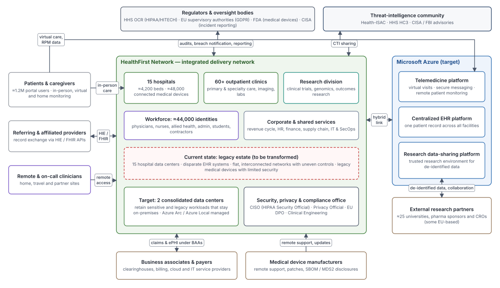
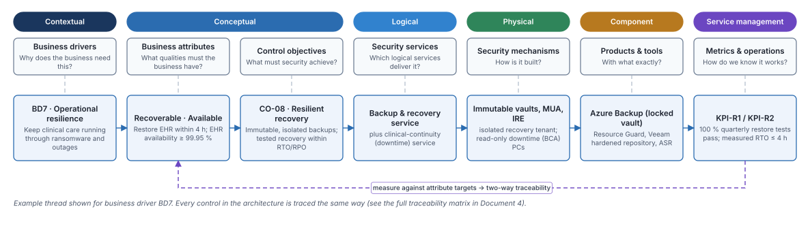
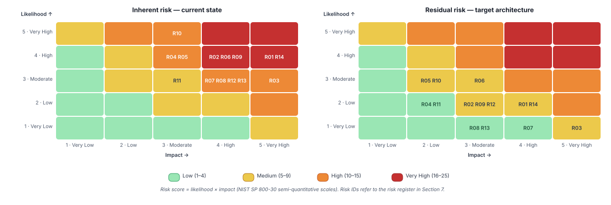
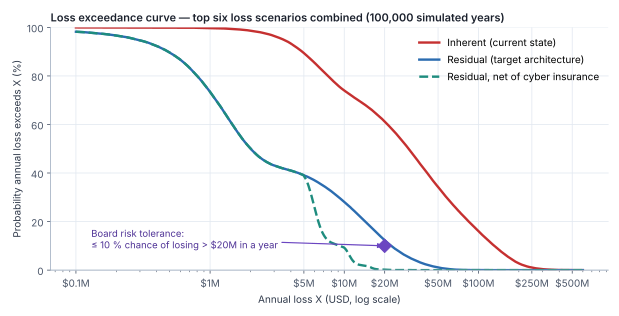
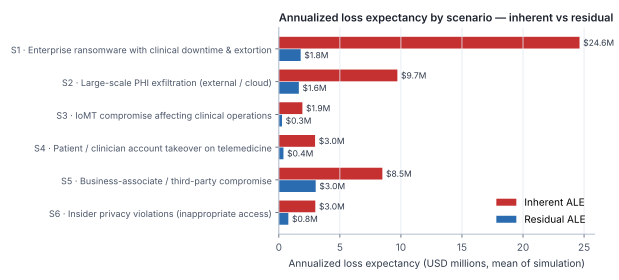

# HealthFirst Network — Enterprise Security Architecture

## Document 1 of 4 · Business and Security Strategy

**Phase 1 — Business and Risk Analysis (SABSA Contextual and Conceptual layers)**

| | |
|---|---|
| **Course** | Cybersecurity Architecture and Engineering — Group Project (CCSE, University of Jeddah, Fall 2026) |
| **Scenario** | Scenario 1 — Healthcare Sector: HealthFirst Network |
| **Team** | Rayan Ameen Kurdi (2440795) · Yazan Tareq Alhazmi (2440370) |
| **Version / date** | 1.0 · November 2026 |
| **Classification** | Academic work — HealthFirst Network is a fictional organization |

### Document control

| Version | Date | Author(s) | Change |
|---|---|---|---|
| 0.1 | Week 1 | All architects | Business context, drivers and stakeholder analysis |
| 0.5 | Week 2 | All architects | Risk assessment, FAIR model, risk appetite |
| 1.0 | Nov 2026 | All architects | Final Phase 1 baseline approved for Phase 2 design |

**Companion documents:** (2) Conceptual and Logical Architecture · (3) Physical Architecture and Technology Specification · (4) Security Architecture Governance and Assessment Plan · Final Architecture Review Presentation.

---

## Executive summary

HealthFirst Network (15 hospitals, 60+ clinics and a research division) is replacing fifteen separate hospital data centers and disparate EHRs with a single EHR on Microsoft Azure. At the same time it is launching telemedicine, connecting a large fleet of medical devices, and opening a data-sharing platform for external research partners. Each of these programs is valuable to patients. Each also widens the attack surface of an organization whose data is the most expensive to lose of any industry: the 2026 IBM / Ponemon study puts the average healthcare breach at **$6.64 million**, against a $4.99 million global average.

The sector's recent history shows what is at stake. In 2024, attackers entered Change Healthcare through a remote-access portal without multi-factor authentication; the breach eventually affected about **192.7 million people** and cost the parent company roughly **$3.1 billion**. A ransomware attack on Ascension, one of the largest U.S. health systems, forced ambulance diversions and a return to paper-based care the same year. For HealthFirst, the dominant risk is therefore not "a data breach" in the abstract but a ransomware event that takes the EHR and clinical systems offline across all facilities at once.

**What we found.** Our NIST SP 800-30 assessment identified 14 material risks; 13 of them are rated High or Very High today (five Very High). The FAIR Monte Carlo model (100,000 simulated years) of the six largest loss scenarios estimates HealthFirst's **current annualized loss expectancy at $50.7 million**, with a 1-in-10 year loss above **$131 million**. That is far outside the risk tolerance proposed in this document (no more than a 10 % chance of losing more than $20 million in a year).

**What we propose.** A business-driven security strategy built on the SABSA framework: every control traces back to a business driver and forward to a measurable business attribute. The strategy rests on five commitments:

1. **Zero Trust by default** — every clinician, patient, partner, vendor, device and workload is verified explicitly on every session; the flat legacy networks are replaced by security zones with allow-listed conduits.
2. **Resilience before features** — immutable, isolated backups, a cyber-recovery environment in a separate tenant, and clinical downtime procedures come first in the roadmap, because ransomware is the top risk.
3. **Patient safety is a security outcome** — medical devices are discovered, profiled and segmented without agents, and legacy devices are placed in protective enclaves rather than left on clinical networks.
4. **Compliance by design** — HIPAA, HITECH, GDPR and NIST CSF 2.0 requirements are built into the architecture and evidenced continuously, and the design already meets the stricter HIPAA Security Rule changes proposed in January 2025.
5. **Measured, not assumed** — 18 SABSA business attributes, each with a KPI and target, are reported to the Board quarterly.

**What it buys.** The target architecture reduces modelled annualized loss from $50.7 million to **$7.9 million** (–84 %) for an average program cost of **$13.8 million per year** over three years — a return on security investment of about **211 %**. Residual exposure (a 12.3 % chance of losing more than $20 million in a year) is still slightly above the proposed tolerance, mainly because of third-party risk; transferring tail risk through a cyber-insurance program ($5 million retention, $50 million limit) brings it to 0.2 %.

**Decisions requested from the Executive Risk Committee and the Board**

| # | Decision | Section |
|---|---|---|
| D1 | Approve the risk appetite statements and the quantitative tolerance (≤ 10 % probability of an annual cyber loss above $20 million) | 5 |
| D2 | Approve the security strategy, architecture principles and the three-wave program envelope ($41.4 million over 3 years) | 8 |
| D3 | Approve placing the cyber-insurance program to transfer residual tail risk | 7.5 |
| D4 | Mandate the Architecture Review Board as the design authority for every change that touches ePHI, clinical systems or medical devices | 8, Doc 4 |

---

## 1. Introduction

### 1.1 Purpose and scope

This document is the Phase 1 deliverable of the HealthFirst enterprise security architecture. It establishes *why* security is needed and *what* it must achieve, in business terms, before any technology is chosen. It covers:

- the business context, objectives and drivers of HealthFirst's digital transformation;
- the SABSA **contextual layer** (business view) and the opening of the **conceptual layer** (business attributes, control objectives);
- risk appetite and tolerance;
- the regulatory landscape (HIPAA, HITECH, NIST CSF 2.0, GDPR and closely related obligations);
- a qualitative (NIST SP 800-30) and quantitative (FAIR) risk assessment;
- the resulting security strategy, principles, strategic objectives and investment envelope.

In scope: all 15 hospitals, 60+ clinics, the research division, corporate services, the planned Azure hybrid cloud, the telemedicine platform, connected medical devices (IoMT) and the external research data-sharing platform. Out of scope: detailed clinical workflow redesign and EHR vendor selection.

### 1.2 Methodology

SABSA is the primary framework, chosen because it forces the architecture to be **business-driven and traceable**. It is integrated with other standards, each doing the job it does best:

| Framework | Role in this project | Where used |
|---|---|---|
| **SABSA** (Sherwood Applied Business Security Architecture) | Six-layer matrix and lifecycle; business attributes profile; two-way traceability from business driver to component and metric | All documents |
| **TOGAF Standard, 10th Edition** | Enterprise architecture method (ADM) and governance; positions security inside the wider enterprise architecture | Phases map to ADM (below); Doc 4 governance |
| **NIST CSF 2.0** | Outcome taxonomy (Govern, Identify, Protect, Detect, Respond, Recover) and current/target organizational profiles | Strategy objectives; compliance mapping; Doc 4 |
| **NIST SP 800-30 Rev. 1** | Qualitative risk-assessment method and scales | Section 7 |
| **FAIR** (Factor Analysis of Information Risk) | Quantifies top loss scenarios in financial terms for executives | Section 7.5 |
| **NIST SP 800-207 / CISA ZTMM v2.0** | Zero Trust reference architecture and maturity model | Docs 2–4 |
| **STRIDE and MITRE ATT&CK** | Threat modeling of distributed and hybrid-cloud data flows | Doc 2 |
| **ISO/IEC 27001/27002:2022** | Control reference and management-system practices | Docs 3–4 |

The four project phases map to the SABSA layers and the TOGAF ADM as follows:

| Project phase | SABSA layer(s) | TOGAF ADM phase(s) | Deliverable |
|---|---|---|---|
| 1 · Business and risk analysis | Contextual; conceptual (attributes, objectives) | Preliminary, A (Architecture Vision), B (Business) | This document |
| 2 · Conceptual and logical design | Conceptual; logical | B, C (Information Systems) | Document 2 |
| 3 · Physical and component design | Physical; component | D (Technology), E (Opportunities & Solutions) | Document 3 |
| 4 · Assessment and governance | Service management (operational) | F (Migration Planning), G (Implementation Governance), H (Change Management) | Document 4 and presentation |

### 1.3 Planning assumptions

The scenario does not quantify HealthFirst's size or finances, so the team adopted the following planning assumptions, chosen to be realistic for a U.S. integrated delivery network of this size. They drive the risk model and should be validated with HealthFirst finance and operations before the program is funded.

| Assumption | Value used | Basis |
|---|---|---|
| Licensed beds | ≈ 4,200 across 15 hospitals | ≈ 280 beds per hospital (regional referral network) |
| Net patient revenue | ≈ $6.5 billion per year | Typical revenue per bed for U.S. systems |
| Workforce identities | ≈ 44,000 (≈ 38,000 employees + ≈ 6,000 affiliated physicians, students and contractors) | Staffing ratio for acute-care networks |
| Connected medical devices | ≈ 48,000 (≈ 11 per bed plus clinic devices) | Industry IoMT density estimates |
| Unique patients / portal users | ≈ 2.1 million per year / ≈ 1.2 million active portal users | Market share assumption |
| External research partners | ≈ 25 institutions, several in the EU | Research division profile |
| Azure regions | East US 2 (primary), Central US (secondary / DR), West Europe (EU-resident datasets only) | Paired regions; data residency |
| Revenue at risk during total EHR outage | $1.2–3.0 million per day (most likely $1.8 million) | Lost volume, diversion, overtime, recovery labor |

---

## 2. Business context

### 2.1 Company profile

HealthFirst Network is a large, integrated healthcare delivery network. Its digital transformation program has four business objectives (from the project brief), which this architecture must enable rather than obstruct:

1. A **centralized EHR** across all facilities (one patient, one record).
2. A **comprehensive telemedicine platform** for remote consultations and patient monitoring.
3. **Integration of IoT medical devices** (infusion pumps, patient monitors and others) for real-time data collection.
4. A **secure data-sharing platform** for collaboration with external research partners.

### 2.2 Stakeholders and ecosystem

*Figure 1.1 — HealthFirst enterprise context: stakeholders, ecosystem and the move from fifteen legacy data centers to a hybrid Azure model.*

| Stakeholder | Interest in security | What they need from the architecture |
|---|---|---|
| Patients and caregivers | Privacy, safety, convenient access | Easy but strong sign-in (passkeys), trustworthy virtual visits, control over their data |
| Clinicians (physicians, nurses, allied health) | Fast access at the point of care; no workflow friction | Badge tap-and-go sign-in, single sign-on, remote access without VPN pain, break-glass in emergencies |
| Researchers and external partners | Access to rich, compliant datasets | De-identified data, collaboration workspaces, predictable approval process |
| Clinical Engineering (Biomed) | Safe, available medical devices | Device visibility, segmentation that does not break devices, controlled vendor access |
| Executives and Board | Mission continuity, reputation, financial performance | Quantified risk, clear appetite, measurable return on security investment |
| Regulators (HHS OCR, EU supervisory authorities, FDA, CISA) | Compliance and timely reporting | Evidence of safeguards, audit trails, breach notification within legal deadlines |
| Business associates and vendors | Workable integration and support | Clear security requirements, brokered remote access, contractual clarity (BAAs) |

### 2.3 Business drivers

Business drivers (BD) are the SABSA starting point: every requirement and control in Documents 2–4 traces back to one or more of them.

| ID | Business driver | Source (brief) | Executive owner | Business success measure |
|---|---|---|---|---|
| BD1 | Deliver one always-available patient record across all facilities | Objective 1; legacy EHR fragmentation | CIO, CMIO | EHR availability ≥ 99.95 %; one record per patient |
| BD2 | Expand access to care through telemedicine and remote monitoring | Objective 2 | Chief Digital Officer | ≈ 600,000 virtual visits/yr; patient satisfaction |
| BD3 | Use connected medical devices for real-time, safer care | Objective 3 | CNO, Clinical Engineering | Device data auto-charted; zero device-related safety events |
| BD4 | Accelerate research through collaboration with external partners | Objective 4 | Chief Research Officer | Time to approved dataset ≤ 30 days; partner growth |
| BD5 | Protect patient safety and patient trust | Challenges 1–2 | CEO, CMO | No patient harm from cyber events; no large breaches |
| BD6 | Meet HIPAA, HITECH, GDPR and other obligations and avoid penalties | Regulatory context | General Counsel, CPO | Zero material audit findings; timely notifications |
| BD7 | Stay operational through ransomware, outages and disasters | Challenge 1 (ransomware) | COO | Clinical systems restored within RTO; downtime procedures work |
| BD8 | Reduce cost and complexity by consolidating 15 data centers onto a hybrid cloud | Technical environment | CFO, CIO | Data-center footprint –85 %; run-cost reduction |
| BD9 | Give a diverse workforce and partner ecosystem seamless, secure access | Challenge 4 (identity) | CIO, CHRO | Sign-in friction metrics; onboarding in ≤ 1 day |

### 2.4 Current-state assessment

The brief describes a fragmented estate. Interpreted as security posture, the current state is:

| Domain | Current state (from the brief and typical legacy conditions) | Key weakness | Linked risks |
|---|---|---|---|
| Identity | Separate directories per hospital; shared clinical logins on workstations; password-only remote access in places | Credential theft and lateral movement; no single view of who has access | R04, R05, R14 |
| Network | "Complex web of interconnected networks with varying levels of security"; flat VLANs between hospitals | One compromised hospital can reach all others | R01, R09 |
| Applications | Disparate EHRs in 15 data centers; legacy interfaces | Inconsistent patching and hardening; unsupported OS | R01, R09 |
| Medical devices | Mix of modern and legacy devices "with limited built-in security"; no complete inventory | Unpatchable devices on clinical networks; vendor back doors | R03, R06 |
| Data | PHI spread across local databases, file shares and exports; limited classification | Unknown data locations; uncontrolled research extracts | R02, R07, R08 |
| Security operations | Local logging, no 24×7 enterprise SOC, limited EHR access monitoring | Slow detection (sector average 220 days to identify a breach) | R02, R05, R13 |
| Resilience | Backups reachable from the production domain; DR untested at network scale | Ransomware encrypts backups; long clinical downtime | R01, R12 |
| Third parties | Many vendors with persistent VPN access; uneven BAA security terms | Supply-chain compromise | R06 |
| Governance | Security decisions made per hospital; no enterprise architecture authority | Inconsistent controls; architecture drift | All |

**Current NIST CSF 2.0 profile (baseline).** A workshop-style self-assessment rates HealthFirst at Tier 1.5–2 across the six functions (GOVERN 1.5, IDENTIFY 1.5, PROTECT 2.0, DETECT 1.5, RESPOND 2.0, RECOVER 1.5). The target profile (Tier 3–3.5, "Repeatable" to "Adaptive") is set in Document 4.

---

## 3. SABSA contextual architecture

### 3.1 The six contextual questions

The SABSA contextual layer describes the business that the security architecture must serve, answering six questions in business language.

| SABSA question | HealthFirst answer (contextual layer) |
|---|---|
| **What** — business assets | Patient trust and safety; ePHI in the EHR, imaging, lab and device data; clinical operations; research data and intellectual property; HealthFirst's reputation and licenses to operate |
| **Why** — business risk | Ransomware halting care; theft or exposure of ePHI; harm to patients from compromised devices; regulatory sanctions; loss of research partnerships; financial loss |
| **How** — business processes | Inpatient and emergency care; outpatient visits; medication management; diagnostics (lab, imaging); telemedicine consults and remote monitoring; research collaboration; revenue cycle; HR and supply chain |
| **Who** — people and organization | ≈ 44,000 workforce identities; ≈ 1.2 million portal users; ≈ 25 research partners; device manufacturers and business associates; regulators |
| **Where** — geography | 15 hospital campuses and 60+ clinics; patients' homes; two consolidated data centers; Azure East US 2 and Central US; West Europe for EU-resident datasets; partner institutions in the U.S. and EU |
| **When** — time dependencies | Care is 24×7×365; clinical recovery objectives in hours (Section 3.2); breach notification clocks (GDPR 72 hours, HIPAA 60 days, CIRCIA 72 hours once in force); 6-year retention of HIPAA documentation |

### 3.2 Business process criticality

Maximum tolerable downtime (MTD) and recovery time objectives (RTO) are set from the patient-safety perspective, then used to tier the resilience design in Document 3.

| Business process | Supporting systems | MTD | RTO | RPO | Data sensitivity |
|---|---|---|---|---|---|
| Emergency, inpatient and surgical care | EHR, clinical integration, identity | 4 h | ≤ 4 h (downtime procedures from minute 0) | ≤ 15 min | ePHI |
| Medication administration | EHR, pharmacy systems, infusion pumps | 2 h on electronic systems (paper MAR from minute 0) | ≤ 4 h | ≤ 15 min | ePHI |
| Diagnostics (lab, imaging) | LIS, PACS, modalities, interface engine | 8 h | ≤ 8 h | ≤ 1 h | ePHI |
| Telemedicine visits and remote monitoring | Telemedicine platform, FHIR, communication services | 8 h | ≤ 8 h | ≤ 1 h | ePHI |
| Revenue cycle and claims | Billing systems, clearinghouse links | 72 h | ≤ 24 h | ≤ 4 h | ePHI, financial |
| Research collaboration | Trusted research environment | 7 days | ≤ 72 h | ≤ 24 h | De-identified / pseudonymized |
| Corporate services (HR, finance, supply chain) | SaaS ERP, Microsoft 365 | 72 h | ≤ 24 h | ≤ 4 h | Confidential, PII |

---

## 4. Business attributes profile

The SABSA business attributes profile turns vague goals ("secure", "compliant") into a short list of **named qualities with measures and targets**. Eighteen attributes were selected from the SABSA attribute taxonomy through stakeholder workshops; each is linked to the business drivers it serves.

| # | SABSA category | Attribute | What it means for HealthFirst | Metric (KPI) | Target | Drivers |
|---|---|---|---|---|---|---|
| A1 | Operational | **Available** | Clinical systems are there when care needs them | EHR availability (monthly) | ≥ 99.95 % | BD1, BD7 |
| A2 | Operational | **Recoverable** | Systems come back quickly and cleanly after ransomware or disaster | Measured restore time of Tier 0/1 systems in tests; % backups immutable | ≤ 4 h; 100 % | BD7 |
| A3 | User | **Usable** | Security does not slow care at the bedside | Median clinician sign-in time at shared workstations; MFA prompts per clinician per day | ≤ 5 s; ≤ 2 | BD9, BD1 |
| A4 | User | **Accessible** | Authorized people can reach what they need from anywhere | Remote access success rate; partner onboarding time | ≥ 99.5 %; ≤ 1 day | BD2, BD4, BD9 |
| A5 | Risk mgmt | **Authenticated** | Every person, device and workload proves who or what it is | Workforce with phishing-resistant MFA (admins) | ≥ 98 % (100 %) | BD5, BD6 |
| A6 | Risk mgmt | **Access-controlled** | Least privilege, just-in-time, no standing admin rights | Standing privileged accounts; access reviews completed on time | 0; 100 % | BD5, BD6 |
| A7 | Risk mgmt | **Confidential** | ePHI is disclosed only to those with a legitimate need | Reportable breaches (≥ 500 records); PHI stores encrypted with customer-managed keys | 0; 100 % | BD5, BD6 |
| A8 | Risk mgmt | **Integrity-assured** | Clinical data and device settings cannot be altered undetected | Backups integrity-verified before restore; critical systems with integrity monitoring | 100 %; 100 % | BD3, BD5 |
| A9 | Risk mgmt | **Accountable** | Every access to a patient record is attributable to one person | Shared clinical accounts; EHR access events retained | 0; ≥ 6 years | BD6 |
| A10 | Operational | **Monitored** | Threats are seen quickly across all environments | Log-source coverage of crown-jewel systems; mean time to detect (high severity) | ≥ 98 %; ≤ 1 h | BD5, BD7 |
| A11 | Operational | **Interoperable** | Data moves through standard, governed interfaces | External integrations through managed APIs (FHIR R4, HL7) | 100 % | BD1, BD2, BD4 |
| A12 | Risk mgmt | **Patient-safe** (custom) | Medical devices work as intended and are protected | Connected devices discovered and profiled; legacy devices in enclaves | ≥ 98 %; 100 % | BD3, BD5 |
| A13 | Legal / regulatory | **Compliant** | Obligations are met and provable | Open high audit findings older than 90 days | 0 | BD6 |
| A14 | Legal / regulatory | **Privacy-respecting** (SABSA "Private") | Data is minimized, de-identified for secondary use and kept where it must stay | Research datasets released without de-identification review | 0 | BD4, BD6 |
| A15 | Management | **Measured** | Security performance is visible to leaders | Attributes with a live KPI on the dashboard | 100 % | All |
| A16 | Management | **Cost-effective** | Security spending reduces more risk than it costs | Return on security investment (FAIR) | ≥ 100 % | BD8 |
| A17 | Technical strategy | **Scalable** | New hospitals, clinics and projects onboard quickly and securely | Time to provision a governed landing zone for a new site | ≤ 30 days | BD8 |
| A18 | Technical strategy | **Legacy-sensitive** | Older systems and devices are protected without forced replacement | Unsupported systems without compensating controls | 0 | BD3, BD8 |

These attributes become the yardstick of every design decision in Documents 2–3 and the backbone of the metrics program in Document 4. Figure 1.2 shows how one attribute is traced end-to-end.

*Figure 1.2 — The SABSA golden thread: example traceability from business driver BD7 to a measurable KPI.*

---

## 5. Risk appetite and tolerance

Risk appetite states how much risk HealthFirst is willing to accept in pursuit of its objectives. It was framed by category, because a healthcare provider's appetite differs sharply between patient safety (none) and innovation (moderate).

| Risk category | Appetite | Appetite statement | Tolerance indicator |
|---|---|---|---|
| Patient safety | **Averse (zero tolerance)** | HealthFirst will not accept any cyber risk that could plausibly cause patient harm without compensating controls. | Any scenario with Very High safety impact must have Very Low residual likelihood and joint CMO–CISO sign-off |
| Confidentiality of ePHI | **Averse** | HealthFirst does not accept material risk of large-scale disclosure of patient information. | Residual risk ≤ Medium; any High risk needs ERC acceptance and a plan within 90 days |
| Clinical availability | **Low** | Clinical systems must be restorable within their RTO, and care must continue safely during any outage. | Tier 0 RTO ≤ 4 h; quarterly restore tests pass |
| Regulatory compliance | **Averse** | No tolerance for willful neglect of any HIPAA, HITECH or GDPR obligation. | 100 % of required HIPAA specifications implemented; addressable decisions documented |
| Third-party and supply chain | **Cautious** | Vendors are accepted only with contractual and technical safeguards proportional to their access. | 100 % of critical vendors assessed annually; no unbrokered vendor remote access |
| Innovation (telemedicine, research, AI) | **Moderate (open)** | HealthFirst accepts moderate risk to deliver digital care and research, provided Zero Trust and privacy-by-design controls are applied from the start. | New services pass ARB gates; DPIA completed where required |
| Financial (aggregate cyber loss) | **Quantified** | HealthFirst tolerates no more than a 10 % probability of total cyber losses above $20 million in any year. Any single event estimated above $25 million is escalated to the Board. | FAIR loss-exceedance curve reviewed quarterly |

**Risk acceptance authority.** Residual risk can be accepted only at the level shown; acceptance is time-bound (maximum 12 months) and recorded in the risk register.

| Residual risk level | Who may accept | Maximum acceptance period |
|---|---|---|
| Very High (16–25) | Board (Audit & Compliance Committee) — exceptional only | 3 months, with funded remediation |
| High (10–15) | Executive Risk Committee | 6 months |
| Medium (5–9) | CISO together with the accountable business executive | 12 months |
| Low (1–4) | System owner | 12 months |

---

## 6. Regulatory landscape

### 6.1 HIPAA Security Rule

The HIPAA Security Rule (45 CFR Part 164, Subpart C) requires covered entities and business associates to protect the confidentiality, integrity and availability of ePHI through **administrative (§164.308), physical (§164.310) and technical (§164.312) safeguards**, plus organizational requirements (§164.314) and documentation requirements (§164.316). Implementation specifications are either *required* or *addressable*; an addressable specification must be implemented if reasonable and appropriate, or an equivalent alternative documented (§164.306(d)). The rule is technology-neutral and risk-based: everything starts with an accurate and thorough **risk analysis** (§164.308(a)(1)(ii)(A)), which this document provides at the enterprise level.

**Proposed update.** On 6 January 2025 HHS published a notice of proposed rulemaking (90 Fed. Reg. 898) for the first major overhaul of the Security Rule. It would, among other changes, remove most of the required/addressable distinction and make multi-factor authentication, encryption of ePHI at rest and in transit, network segmentation, an asset inventory and network map, annual compliance audits, vulnerability scanning and penetration testing, and 72-hour restoration capability explicit requirements. As of late 2026 the rule is **not final**: the federal regulatory agenda now targets final action for July 2027, and the current Security Rule remains in force. HealthFirst's target architecture is designed to meet the proposed requirements anyway (Document 4, Section 4.5), because they reflect controls the risk assessment calls for in any case, and because building them in now avoids a second compliance project.

### 6.2 HITECH Act

The HITECH Act (2009) strengthened HIPAA in four ways that matter to this design:

- **Breach notification** (45 CFR §§164.400–414): unsecured PHI breaches must be notified to individuals without unreasonable delay and no later than 60 days after discovery; breaches affecting 500 or more people must also be reported to HHS and the media. Breaches of *encrypted* ePHI, where the keys were not compromised and the encryption meets HHS guidance (NIST SP 800-111 for data at rest; NIST SP 800-52, 800-77 or 800-113 for data in transit; FIPS-validated modules), fall outside the definition of "unsecured PHI". **Encryption is therefore an architectural safe harbor, not only a control.**
- **Direct liability of business associates**, which extends HealthFirst's security requirements to cloud providers, vendors and subcontractors through business associate agreements (BAAs).
- **Tiered civil money penalties** based on culpability, reaching more than $2 million per calendar year for identical violations at the highest tier (inflation-adjusted), plus state attorney-general enforcement.
- **Recognized security practices** (HITECH amendment of January 2021, Public Law 116-321): when setting fines and audit outcomes, HHS must consider whether the entity had recognized security practices — such as those under the NIST Cybersecurity Framework or the HHS 405(d) Health Industry Cybersecurity Practices — in place for the previous 12 months. Adopting NIST CSF 2.0 and 405(d) practices *and keeping the evidence* is therefore a direct financial lever.

### 6.3 NIST Cybersecurity Framework 2.0

CSF 2.0 (February 2024) organizes outcomes into six functions — the new **Govern** function plus Identify, Protect, Detect, Respond and Recover — 22 categories and 106 subcategories. HealthFirst uses it three ways: as the outcome language for strategic objectives (Section 8.2), as the structure of current and target profiles with implementation tiers, and as the "recognized security practice" baseline under HITECH. The HHS Healthcare and Public Health Cybersecurity Performance Goals (10 essential and 10 enhanced goals, January 2024) and the 405(d) HICP (2023 edition) supply healthcare-specific priorities that map onto CSF.

### 6.4 GDPR

GDPR applies to HealthFirst where it offers services to people in the EU (for example, telemedicine second opinions for EU-resident patients) or processes personal data of EU clinical-trial participants with EU research partners (Article 3(2)). Health data is a *special category* (Article 9) and may be processed only under specific conditions, such as health care (9(2)(h)) or scientific research with safeguards (9(2)(j) and Article 89). Architecture-relevant obligations are:

- **Data protection by design and by default** (Art. 25) and **security of processing** (Art. 32);
- **Data protection impact assessments** for large-scale processing of health data (Art. 35) — required for the telemedicine and research platforms where EU data is involved;
- **Breach notification to the supervisory authority within 72 hours** (Art. 33) and to individuals when the risk is high (Art. 34);
- a **Data Protection Officer** (Art. 37) and an EU representative (Art. 27);
- **International transfers** (Arts. 44–49): the EU–U.S. Data Privacy Framework remains valid after the EU General Court dismissed the Latombe challenge in September 2025, but an appeal is pending before the Court of Justice. HealthFirst therefore relies on Standard Contractual Clauses as a fallback and keeps EU-resident datasets in an EU Azure region wherever possible.

### 6.5 Related obligations (beyond the brief, but material)

| Obligation | Why it matters to the architecture |
|---|---|
| **FDA FD&C Act §524B** and the June 2025 final premarket cybersecurity guidance | Manufacturers of "cyber devices" must provide SBOMs and vulnerability-management plans; HealthFirst makes these procurement gates for new devices (Doc 3, Section 3.3) |
| **42 CFR Part 2** (substance-use disorder records) | Stricter consent and segregation rules; drives "special-handling" data labels and EHR sensitive-record controls |
| **21st Century Cures Act information-blocking rules** | Patient and provider access through standard FHIR APIs must be available; security must not become "information blocking" — reinforces the API-gateway design |
| **CIRCIA** (Cyber Incident Reporting for Critical Infrastructure Act) | Once the final rule takes effect (sent to OMB for review on 1 October 2026), covered hospitals must report substantial incidents to CISA within 72 hours and ransom payments within 24 hours |
| **State breach-notification and health-privacy laws** | Shorter or additional notification timelines; handled through the incident-response legal playbook |

### 6.6 Regulatory requirements that shape the design

Some requirements do not just add controls; they **force architectural decisions**. These are carried into Phase 2 as hard constraints.

| Requirement | Source | Architectural consequence |
|---|---|---|
| Unique user identification | HIPAA §164.312(a)(2)(i) | No shared clinical accounts; fast user switching with badge tap-and-go on shared workstations |
| Emergency access procedure | HIPAA §164.312(a)(2)(ii) | EHR "break-the-glass" with justification and retrospective review; cloud break-glass admin accounts |
| Audit controls; documentation retained 6 years | HIPAA §164.312(b), §164.316(b)(2) | Central SIEM with long-term retention tier; tamper-evident EHR access logs |
| Encryption and transmission security (proposed to become mandatory) | HIPAA §164.312(a)(2)(iv), (e); NPRM | FIPS-validated encryption everywhere; customer-managed keys for ePHI (also HITECH safe harbor) |
| Contingency plan: backup, DR, emergency mode | HIPAA §164.308(a)(7) | Immutable backups, cyber-recovery tenant, downtime (BCA) procedures |
| Business associate contracts | HIPAA §164.308(b), §164.314 | BAAs with Microsoft and all vendors; vendor access brokered and recorded |
| 72-hour breach notification | GDPR Art. 33; CIRCIA | 24×7 detection and response; incident classification playbooks with legal triggers |
| Data protection by design; DPIA | GDPR Arts. 25, 35 | Privacy reviews at ARB gates; de-identification before research use |
| Transfer restrictions | GDPR Arts. 44–49 | EU-resident datasets in an EU region; Azure Policy "allowed locations" enforcement |
| Recognized security practices | HITECH (P.L. 116-321) | NIST CSF 2.0 and 405(d) adoption with 12 months of retained evidence |

---

## 7. Risk assessment

### 7.1 Method and scales

The assessment follows NIST SP 800-30 Rev. 1: identify threat sources and events, identify vulnerabilities and predisposing conditions, determine likelihood and impact, and determine risk. Five-level semi-quantitative scales are used; risk score = likelihood × impact (1–25).

| Level | Likelihood (adversarial: intent + capability + exposure; non-adversarial: frequency) | Impact (worst credible outcome) |
|---|---|---|
| 5 · Very High | Almost certain within 12 months; actively targeted, easily exploitable | Patient death or serious harm; multi-day enterprise-wide outage; > $50 M loss; national media and regulator action |
| 4 · High | Likely within 12 months (has happened to peers repeatedly) | Serious clinical disruption across facilities; > 500,000 records; $10–50 M loss |
| 3 · Moderate | Possible within 12 months | Disruption at one facility; 500–500,000 records; $1–10 M loss |
| 2 · Low | Unlikely within 12 months, possible within 3 years | Limited, contained disruption; < 500 records; < $1 M loss |
| 1 · Very Low | Rare (less than once in 10 years) | Negligible operational, financial or reputational effect |

Risk bands: **Low 1–4**, **Medium 5–9**, **High 10–15**, **Very High 16–25**.

### 7.2 Threat landscape

Healthcare is the most attractive and most damaging target sector:

- **Volume.** A record 772 large breaches (500+ records) were reported to HHS OCR in 2025, affecting about 138 million individuals — roughly two large breaches a day. Hacking and IT incidents account for the large majority.
- **Cost and dwell time.** The average healthcare breach costs $6.64 million (IBM / Ponemon, 2026), the highest of the 17 industries studied; in healthcare a breach takes on average 220 days to identify and a further 72 days to contain.
- **Systemic ransomware.** The 2024 Change Healthcare attack (192.7 million people, about $3.1 billion in costs) began with stolen credentials on a remote-access portal lacking MFA. The 2024 Ascension attack forced ambulance diversions, paper-based operations and an 8–12 % drop in patient volumes for two months.
- **Third parties.** Business associates have become a dominant point of exposure; one vendor compromise can halt claims, pharmacy or lab services for thousands of providers.
- **Medical devices.** Legacy devices running unsupported operating systems cannot be patched quickly, and vendor remote-support channels are frequently exploited.

| Threat source (NIST SP 800-30 type) | Examples | Capability / intent | Primary targets at HealthFirst |
|---|---|---|---|
| Adversarial — organized cybercrime | Ransomware-as-a-service and extortion groups; initial access brokers | High / financial | Identity (credentials), remote access, backups, EHR |
| Adversarial — nation-state | Espionage and pre-positioning in critical infrastructure | Very high / strategic | Research IP, identity infrastructure, critical services |
| Adversarial — insiders | Curious or malicious staff ("snooping"), departing employees | Moderate / mixed | EHR records of VIPs and colleagues; data exfiltration |
| Adversarial — hacktivists | DDoS against patient-facing services | Moderate / ideological | Patient portal, telemedicine |
| Adversarial — supply chain | Compromised vendor, software update or business associate | High / opportunistic | Vendor remote access, integrations, device firmware |
| Accidental | Misconfiguration, mis-sent data, lost devices | n/a | Cloud storage, research extracts, email |
| Structural | Hardware/software failure, unsupported systems | n/a | Legacy servers and devices |
| Environmental | Power, network, regional cloud outage, natural disaster | n/a | Data centers, WAN, a single Azure region |

### 7.3 Critical assets ("crown jewels")

| Asset | Description | C / I / A priority | Owner |
|---|---|---|---|
| EHR platform and databases | Central clinical record for ≈ 2.1 million patients | High / **Very High** / **Very High** | CMIO, CIO |
| Identity infrastructure (Tier 0) | Entra ID, on-premises AD DS, PKI, privileged accounts | High / Very High / Very High | CISO, CIO |
| Medical devices and clinical integration | Infusion pumps, monitors, modalities, interface engines | Medium / **Very High** / **Very High** | CNO, Clinical Engineering |
| Telemedicine platform and FHIR data | Virtual-care records, video sessions, device telemetry | **Very High** / High / High | Chief Digital Officer |
| Research datasets | Pseudonymized clinical and genomic data; re-identification keys | **Very High** / High / Medium | Chief Research Officer |
| Backups and recovery assets | Copies of all of the above | Very High / Very High / Very High | CIO |
| Corporate and financial systems | ERP, payroll, revenue cycle | High / High / Medium | CFO |

### 7.4 Risk register

The register records each risk's inherent rating, the architecture response and the target residual rating. After treatment, **no residual risk is above Medium**, consistent with the appetite in Section 5 (R03 meets the patient-safety rule: residual likelihood Very Low with a Very High impact). Figure 1.3 compares the two heat maps.

| ID | Risk scenario (threat → vulnerability → impact) | L | I | Inherent | Main treatment (architecture response) | Residual L × I | Owner |
|---|---|---|---|---|---|---|---|
| R01 | Ransomware group uses stolen credentials or an exposed service, moves laterally across flat networks, encrypts EHR and backups → enterprise-wide clinical outage and data extortion | 4 | 5 | **20 VH** | Phishing-resistant MFA, ZTNA, segmentation, EDR/XDR, immutable and isolated backups, cyber-recovery tenant, downtime procedures | 2 × 4 = **8 M** | COO / CISO |
| R02 | External actor exfiltrates large volumes of ePHI (e.g., via compromised accounts or misused APIs) → mass breach notification, fines, litigation | 4 | 4 | **16 VH** | Strong authentication, Conditional Access, DLP, encryption with CMK, API gateway, UEBA, 24×7 SOC | 2 × 3 = **6 M** | CPO / CISO |
| R03 | Compromise or malfunction of IoMT devices (unpatchable OS, vendor back doors) alters therapy or disrupts monitoring → patient harm | 3 | 5 | **15 H** | IoMT discovery, NAC, device-class segmentation, protective enclaves, brokered vendor access, procurement gates | 1 × 5 = **5 M** | CNO / Clinical Eng. |
| R04 | Account takeover of patients or clinicians on telemedicine (credential stuffing, MFA fatigue, session hijacking) → fraud, privacy breach | 4 | 3 | **12 H** | Passkeys, risk-based access, bot protection, token protection, rate limiting | 2 × 2 = **4 L** | CDO |
| R05 | Insider inappropriately accesses patient records (curiosity, VIPs) or exfiltrates data → privacy violations | 4 | 3 | **12 H** | Least privilege, EHR privacy monitoring, UEBA, DLP, sanctions policy | 3 × 2 = **6 M** | CPO |
| R06 | Compromise of a business associate or vendor (remote access, software supply chain, clearinghouse outage) → data loss or operational disruption | 4 | 4 | **16 VH** | Vendor access via PAM broker, BAAs with security terms, vendor risk tiers, SBOM, contingency providers | 3 × 3 = **9 M** | CFO / CISO |
| R07 | Cloud misconfiguration (public storage, over-permissive identities) exposes ePHI | 3 | 4 | **12 H** | Landing zones, policy-as-code, private endpoints only, CSPM | 1 × 4 = **4 L** | CIO |
| R08 | Research data is re-identified, over-shared or transferred unlawfully (DUA or GDPR breach) | 3 | 4 | **12 H** | De-identification pipeline, TRE with airlock, honest broker, data residency controls | 1 × 3 = **3 L** | CRO |
| R09 | Exploitation of legacy or unsupported systems in hospital data centers | 4 | 4 | **16 VH** | Consolidation and migration, virtual patching, segmentation, vulnerability SLAs | 2 × 3 = **6 M** | CIO |
| R10 | Phishing or business email compromise leading to fraud or initial access | 5 | 3 | **15 H** | Email security, phishing-resistant MFA, awareness, payment-change verification | 3 × 2 = **6 M** | CISO |
| R11 | DDoS against telemedicine and the patient portal | 3 | 3 | **9 M** | Global edge with DDoS and WAF, autoscaling, failover | 2 × 2 = **4 L** | CDO |
| R12 | Loss of WAN or cloud-region availability disrupts clinical operations (hybrid dependency) | 3 | 4 | **12 H** | Dual carriers, two Azure regions, local survivability, read-only downtime (BCA) PCs | 2 × 3 = **6 M** | CIO |
| R13 | Failure to detect and notify breaches within legal deadlines (HIPAA, GDPR, CIRCIA) | 3 | 4 | **12 H** | Central logging, 24×7 SOC, IR playbooks with legal triggers, tested notification process | 1 × 3 = **3 L** | General Counsel |
| R14 | Compromise of identity infrastructure (Tier 0: AD, Entra ID, PKI) enables enterprise-wide takeover | 4 | 5 | **20 VH** | Tiered admin model, PAWs, PIM, Defender for Identity, AD forest recovery plan | 2 × 4 = **8 M** | CISO |

*Figure 1.3 — Inherent and residual risk heat maps (NIST SP 800-30 scales).*

### 7.5 Quantitative risk analysis (FAIR)

Heat maps rank risks but do not tell the Board *how much* risk it holds or whether the program is worth its cost. The six largest loss scenarios were therefore modelled with FAIR. For each scenario the team estimated **loss event frequency** (events per year) and **loss magnitude** (primary loss — response, recovery, lost revenue — plus secondary loss — notification, regulatory, legal, reputation) as calibrated minimum / most-likely / maximum ranges. Estimates use the planning assumptions in Section 1.3, peer incidents (Section 7.2) and the IBM healthcare cost benchmark. A Monte Carlo simulation (beta-PERT distributions, Poisson event counts, 100,000 simulated years; script in the project repository) produced the results below.

| Scenario | Risks covered | Inherent LEF (/yr) min · ML · max | Inherent loss per event ($M) | Residual LEF (/yr) | Residual loss per event ($M) |
|---|---|---|---|---|---|
| S1 Enterprise ransomware with clinical downtime and extortion | R01, R09, R14 | 0.08 · 0.25 · 0.60 | 20 · 65 · 250 | 0.02 · 0.06 · 0.15 | 6 · 18 · 80 |
| S2 Large-scale ePHI exfiltration (external / cloud) | R02, R07, R10 | 0.20 · 0.50 · 1.20 | 3 · 10 · 60 | 0.05 · 0.15 · 0.40 | 2 · 6 · 30 |
| S3 IoMT compromise affecting clinical operations | R03 | 0.05 · 0.15 · 0.40 | 1 · 6 · 40 | 0.01 · 0.04 · 0.12 | 0.5 · 3 · 20 |
| S4 Patient / clinician account takeover on telemedicine | R04, R11 | 1 · 3 · 8 | 0.1 · 0.5 · 3 | 0.3 · 1 · 3 | 0.05 · 0.2 · 1 |
| S5 Business-associate / third-party compromise | R06 | 0.10 · 0.30 · 0.70 | 2 · 15 · 90 | 0.08 · 0.25 · 0.60 | 1 · 6 · 40 |
| S6 Insider privacy violations | R05 | 2 · 6 · 15 | 0.02 · 0.15 · 2 | 1 · 3 · 8 | 0.01 · 0.08 · 1 |

Residual estimates reflect the target architecture: lower frequency (strong authentication, segmentation, detection) and lower magnitude (immutable backups and downtime procedures shorten outages; encryption reduces notification obligations; faster detection reduces breach size).

**Results — annual loss (USD millions)**

| Measure | Inherent (today) | Residual (target architecture) | Residual, net of cyber insurance |
|---|---|---|---|
| Annualized loss expectancy (mean) | **50.7** | **7.9** | 3.8 (+ 3.2 premium) |
| Median year (P50) | 30.2 | 2.0 | 2.0 |
| 1-in-10 year (P90) | 131.2 | 22.4 | 9.3 |
| 1-in-20 year (P95) | 171.4 | 31.0 | 11.2 |
| Probability annual loss > $20 M | 61 % | 12.3 % | 0.2 % |
| Probability annual loss > $50 M | 34 % | 1.1 % | < 0.1 % |

| Scenario | Inherent ALE ($M) | Residual ALE ($M) | Reduction |
|---|---|---|---|
| S1 Enterprise ransomware | 24.6 | 1.8 | –93 % |
| S2 ePHI exfiltration | 9.7 | 1.6 | –83 % |
| S3 IoMT compromise | 1.9 | 0.3 | –86 % |
| S4 Account takeover | 3.0 | 0.4 | –87 % |
| S5 Third-party compromise | 8.5 | 3.0 | –64 % |
| S6 Insider privacy violations | 3.0 | 0.8 | –74 % |
| **Total** | **50.7** | **7.9** | **–84 %** |

*Figure 1.4 — Loss exceedance curves: current state, target architecture, and target architecture with cyber insurance.*

*Figure 1.5 — Annualized loss expectancy by scenario, inherent vs residual.*

**Interpretation for executives**

1. **Ransomware dominates.** S1 is almost half of today's expected loss. That is why resilience and identity are funded first (Wave 1).
2. **The program pays for itself.** Expected annual loss falls by $42.9 million against an average program cost of $13.8 million per year: ROSI = (42.9 – 13.8) / 13.8 ≈ **211 %**.
3. **Third-party risk is the hardest to engineer away.** S5 falls least (–64 %) because HealthFirst cannot control a vendor's internal security. With S5 included, residual exposure (12.3 % chance of > $20 M) is slightly outside the 10 % tolerance.
4. **Transfer the tail.** A cyber-insurance program with a $5 million per-event retention and a $50 million limit (assumed premium $3.2 million per year) reduces the probability of a > $20 M retained loss to 0.2 % and also lowers expected retained loss. Insurers increasingly require MFA, EDR and immutable backups — exactly the Wave 1 controls — so the strategy also protects insurability (attribute A16 *Cost-effective*).

*Model limitations:* the estimates are calibrated judgments, not actuarial data; they should be refined as HealthFirst's own incident and control data accumulates (Document 4 sets a quarterly review).

---

## 8. Security strategy

### 8.1 Vision and mission

**Vision.** *Every patient can trust that HealthFirst keeps them safe and their information private — in the hospital, at home and in research — while clinicians get the information they need without friction.*

**Mission of the security architecture.** Enable HealthFirst's four digital objectives by providing a Zero Trust, resilient and compliant foundation whose effectiveness is measured in business terms.

### 8.2 Strategic security objectives

| ID | Strategic objective | CSF 2.0 function | Drivers | Risks reduced | Headline KPI (target) |
|---|---|---|---|---|---|
| SO1 | Establish enterprise security governance, risk management and architecture authority | GOVERN | BD6, all | All | ARB covering 100 % of ePHI changes; risk register reviewed quarterly |
| SO2 | Make identity the primary control plane: phishing-resistant, risk-adaptive, least-privilege access for every user, device and workload | PROTECT (PR.AA) | BD9, BD5 | R01, R04, R05, R14 | ≥ 98 % phishing-resistant MFA; 0 standing admins |
| SO3 | Replace flat networks with zones, conduits and ZTNA; segment every medical device | PROTECT (PR.IR) | BD3, BD5 | R01, R03, R09 | 100 % hospitals segmented; VPN retired |
| SO4 | Know, classify and protect ePHI wherever it lives, including in research use | IDENTIFY, PROTECT (PR.DS) | BD4, BD6 | R02, R07, R08 | 100 % PHI stores labeled and CMK-encrypted |
| SO5 | Detect and respond to threats across cloud, on-premises and IoMT, 24×7 | DETECT, RESPOND | BD5, BD7 | R02, R05, R13 | MTTD ≤ 1 h; MTTR (contain) ≤ 4 h for high severity |
| SO6 | Guarantee recovery: immutable backups, isolated recovery, tested downtime procedures | RECOVER, PR.DS-11 | BD7 | R01, R12 | Tier 0 restore ≤ 4 h in quarterly tests |
| SO7 | Build security into cloud platforms and software delivery (secure by design) | PROTECT (PR.PS), GOVERN | BD1, BD2, BD8 | R07, R04 | 0 critical misconfigurations > 7 days |
| SO8 | Manage third-party and supply-chain risk proportionally to access | GOVERN (GV.SC) | BD6, BD3 | R06 | 100 % critical vendors assessed; 0 unbrokered vendor access |

### 8.3 Architecture principles

The principles below are written in TOGAF format (statement, rationale, implications). They bind every design in Documents 2–3 and are enforced through the ARB (Document 4).

| ID | Principle | Rationale | Implications |
|---|---|---|---|
| P1 | **Business-driven security** — every control traces to a business driver and attribute | Prevents gold-plating and gaps; justifies spend | SABSA traceability is mandatory for ARB approval |
| P2 | **Never trust, always verify** | Network location no longer indicates trust; credentials are stolen daily | Per-session, policy-based access; no implicit trust between zones |
| P3 | **Assume breach** | Prevention fails eventually | Segmentation limits blast radius; detection and recovery are designed in |
| P4 | **Least privilege and just-in-time** | Standing privilege is the attacker's fastest path | No permanent admin rights; access reviews; JIT elevation |
| P5 | **Patient safety first** | Security controls must never endanger care | Clinical safety review for controls on devices and clinical workflows; break-glass always available |
| P6 | **Protect the data, not just the network** | ePHI moves across clouds, apps and partners | Data-centric labels, encryption with customer-managed keys, DLP, de-identification |
| P7 | **Secure by default and by design** | Retrofitting security costs more and fails more | Guardrails (policy-as-code), threat modeling and security tests are part of delivery |
| P8 | **Resilience over perfection** | Availability is a clinical requirement | Immutable backups, isolated recovery, local survivability, tested downtime procedures |
| P9 | **Compliance through evidence** | Regulators and insurers require proof | Controls produce machine-readable evidence; continuous compliance monitoring |
| P10 | **Standardize and simplify** | Fifteen ways of doing things cannot be secured | A small set of approved platforms and reference patterns; exceptions are time-bound |
| P11 | **Usable security** | Unusable controls are bypassed | Tap-and-go, SSO, passwordless; measure clinician friction (attribute A3) |
| P12 | **Privacy by design** | GDPR Art. 25; patient trust | Minimize, pseudonymize and keep data in its required region; DPIAs at design gates |

### 8.4 Strategic choices and trade-offs

| Decision | Options considered | Choice and rationale |
|---|---|---|
| Overall security model | (a) Harden the perimeter of each hospital; (b) Zero Trust | **Zero Trust** — the perimeter dissolves with cloud EHR, telemedicine and partners; NIST SP 800-207 and CISA ZTMM give a phased path |
| Security platform strategy | (a) Best-of-breed per domain; (b) Microsoft-centric platform with targeted specialist tools | **(b)** — the EHR and telemedicine are on Azure; native integration (Entra, Defender, Sentinel, Purview) reduces integration cost and gives one signal fabric for Zero Trust. Specialist tools where Microsoft is weaker: IoMT security, NAC, PAM for vendors, clinical SSO |
| Data-center strategy | (a) Keep 15 data centers; (b) all-in cloud; (c) consolidate to 2 + Azure | **(c)** — some sensitive and legacy workloads must stay on-premises (as the brief states), but 15 sites cannot be secured consistently |
| Medical-device protection | (a) Agents on devices; (b) network-based, agentless enforcement | **(b)** — most medical devices cannot run agents or be modified without re-certification |
| Ransomware recovery | (a) Backups in production domain; (b) immutable + isolated cyber-recovery tenant | **(b)** — attackers routinely destroy reachable backups |
| Residual tail risk | (a) Accept; (b) transfer with insurance | **(b)** — brings residual exposure within tolerance (Section 7.5) |

### 8.5 Roadmap and investment overview

Delivery is organized in three overlapping waves over 30 months, ordered by **risk burn-down**: the controls that remove the most modelled loss per dollar go first. The detailed roadmap and milestones are in Document 4 (Figure 4.4).

| Wave | Timing | Focus | Main risks addressed |
|---|---|---|---|
| **1 — Foundations** | Months 0–12 | Governance and ARB; phishing-resistant MFA and Conditional Access; landing zones; 24×7 SOC (Sentinel, XDR, MDR); immutable backups, cyber-recovery tenant, downtime PCs | R01, R10, R13, R14 |
| **2 — Transformation** | Months 3–21 | Secure EHR consolidation on Azure; ZTNA and PAM; data protection; IoMT discovery, NAC and segmentation; telemedicine launch | R02, R03, R04, R05, R07, R09 |
| **3 — Optimize and extend** | Months 15–30 | Research TRE and data sharing; confidential computing; automation; HITRUST certification; Zero Trust "Advanced" maturity | R06, R08, R11 |

**Three-year investment envelope (incremental security spend, USD millions)**

| Capability area | 3-year cost | Share |
|---|---|---|
| Security operations (SIEM ingestion, XDR increments, MDR, IR retainer) | 10.8 | 26 % |
| Identity and access (identity governance, PAM, clinical SSO, FIDO2 authenticators) | 7.2 | 17 % |
| Network, ZTNA and segmentation (firewalls, SD-WAN security, NAC) | 6.3 | 15 % |
| IoMT security platform and device segmentation | 4.5 | 11 % |
| Resilience (immutable backup, cyber-recovery tenant, DR testing) | 4.2 | 10 % |
| Governance, risk, compliance and assurance (architects, pen tests, HITRUST, training) | 3.9 | 9 % |
| Data protection (Purview, HSM, DLP) | 2.7 | 7 % |
| Application security and DevSecOps | 1.8 | 4 % |
| **Total** | **41.4** (≈ 13.8 per year) | 100 % |

The core EHR migration and telemedicine build budgets are owned by their programs and are excluded; this envelope covers the security architecture only.

---

## 9. Opening the conceptual layer: control objectives

Control objectives (CO) state *what security must achieve* without saying *how*. They connect the attributes (Section 4) and risks (Section 7) to the logical services designed in Document 2.

| ID | Control objective | Attributes served | Risks treated |
|---|---|---|---|
| CO-01 | Verify every identity explicitly with authentication strength matched to risk (phishing-resistant for workforce) | A5, A3 | R01, R04, R14 |
| CO-02 | Enforce least privilege, just-in-time and just-enough access; no standing privilege | A6, A9 | R05, R14 |
| CO-03 | Know the health and compliance of every device — managed, personal or medical — before and during access | A12, A5 | R03, R01 |
| CO-04 | Segment the environment into zones; allow only explicitly authorized flows (default deny) | A12, A18 | R01, R03, R09 |
| CO-05 | Protect ePHI at rest, in transit and in use, with customer-controlled keys | A7, A8 | R02, R07 |
| CO-06 | Discover, classify and govern data; minimize and de-identify data for secondary use | A14, A7 | R08, R02 |
| CO-07 | Continuously monitor, detect and respond to threats across all environments within defined times | A10, A9 | R02, R05, R13 |
| CO-08 | Ensure recovery through immutable, isolated backups and tested restoration within RTO/RPO; keep care running during outages | A1, A2 | R01, R12 |
| CO-09 | Secure the software and supply chain (secure SDLC, vendor access, SBOM) | A13, A18 | R06, R07 |
| CO-10 | Govern and demonstrate compliance continuously through policy-as-code and automated evidence | A13, A15 | R13 |
| CO-11 | Protect patient safety by assuring the integrity and availability of medical devices and clinical data | A12, A8 | R03 |
| CO-12 | Provide attributable, tamper-evident audit trails for all ePHI access and administrative actions | A9, A13 | R05, R13 |

---

## 10. Conclusion

HealthFirst's transformation cannot succeed on the current security foundation: today's modelled exposure ($50.7 million a year, with a one-in-ten-year loss above $131 million) is incompatible with the organization's mission and with any reasonable risk appetite. The SABSA-based strategy in this document defines the business attributes the architecture must deliver, sets clear appetite and tolerance, identifies the regulatory constraints that shape the design, and prioritizes investment by risk reduction. Document 2 now turns the control objectives into a conceptual and logical Zero Trust architecture.

---

## Appendix A — SABSA matrix for HealthFirst (summary)

| Layer | Assets (What) | Motivation (Why) | Process (How) | People (Who) | Location (Where) | Time (When) |
|---|---|---|---|---|---|---|
| **Contextual** | Patient trust, ePHI, clinical operations, research IP | Ransomware, breach, patient harm, sanctions | Care delivery, telemedicine, research, revenue cycle | Workforce, patients, partners, vendors | Hospitals, clinics, homes, Azure regions | 24×7 care; notification clocks |
| **Conceptual** | Business attributes profile (Sec. 4) | Control objectives CO-01–12 (Sec. 9) | Zero Trust and defense-in-depth strategies (Doc 2) | Trust and entity model (Doc 2) | Security domain model (Doc 2) | RTO/RPO tiers (Sec. 3.2) |
| **Logical** | Information classification (Doc 2) | Security policies (Doc 2, 4) | Logical security services (Doc 2) | Identity schema, roles and privilege profiles (Doc 2) | Zones and conduits (Doc 2) | Session, review and rotation cycles (Doc 2) |
| **Physical** | Data stores and encryption (Doc 3) | Rules, practices, procedures (Doc 3) | Security mechanisms (Doc 3) | Access policies and user interfaces (Doc 3) | Azure and on-premises infrastructure (Doc 3) | Execution schedules (Doc 3) |
| **Component** | Data structures and labels (Doc 3) | Security standards (Doc 3) | Products and tools (Doc 3) | Identities, groups and ACLs (Doc 3) | Nodes, addresses, protocols (Doc 3) | Timing and sequencing (Doc 3) |
| **Service management** | Assurance of continuity (Doc 4) | Operational risk management (Doc 4) | Security service management (Doc 4) | User and application management (Doc 4) | Site and platform security (Doc 4) | Operations schedule (Doc 4) |

## References

1. Sherwood, J., Clark, A., and Lynas, D. *Enterprise Security Architecture: A Business-Driven Approach.* CRC Press, 2005; The SABSA Institute, SABSA framework resources.
2. The Open Group. *The TOGAF Standard, 10th Edition*, 2022.
3. NIST. *The NIST Cybersecurity Framework (CSF) 2.0*, February 2024.
4. NIST SP 800-30 Rev. 1, *Guide for Conducting Risk Assessments*, 2012.
5. The Open Group. *Risk Taxonomy (O-RT) and Risk Analysis (O-RA) Standards* (FAIR).
6. U.S. HHS. HIPAA Security Rule, 45 CFR Part 160 and Part 164 Subparts A and C; Breach Notification Rule, 45 CFR §§164.400–414.
7. U.S. HHS OCR. *HIPAA Security Rule Notice of Proposed Rulemaking to Strengthen Cybersecurity for ePHI*, 90 Fed. Reg. 898 (6 January 2025). https://www.hhs.gov/hipaa/for-professionals/security/hipaa-security-rule-nprm/factsheet/index.html
8. Fierce Healthcare. "Feds push back HIPAA security rule overhaul to July 2027," 2026. https://www.fiercehealthcare.com/health-tech/feds-push-back-hipaa-security-rule-overhaul-july-2027
9. Public Law 116-321 (HITECH amendment on recognized security practices), 5 January 2021.
10. HHS. *Healthcare and Public Health Sector Cybersecurity Performance Goals*, January 2024. https://hhscyber.hhs.gov/cybersecurity-performance-goals.html
11. HHS 405(d) and HSCC. *Health Industry Cybersecurity Practices (HICP)*, 2023 edition.
12. Regulation (EU) 2016/679 (General Data Protection Regulation).
13. King & Spalding. "Framework Intact, For Now: EU-US Data Flows Dodge Another Bullet," September 2025. https://www.kslaw.com/insights/articles/framework-intact-for-now-eu-us-data-flows-dodge-another-bullet
14. WilmerHale. "European Court of Justice to Review Challenge to EU-U.S. Data Privacy Framework," December 2025. https://www.wilmerhale.com/en/insights/blogs/wilmerhale-privacy-and-cybersecurity-law/20251201-european-court-of-justice-to-review-challenge-to-eu-us-data-privacy-framework
15. U.S. FDA. *Cybersecurity in Medical Devices: Quality System Considerations and Content of Premarket Submissions*, final guidance, 27 June 2025. https://www.hhs.gov/guidance/sites/default/files/hhs-guidance-documents/FDA/GUI00001825-final-PremarketCybersecurity-2025.pdf
16. Paubox. "Cyber incident reporting rule reaches final White House review," October 2026. https://www.paubox.com/blog/cyber-incident-reporting-rule-reaches-final-white-house-review
17. IBM Security / Ponemon Institute. *Cost of a Data Breach Report 2026* (healthcare: $6.64 M average). Coverage: https://www.hipaajournal.com/?p=56602 ; IBM healthcare industry deck: https://www.northdoor.co.uk/wp-content/uploads/2026/07/2026-CODB-Industry-Deck_Healthcare.pdf
18. Compliancy Group / HIPAA Journal. "Healthcare data breach statistics" (2025: 772 large breaches). https://compliancy-group.com/healthcare-data-breach-statistics/
19. Pymnts / Reuters. "US Health Dept Says UnitedHealth Hack Impacted 192.7 Million Consumers' Data," August 2025. https://www.pymnts.com/cybersecurity/2025/us-health-dept-says-unitedhealth-hack-impacted-192-7-million-consumers-data/
20. HC Innovation Group. "Change Healthcare Tallies 190 Million Data Breach Victims" (costs $3.1 B), January 2025. https://www.hcinnovationgroup.com/cybersecurity/data-breaches/news/55263828/change-healthcare-tallies-190-million-data-breach-victims
21. Becker's Hospital Review. "Ascension ransomware attack affects 5.6 million." https://www.beckershospitalreview.com/cybersecurity/ascension-ransomware-attack-affects-5-million
22. Chief Healthcare Executive. "Ascension cyberattack's impact: More than 5 million people affected." https://chiefhealthcareexecutive.com/view/ascension-cyberattack-s-impact-more-than-5-million-people-affected
