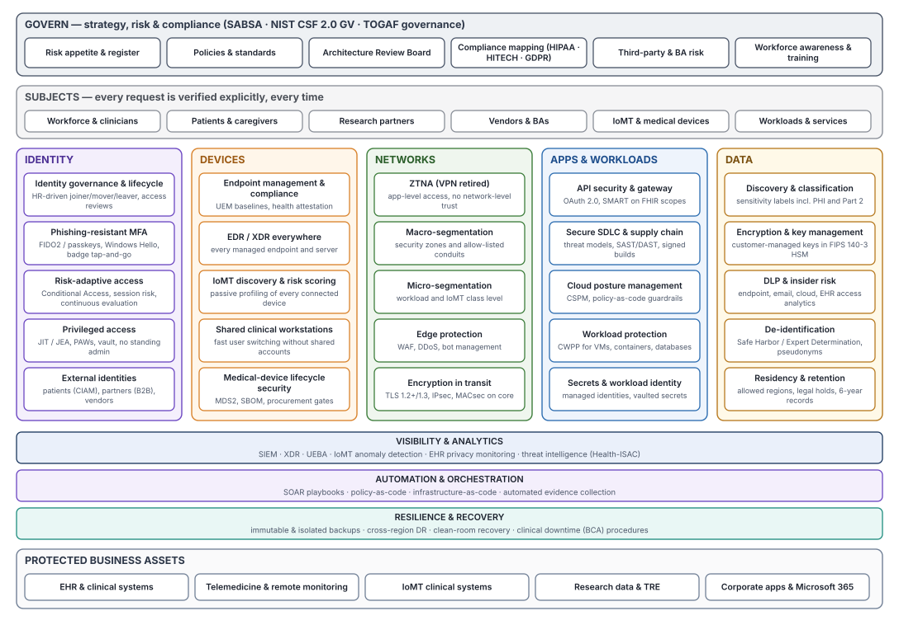
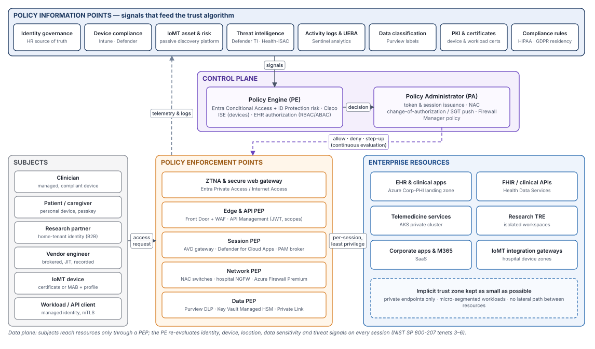
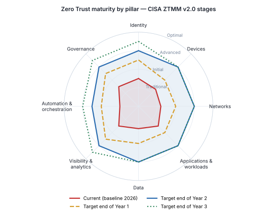
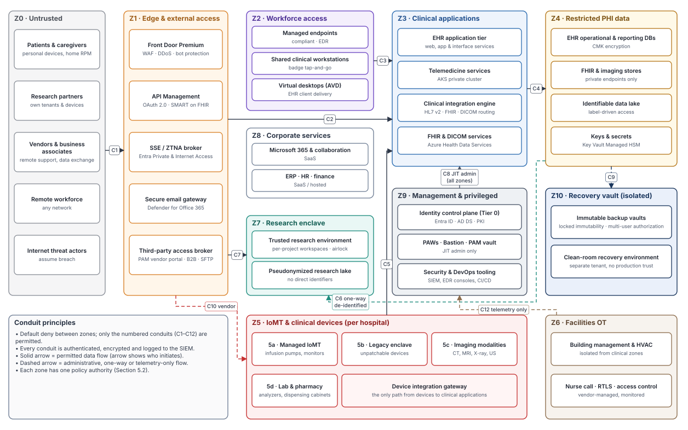
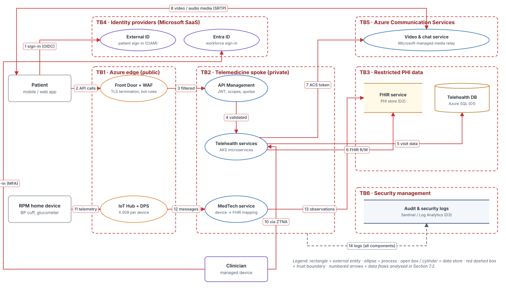
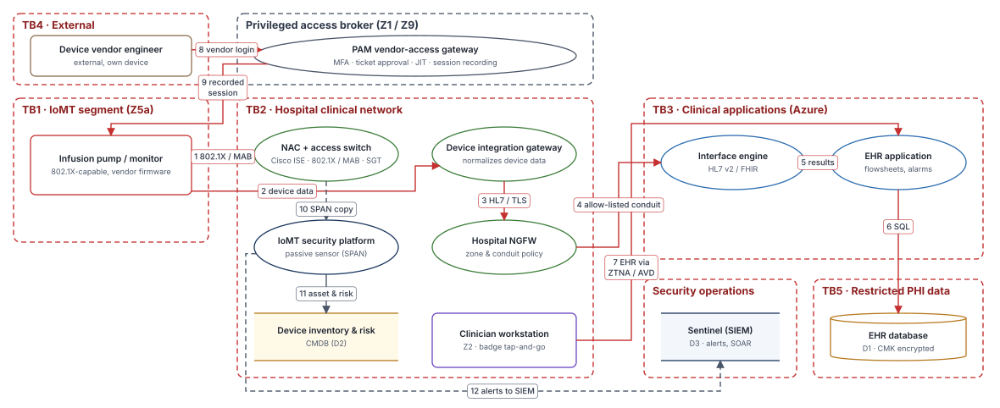

# HealthFirst Network — Enterprise Security Architecture

## Document 2 of 4 · Conceptual and Logical Architecture

**Phase 2 — Conceptual and Logical Architecture Design (SABSA Conceptual and Logical layers)**

| | |
|---|---|
| **Course** | Cybersecurity Architecture and Engineering — Group Project (CCSE, University of Jeddah, Fall 2026) |
| **Scenario** | Scenario 1 — Healthcare Sector: HealthFirst Network |
| **Team** | Rayan Ameen Kurdi (2440795) · Yazan Tareq Alhazmi (2440370) |
| **Version / date** | 1.0 · November 2026 |
| **Classification** | Academic work — HealthFirst Network is a fictional organization |

### Document control

| Version | Date | Author(s) | Change |
|---|---|---|---|
| 0.1 | Week 3 | All architects | Capability model, Zero Trust logical architecture |
| 0.5 | Week 4 | All architects | Domains, zones and conduits; threat models |
| 1.0 | Nov 2026 | All architects | Baseline approved by ARB for Phase 3 physical design |

**Companion documents:** (1) Business and Security Strategy · (3) Physical Architecture and Technology Specification · (4) Security Architecture Governance and Assessment Plan · Final Architecture Review Presentation.

---

## Executive summary

Document 1 established *why* HealthFirst needs a new security architecture and *what* it must achieve: 18 business attributes, 12 control objectives (CO-01 to CO-12) and a risk register dominated by ransomware, ePHI exfiltration and medical-device compromise. This document defines *how*, in technology-neutral terms, the architecture will meet those objectives. It covers the SABSA conceptual and logical layers.

**The conceptual architecture** is a capability model organized around the five Zero Trust pillars of the CISA Zero Trust Maturity Model — identity, devices, networks, applications and workloads, data — plus three cross-cutting capabilities (visibility and analytics, automation and orchestration, resilience) and a governance layer. Every capability traces to a control objective.

**The Zero Trust architecture** applies NIST SP 800-207 directly. Every subject — clinician, patient, research partner, vendor engineer, medical device or workload — reaches a resource only through a policy enforcement point, and a policy engine re-evaluates identity, device health, location, data sensitivity and threat signals on every session. Real healthcare constraints are designed in rather than ignored: shared bedside workstations, emergency "break-the-glass" access, medical devices that cannot run agents, legacy systems, and care that must continue when networks fail.

**The domain and zone model** replaces today's flat, interconnected hospital networks with **eleven security zones (Z0–Z10)**, each with one policy authority, connected only by **twelve allow-listed conduits (C1–C12)**. Medical devices sit in their own sub-zones by device class; research receives only de-identified data through a one-way conduit; backups live in an isolated recovery zone with separate identity.

**The logical services** — 39 security services in eight families — define the identity assurance level for each persona (aligned with NIST SP 800-63-4), the authorization model (role-based plus context-based access for the EHR), the data classification and key hierarchy, the detection catalogue and the resilience tiers.

**Threat modeling** with STRIDE on the two highest-risk data flows (telemedicine and IoMT-to-EHR) identified 22 threats; all have a designed mitigation, and 6 remain at Medium residual risk and are tracked in the risk register. A MITRE ATT&CK mapping of the ransomware kill chain shows preventive *and* detective coverage at every stage, with recovery controls that remain effective even if every preventive control fails.

---

## 1. Introduction

### 1.1 Purpose and scope

This document is the Phase 2 deliverable. It translates the business requirements of Document 1 into a conceptual architecture (capabilities, strategies, trust model, domains) and a logical architecture (services, zones, conduits, policies, information model), and validates the design through threat modeling. Product choices and physical topology are deliberately left to Document 3, so that the logical design remains valid if a product changes.

### 1.2 Inputs from Phase 1

| Input | Reference (Document 1) | How it is used here |
|---|---|---|
| Business drivers BD1–BD9 | Section 2.3 | Scope and priorities of each capability |
| Business attributes A1–A18 | Section 4 | Design acceptance criteria (e.g., A3 *Usable* constrains authentication design) |
| Risk register R01–R14 and FAIR scenarios | Section 7 | Threat modeling focus; residual-risk targets |
| Control objectives CO-01–CO-12 | Section 9 | Mapped to capabilities (Section 3.2) and services (Section 6) |
| Design-forcing regulatory requirements | Section 6.6 | Hard constraints (Section 2.2) |
| Architecture principles P1–P12 | Section 8.3 | Applied throughout; recorded in decisions (Section 8) |

### 1.3 Framework alignment

| SABSA layer | Matrix cells completed in this document | TOGAF ADM |
|---|---|---|
| Conceptual (architect's view) | Control objectives → capabilities; security strategies; trust and entity model; security domain model; resilience tiers | Phase B (Business Architecture) |
| Logical (designer's view) | Information classification; security policies; logical security services; identity schema and privilege profiles; zones and conduits; session and review cycles | Phase C (Data and Application Architecture) |

---

## 2. Design tenets

### 2.1 Zero Trust tenets applied to HealthFirst

NIST SP 800-207 defines seven tenets of Zero Trust. Each is interpreted for HealthFirst and turned into a testable design rule.

| # | NIST SP 800-207 tenet | HealthFirst interpretation | Design rule |
|---|---|---|---|
| 1 | All data sources and computing services are resources | Medical devices, research datasets, FHIR APIs, SaaS apps and building systems are all resources to inventory and protect | Every resource has an owner, a zone and a classification in the CMDB |
| 2 | All communication is secured regardless of network location | The hospital LAN is not trusted; a nurse's workstation on the ward is treated like one on the Internet | Encrypt and authenticate every flow, including inside hospitals (TLS, IPsec, MACsec) |
| 3 | Access is granted per session | Clinicians get application-level sessions, not network access; administrators get time-boxed elevation | No VPN to networks; JIT privileged roles expire automatically |
| 4 | Access is determined by dynamic policy (identity, device, application, behavior, environment) | Decisions combine role, device compliance, location, data label, treatment relationship and risk score | Policies are expressed as Conditional Access, NAC and EHR rules — not static firewall rules alone |
| 5 | The enterprise monitors the integrity and security posture of all assets | Device compliance, IoMT risk scores and cloud posture feed access decisions | Non-compliant or high-risk assets are restricted automatically |
| 6 | Authentication and authorization are dynamic and strictly enforced before access | Policy enforcement points in front of every resource class | No resource is reachable without passing a PEP |
| 7 | The enterprise collects information to improve its security posture | Telemetry from every PEP and resource feeds the SIEM and the metrics program | Detection findings change policy through the governance loop (Document 4) |

### 2.2 Healthcare design constraints

Zero Trust designs fail in hospitals when they ignore clinical reality. These constraints were derived from the attributes and regulations in Document 1 and are binding on every design in this document and in Document 3.

| ID | Constraint | Source | Consequence for the design |
|---|---|---|---|
| K1 | Clinicians must authenticate in seconds at shared workstations; repeated MFA prompts are unacceptable | A3 *Usable*; P11 | Badge tap-and-go with PIN bound to the clinician's own identity; device-bound credentials; SSO |
| K2 | Emergency access must never be blocked by a security control | HIPAA §164.312(a)(2)(ii); P5 | Break-the-glass in the EHR with justification and retrospective review; emergency administrative accounts |
| K3 | Medical devices cannot run agents and cannot be reconfigured without manufacturer validation | A12, A18 | Enforcement is network-based (NAC, segmentation, monitoring), not on the device |
| K4 | Care must continue if the WAN, the cloud or identity services are unavailable | A1, A2; BD7 | Local survivability (cached policies and credentials, read-only downtime PCs) |
| K5 | Every access to ePHI must be attributable to a unique person and retained | HIPAA §164.312(a)(2)(i), (b); A9 | No shared clinical accounts anywhere, including downtime PCs |
| K6 | Some datasets must remain on-premises; EU-resident data must stay in the EU where possible | Brief; GDPR Arts. 44–49 | Hybrid policy enforcement; residency tags and allowed-location policies |
| K7 | Partners and vendors keep their own identities | BD4, BD9 | Federation (B2B) and brokered access instead of HealthFirst accounts for outsiders |
| K8 | Automated containment must not harm patients | P5 | Approval gates for any automated action that could affect clinical systems or devices |

---

## 3. Conceptual security architecture

### 3.1 Capability model

*Figure 2.1 — HealthFirst conceptual security capability model: Zero Trust pillars, cross-cutting capabilities and governance.*

The model reads top to bottom. **Governance** sets direction and accepts risk. **Subjects** request access. Their requests are evaluated by capabilities in the **five pillars**, which sit on **three cross-cutting layers** (visibility and analytics, automation and orchestration, resilience and recovery). All of this exists to protect the **business assets** at the bottom. The model deliberately has no "perimeter" box: in a Zero Trust design, protection is attached to identities, devices, workloads and data, not to a network edge.

### 3.2 Control objectives mapped to capabilities

| Control objective (Doc 1) | Primary capabilities | Pillar / layer |
|---|---|---|
| CO-01 Verify every identity explicitly | Phishing-resistant MFA; external identities; risk-adaptive access | Identity |
| CO-02 Least privilege, just-in-time | Identity governance & lifecycle; privileged access; secrets & workload identity | Identity; Applications |
| CO-03 Know device health | Endpoint management & compliance; EDR/XDR; IoMT discovery & risk scoring | Devices |
| CO-04 Segment; default deny | Macro- and micro-segmentation; ZTNA; edge protection | Networks |
| CO-05 Protect ePHI at rest, in transit, in use | Encryption & key management; encryption in transit; confidential computing | Data; Networks |
| CO-06 Classify, minimize, de-identify | Discovery & classification; de-identification; residency & retention | Data |
| CO-07 Monitor, detect, respond | Visibility & analytics; automation & orchestration | Cross-cutting |
| CO-08 Resilient recovery | Resilience & recovery | Cross-cutting |
| CO-09 Secure software and supply chain | Secure SDLC & supply chain; medical-device lifecycle security; third-party risk | Applications; Devices; Govern |
| CO-10 Continuous compliance | Cloud posture management; policy-as-code; compliance mapping | Applications; Govern |
| CO-11 Patient safety (device and data integrity) | IoMT discovery; micro-segmentation; medical-device lifecycle | Devices; Networks |
| CO-12 Attributable audit trails | Visibility & analytics (EHR privacy monitoring, log retention) | Cross-cutting |

### 3.3 Security strategies

Four strategies shape the logical design:

1. **Identity as the primary control plane.** Network location stops being a reason to trust. Strong, risk-adaptive identity verification for people, devices and workloads is the first gate for every decision (CO-01, CO-02).
2. **Defense in depth by layer, not by perimeter.** Controls are stacked at identity, device, network, application and data layers so that the failure of one layer does not expose ePHI. For example, a stolen clinician password fails at phishing-resistant MFA; a compromised workstation is contained by EDR and segmentation; an over-privileged query is limited by EHR context rules and detected by privacy analytics.
3. **Assume breach and contain the blast radius.** Zones, micro-segmentation, tiered administration and per-session access ensure that one compromised hospital, account or device cannot become an enterprise-wide outage — the failure mode of the Change Healthcare and Ascension incidents.
4. **Resilience as the last line of defense.** Even if every preventive control fails, isolated immutable backups, a clean-room recovery environment and clinical downtime procedures keep care running and bound the loss (CO-08). This is what moves the FAIR loss magnitude for ransomware from a most-likely $65 million to $18 million per event.

### 3.4 Trust and entity model

The SABSA "People" column at the conceptual and logical layers is captured as personas. Assurance levels follow NIST SP 800-63-4 (final, July 2025): identity assurance (IAL), authenticator assurance (AAL) and federation assurance (FAL).

| Persona | Population | Identity authority | Proofing | Authentication | Federation | Device trust required | Typical access |
|---|---|---|---|---|---|---|---|
| Employed clinicians and staff | ≈ 38,000 | HR system → Entra ID | IAL2 (in person at hire) | AAL2 phishing-resistant (Windows Hello, badge + PIN, FIDO2) | — | Managed and compliant for full access | EHR, clinical apps, M365 |
| Affiliated physicians, students, contractors | ≈ 6,000 | Credentialing office / sponsor → Entra ID (time-bound) | IAL2 | AAL2 phishing-resistant | — | Managed, or AVD-only from unmanaged devices | Role-limited EHR and apps |
| Privileged administrators | ≈ 300 | Separate cloud-only admin identities | IAL2 + background check | **AAL3** (hardware-bound FIDO2 keys) from privileged access workstations | — | PAW only | JIT elevation to specific scopes |
| Patients and proxies | ≈ 1.2 million | Entra External ID (separate tenant) | IAL1 for scheduling; **IAL2** (remote proofing) for record access and proxy rights | AAL2 (passkey; one-time code fallback with risk checks) | — | None (personal devices) | Portal, telemedicine, own FHIR data |
| Research partners | ≈ 25 institutions | Partner's home identity provider (B2B) | IAL2 asserted by institution | AAL2 phishing-resistant (verified through cross-tenant trust) | FAL2 | Compliant device claim, or TRE virtual desktop | Trusted research environment only |
| Vendor and business-associate staff | ≈ 1,500 | PAM vendor portal or B2B | IAL2 via vendor attestation plus identity verification | AAL2 phishing-resistant | FAL2 where federated | Brokered session (no direct network) | Specific systems per approved ticket |
| Medical devices | ≈ 48,000 | IoMT platform and NAC profiles; device certificates where supported | Asset registration by Clinical Engineering | 802.1X EAP-TLS certificate, or MAB plus behavioral profiling | — | Sub-zone by device class | Device-specific conduits only |
| Workloads and services | Thousands | Managed identities; workload identity federation; service certificates | Issued by platform | Token or mTLS; no static secrets | — | Signed images; compliant hosts | Least-privilege service-to-service |

---

## 4. Zero Trust architecture

### 4.1 Logical architecture

*Figure 2.2 — Zero Trust logical architecture for HealthFirst, applying the NIST SP 800-207 model.*

| NIST SP 800-207 component | HealthFirst implementation (logical) | Scope |
|---|---|---|
| **Policy Engine (PE)** — decides to grant, deny or revoke access | Workforce/partner session policy (Conditional Access with identity-risk scoring); device compliance evaluation; network-access policy for devices (NAC); EHR authorization engine (record-level and break-the-glass rules); cloud control-plane authorization (RBAC with JIT); API scope policy | Every access request |
| **Policy Administrator (PA)** — establishes or shuts down the session | Token issuance and revocation (including continuous access evaluation); NAC change-of-authorization and security-group-tag assignment; firewall policy distribution; JIT role activation | All sessions and network paths |
| **Policy Enforcement Points (PEP)** | ZTNA and secure web gateway; edge and API gateway; session gateways (virtual desktop, cloud-app session control, PAM broker); network PEPs (NAC switches, hospital firewalls, cloud firewall); data PEPs (DLP, key vault, private endpoints) | In front of every resource class |
| **Continuous diagnostics and mitigation** | Endpoint management and EDR; IoMT asset and risk platform; cloud posture management; CMDB | All assets |
| **Industry compliance** | HIPAA, GDPR residency and organizational policies expressed as policy-as-code | Cloud and identity |
| **Threat intelligence** | Commercial threat intelligence, Health-ISAC, CISA Known Exploited Vulnerabilities catalogue | SIEM, PE risk scoring |
| **Activity logs, SIEM** | Central SIEM with UEBA; long-term retention | All zones |
| **Data access policy** | Sensitivity labels; EHR roles and sensitive-record flags | Data stores and apps |
| **PKI** | Enterprise PKI for device, workload and smart-badge certificates | Devices, workloads |
| **ID management** | Authoritative HR source, identity governance, external identity tenant | All identities |

### 4.2 Trust algorithm and access decisions

**Signals.** Identity and authentication strength; user and sign-in risk; device compliance and EDR risk; device type (managed, personal, medical); network context (hospital, home, foreign country, anonymizer); application sensitivity and data label; relationship to the patient (care team, scheduled visit); behavioral anomalies; current threat level.

**Decision outcomes.** Not just *allow* or *deny*. The policy engine can grant:

- **Allow** — full access for the session;
- **Allow with session controls** — read-only, no download or print, watermarking, shorter session;
- **Step-up** — require a stronger authenticator or re-authentication;
- **Redirect to a protected portal** — virtual desktop only, data never reaches the device;
- **Deny and alert**;
- **Quarantine** (devices) — move to a remediation or isolated network segment.

**Representative policies**

| # | Context | Decision |
|---|---|---|
| AP-1 | Clinician, compliant hospital workstation, badge + PIN, low risk | Allow EHR; SSO to clinical apps |
| AP-2 | Clinician at home on a managed laptop | Allow through ZTNA; phishing-resistant MFA; continuous evaluation |
| AP-3 | Clinician on an unmanaged personal device | EHR only through virtual desktop; no download; no local storage of ePHI |
| AP-4 | Any workforce user with high sign-in risk or impossible travel | Block; require password reset with phishing-resistant MFA; SOC alert |
| AP-5 | Administrator requesting Tier 0 role | Only from a privileged access workstation, hardware key, JIT approval, ≤ 4-hour window |
| AP-6 | Patient viewing own records | Passkey (AAL2); IAL2-proofed account required for full record and proxy access |
| AP-7 | Research partner | Home-tenant MFA and compliant device claims accepted; access only to assigned TRE workspace; no data egress |
| AP-8 | Vendor engineer for an infusion-pump server | Approved ticket, MFA, JIT session through PAM broker, recorded, limited to that server's protocols |
| AP-9 | New, unknown device plugged into a ward network port | Restricted onboarding segment; profiled by NAC and the IoMT platform; Clinical Engineering approval to place in a sub-zone |
| AP-10 | EHR user opens a record with no care relationship | Allowed with break-the-glass reason; real-time privacy alert; retrospective review |

### 4.3 Deployment models

NIST SP 800-207 describes several deployment variations; HealthFirst uses four, each where it fits:

| 800-207 variation | Where HealthFirst uses it | Why |
|---|---|---|
| **Device agent / gateway** | Managed workforce endpoints (ZTNA client to application connectors) | Strongest signal set; per-application access |
| **Enclave gateway** | IoMT sub-zones and the legacy protective enclave; on-premises application connectors | Resources cannot host agents; a gateway protects a group |
| **Resource portal** | Virtual desktop for unmanaged devices; TRE portal for research partners; PAM portal for vendors | No agent on the subject's device; data stays inside |
| **Application sandboxing** | Hardened virtual desktop images for third-party coders and remote reading | Isolates untrusted endpoints from ePHI |

### 4.4 Real-world Zero Trust challenges and how the design solves them

| Challenge | Why naive Zero Trust fails | Design response |
|---|---|---|
| Shared bedside workstations and speed of care (K1) | Per-user MFA at every login slows care; staff share sessions | Badge tap-and-go with PIN tied to the individual's identity; fast user switching; proximity or tap-out sign-out; phishing-resistant by design |
| Emergencies (K2) | Strict policy could block a life-saving lookup | Break-the-glass with justification and real-time privacy alert instead of a hard block; emergency cloud accounts excluded from Conditional Access, protected by hardware keys and monitored |
| Agentless medical devices (K3) | No device health signal; cannot install clients | NAC profiling plus passive network monitoring provides device identity and risk; enforcement at switch and firewall (enclave gateway model) |
| Legacy applications without modern authentication | Cannot speak OIDC or SAML | Identity-aware application proxy / ZTNA in front; protocol isolation; jump hosts; replacement plan |
| Vendor remote support | Persistent VPNs are the classic entry point | Brokered, ticket-bound, recorded sessions; no network-level access |
| Outages of WAN, cloud or identity services (K4) | A cloud policy engine that cannot be reached can stop care | Fail-safe for care, fail-secure for administration: cached policies and credentials at hospital edge, offline downtime PCs, local NAC policy cache; administration denied when the policy engine is unreachable |
| Partner and vendor identities (K7) | Creating accounts for outsiders creates orphaned identities | Cross-tenant federation with explicit trust in partner MFA and device claims; time-bound access packages |
| Automated containment (K8) | Auto-isolating a nursing-station PC or device mid-procedure could harm a patient | SOAR approval gates for clinical-impact assets; automatic isolation only for non-clinical endpoints |

### 4.5 Zero Trust maturity targets

Maturity is tracked with the CISA Zero Trust Maturity Model v2.0 stages (Traditional, Initial, Advanced, Optimal). The baseline comes from the current-state assessment in Document 1; targets follow the three-wave roadmap.

| Pillar / capability | Baseline (2026) | End of Year 1 | End of Year 2 | End of Year 3 |
|---|---|---|---|---|
| Identity | Traditional–Initial | Initial–Advanced | Advanced | Advanced–Optimal |
| Devices (incl. IoMT) | Traditional | Initial | Advanced | Advanced |
| Networks | Traditional | Initial | Advanced | Advanced |
| Applications and workloads | Traditional–Initial | Initial | Advanced | Advanced |
| Data | Traditional | Initial | Advanced | Advanced |
| Visibility and analytics | Traditional–Initial | Initial–Advanced | Advanced | Advanced–Optimal |
| Automation and orchestration | Traditional | Initial | Initial–Advanced | Advanced |
| Governance | Traditional–Initial | Initial–Advanced | Advanced | Advanced–Optimal |

*Figure 2.3 — Zero Trust maturity baseline and targets by pillar (CISA ZTMM v2.0).*

---

## 5. Security domains and zones

SABSA distinguishes a **security domain** — a set of elements governed by one security policy under one authority — from a **security zone**, the technical trust boundary that enforces it. HealthFirst defines both.

### 5.1 SABSA domain model

| Domain | Scope | Policy authority | Key policy | Trust relationships |
|---|---|---|---|---|
| HealthFirst enterprise (super-domain) | All HealthFirst assets and people | Executive Risk Committee (delegated to CISO) | Enterprise information security policy | Parent of all internal domains |
| Clinical care | EHR, clinical apps, clinical workstations | CMIO and CNO, with CISO | Clinical access and privacy policy | Trusts identity services; trusts device domain only through the integration gateway |
| Medical device | All connected medical devices and their servers | Director of Clinical Engineering | Medical-device security policy (IEC 80001-1 risk management) | No direct trust to clinical apps; data flows only via gateway |
| Patient | Patient and proxy identities, portal, telemedicine front end | Chief Digital Officer and Chief Privacy Officer | Patient identity and consent policy | Separate identity tenant; federated to telemedicine apps |
| Research | Trusted research environment and research data | Chief Research Officer and IRB | Research data governance policy | Receives only de-identified or pseudonymized data; federates partner domains |
| Corporate | ERP, HR, finance, collaboration | CFO and CHRO | Corporate IT policy | Limited, API-mediated exchange with clinical domain |
| Security management (Tier 0) | Identity systems, PKI, security tooling, PAM | CISO | Privileged access policy | Trusted by all domains; trusts none |
| Recovery | Backup vaults and clean-room environment | CIO and CISO jointly (dual control) | Recovery and backup policy | Trusts no production identity; isolated |
| External partner domains | Research institutions, vendors, business associates | The partner's own authority | Governed by contracts (DUA, BAA) and cross-tenant policy | Explicit, limited, reviewed trust |

### 5.2 Security zones

*Figure 2.4 — HealthFirst security zones (Z0–Z10) and allow-listed conduits (C1–C12).*

| Zone | Purpose and contents | Trust level | Entry requirements | Policy authority |
|---|---|---|---|---|
| **Z0 Untrusted** | Internet, patients' homes, partner and vendor networks, remote workforce on any network | 0 | n/a | n/a |
| **Z1 Edge & external access** | Public-facing PEPs: edge WAF and DDoS protection, API gateway, ZTNA broker, email gateway, third-party access broker | 1 | Hardened managed services only; no data at rest | CISO |
| **Z2 Workforce access** | Managed endpoints, shared clinical workstations, virtual desktops | 2 | Compliant device + authenticated user | CIO / CISO |
| **Z3 Clinical applications** | EHR application tier, telemedicine services, integration engine, FHIR and DICOM services | 3 | Reachable only via conduits C2, C3, C5, C8, C11 | CMIO / CISO |
| **Z4 Restricted PHI data** | EHR databases, FHIR and imaging stores, identifiable data lake, keys and secrets | 4 (highest data sensitivity) | Private endpoints only; managed identities; no human direct access except JIT break-glass | CPO / CISO |
| **Z5 IoMT & clinical devices** | Sub-zones 5a–5d per hospital; device integration gateway | 3 (high safety impact, low device trust) | NAC profile and Clinical Engineering approval | Clinical Engineering |
| **Z6 Facilities OT** | Building management, HVAC, nurse call, RTLS, physical access control | 1–2 | Vendor-managed; isolated from clinical zones | Facilities director / CISO |
| **Z7 Research enclave** | Trusted research environment, pseudonymized research lake | 3 | Approved project membership; B2B or workforce identity | Chief Research Officer |
| **Z8 Corporate services** | Microsoft 365, ERP, HR, finance | 2 | Workforce identity; compliant device | CFO / CIO |
| **Z9 Management & privileged** | Identity control plane (Tier 0), PAWs, bastion, PAM vault, security and DevOps tooling | 5 (most trusted, most protected) | PAW + hardware key + JIT | CISO |
| **Z10 Recovery vault** | Immutable backup vaults and clean-room recovery environment in a separate tenant | 5 (isolated) | Separate identity; quorum break-glass | CIO + CISO (dual control) |

### 5.3 Conduits

Default deny applies between all zones. Only these conduits are permitted; each is authenticated, encrypted and logged.

| ID | From → To | Purpose | Protocols and controls | Initiated by |
|---|---|---|---|---|
| C1 | Z0 → Z1 | Patients, partners and remote users reach edge services | HTTPS (TLS 1.2+); WAF, DDoS, bot management, rate limits | Z0 |
| C2 | Z1 → Z3 | API gateway forwards validated requests to application tier | mTLS to private endpoints; OAuth 2.0 / SMART token and scope validation | Z1 |
| C3 | Z2 → Z3 | Workforce access to clinical applications | Per-application ZTNA or virtual-desktop gateway; Conditional Access | Z2 |
| C4 | Z3 → Z4 | Applications read and write ePHI | Private endpoints; managed identities; TLS; database firewall | Z3 |
| C5 | Z5 → Z3 | Device data to clinical systems | Device integration gateway → integration engine; HL7 v2 / FHIR over TLS (IPsec for legacy); allow-listed; one-directional data | Z5 gateway |
| C6 | Z4 → Z7 | Research datasets | One-way de-identification pipeline; honest-broker approval; no reverse path | Z4 pipeline |
| C7 | Z1 → Z7 | Partner researchers use the TRE | B2B authentication; virtual desktop only; no download | Z1 broker |
| C8 | Z9 → all | Privileged administration | PAW → bastion / PAM → target; JIT; session recording | Z9 |
| C9 | Z3/Z4 → Z10 | Backups | Push to immutable vault with separate credentials; vaulted copies pulled by Z10 | Backup service |
| C10 | Z1 → Z5 | Vendor remote support for devices | PAM jump host into the enclave; per-ticket JIT; recorded | Z1 broker (after approval) |
| C11 | Z8 ↔ Z3 | Corporate–clinical integration (revenue cycle, HR feeds) | API gateway / integration engine only; no direct database access (not drawn in Figure 2.4) | Application |
| C12 | Z6 → Z9 | Facilities OT telemetry to SOC monitoring | One-way syslog / flow export; no inbound path | Z6 |

### 5.4 IoMT sub-zoning

Devices are grouped by clinical function and risk, following the responsible-organization approach of IEC 80001-1:2021 and using manufacturer disclosures (MDS2) as inputs.

| Sub-zone | Examples | Main risk drivers | Allowed conduits | Compensating controls |
|---|---|---|---|---|
| 5a Managed IoMT | Infusion pumps, patient monitors, networked ventilators | Therapy delivery and alarms (highest safety impact) | To the manufacturer's device server and the integration gateway only | 802.1X where supported; firewall application identification; anomaly detection |
| 5b Legacy protective enclave | Devices running unsupported operating systems | Cannot be patched; known exploitable vulnerabilities | To PACS or the gateway only; no Internet | Strict allow-lists; IPS virtual patching; jump host for service; funded replacement plan |
| 5c Imaging modalities | CT, MRI, X-ray, ultrasound | Large DICOM transfers; vendor remote service | To PACS and modality worklist only | DICOM TLS where supported; vendor access via C10 |
| 5d Lab and pharmacy automation | Analyzers, automated dispensing cabinets | Medication and result integrity | To LIS middleware or pharmacy server only | Integrity checks; change control with pharmacy |

Each device receives a **risk score** — likelihood (OS support status, known exploited vulnerabilities, exposure, vendor access) × impact (clinical criticality and safety classification). The score determines its sub-zone, monitoring intensity and replacement priority.

---

## 6. Logical security services

### 6.1 Service catalogue

| Family | Logical service | Key functions | Control objectives |
|---|---|---|---|
| **Identity & access** | Identity lifecycle & governance | Authoritative sources, joiner–mover–leaver automation, access packages, access reviews | CO-02 |
| | Workforce authentication | Phishing-resistant MFA, passwordless, badge tap-and-go, risk-based step-up | CO-01 |
| | Customer (patient) identity | Self-service registration, passkeys, remote identity proofing, proxy/delegated access | CO-01 |
| | Partner federation | Cross-tenant trust, B2B, time-bound access | CO-01, CO-02 |
| | Authorization | RBAC + ABAC, EHR context rules, break-the-glass | CO-02 |
| | Privileged access management | JIT elevation, PAWs, vaulting, session recording, vendor brokering | CO-02 |
| | Credential & PKI services | Certificates for devices, workloads, smart badges | CO-01, CO-03 |
| **Device trust** | Endpoint management & compliance | Baselines, encryption, compliance attestation | CO-03 |
| | Endpoint detection & response | Behavioral detection, isolation, investigation | CO-03, CO-07 |
| | IoMT asset intelligence | Passive discovery, profiling, vulnerability correlation, risk scoring | CO-03, CO-11 |
| | Network access control | 802.1X / MAB, profiling, segment assignment, quarantine | CO-03, CO-04 |
| **Network security** | Zero Trust network access | Per-application access, no network-level trust | CO-04 |
| | Segmentation & firewalling | Zones and conduits, micro-segmentation, IPS | CO-04 |
| | Edge protection | WAF, DDoS, bot management | CO-04 |
| | Secure web gateway & egress control | URL filtering, TLS inspection, data-exfiltration controls | CO-04, CO-05 |
| | Protective DNS | Malicious-domain blocking, private name resolution | CO-04 |
| | Encrypted transport | TLS, IPsec, MACsec everywhere | CO-05 |
| **Data protection** | Classification & labeling | Discovery, auto-labeling, label inheritance | CO-06 |
| | Encryption & key management | Customer-managed keys, HSM, rotation, separation of duties | CO-05 |
| | Data loss prevention | Endpoint, email, cloud and SaaS DLP | CO-05, CO-06 |
| | De-identification & pseudonymization | Safe Harbor / Expert Determination, keyed pseudonyms | CO-06 |
| | Residency & retention | Allowed locations, retention and legal hold | CO-06, CO-10 |
| **Application security** | API security | Gateway authentication, SMART scopes, schema validation, rate limiting | CO-04, CO-09 |
| | Secrets management | Vaulted secrets, managed identities, rotation | CO-02, CO-09 |
| | Secure SDLC & supply chain | Threat modeling, code scanning, signed builds, SBOM | CO-09 |
| | Cloud posture & workload protection | CSPM, CWPP, container security | CO-09, CO-10 |
| **Monitoring & response** | Log management | Collection, normalization, retention ≥ 6 years | CO-07, CO-12 |
| | SIEM analytics & UEBA | Correlation, anomaly detection, hunting | CO-07 |
| | Extended detection & response | Cross-domain incident correlation | CO-07 |
| | SOAR | Automated containment with clinical approval gates | CO-07 |
| | Threat intelligence | Feeds, Health-ISAC sharing, known-exploited-vulnerability tracking | CO-07 |
| | Vulnerability management | Scanning, prioritization, remediation SLAs | CO-09 |
| | EHR privacy monitoring | Inappropriate-access analytics for patient records | CO-07, CO-12 |
| | Incident response & forensics | Playbooks, evidence preservation, regulatory notification | CO-07, CO-10 |
| **Resilience** | Immutable backup | Locked immutability, multi-user authorization | CO-08 |
| | Disaster recovery | Cross-region replication and failover | CO-08 |
| | Isolated recovery (clean room) | Restore and verify in a separate tenant | CO-08 |
| | Clinical continuity | Downtime PCs and procedures | CO-08 |
| **Governance & compliance** | Policy-as-code & continuous compliance | Guardrails, compliance dashboards, evidence automation, risk and exception register | CO-10 |

### 6.2 Identity and access — logical design

**Lifecycle.** The HR system is authoritative for employees; the medical-staff credentialing system for affiliated physicians; sponsors for contractors and students, whose access expires automatically. Joiner–mover–leaver events drive automatic provisioning and de-provisioning. Involuntary terminations remove access within one hour and all other departures the same day, well inside the 24-hour notification window proposed in the HIPAA NPRM. Access reviews run quarterly (monthly for privileged roles).

**Authorization model.** EHR access combines **role-based access** (job role, department) with **attribute-based context**: treatment relationship, location, sensitive-record flags (VIP, behavioral health, 42 CFR Part 2, reproductive health) and device context. Where a clinician lacks a care relationship, the EHR permits break-the-glass with a reason and raises a privacy alert, rather than blocking care. Research access is granted through access packages that require an approved IRB protocol and a signed data use agreement.

**Privileged access model.** HealthFirst adopts a tiered *enterprise access model*:

| Plane | Contents | Rules |
|---|---|---|
| Control plane (Tier 0) | Identity provider, on-premises directory, PKI, identity sync servers, security tooling, PAM | Separate admin identities; PAW only; hardware keys; JIT ≤ 4 h; no Internet browsing |
| Management plane | Cloud subscriptions, hypervisors, network devices | JIT; approval for production; session recording |
| Data / workload plane | Databases, applications, servers | JIT; least privilege; break-glass only for data access |
| User access | End-user apps | Standard Zero Trust policies |

**Session and review cycles (SABSA logical "Time").** Workforce sign-in sessions are re-evaluated continuously (continuous access evaluation); shared clinical workstations lock on badge tap-out or after inactivity; privileged roles expire after at most 4 hours; patient sessions use short-lived access tokens (≤ 60 minutes) with rotating refresh tokens.

### 6.3 Data security — logical design

**Information classification**

| Label | Definition | Examples | Required handling |
|---|---|---|---|
| Public | Approved for public release | Website content, open datasets | Integrity protection only |
| Internal | Routine business information | Policies, internal communications | Workforce access; no external sharing without review |
| Confidential | Sensitive business or personal (non-PHI) data | Employee records, contracts, financials | Encryption; need-to-know; DLP monitoring |
| Highly Confidential — PHI | Any ePHI | EHR records, images, device data, claims | Encryption with customer-managed keys; Zone Z4 storage; DLP blocking; audit of all access |
| Highly Confidential — Special handling | ePHI with extra legal or ethical protection | 42 CFR Part 2 records, behavioral health, genetic data, VIP records | As above plus segmented access, consent checks, enhanced monitoring |
| Research — De-identified / Pseudonymized | Data de-identified under HIPAA or pseudonymized for research | Research-lake datasets | TRE only; DUA terms; no re-identification attempts; export via airlock |

**Key hierarchy.** HSM-protected root and key-encryption keys per security domain → workload data-encryption keys in key vaults → service-level encryption (database TDE, storage encryption) → column-level keys for the most sensitive fields. Keys are separated per environment and per research project; key-encryption keys rotate at least annually and immediately on suspected compromise; HSM administration needs two custodians (dual control). Crypto-shredding (destroying keys) supports secure disposal of cloud data.

**De-identification model.** Broadly shared datasets use HIPAA **Safe Harbor** (removal of the 18 identifiers); richer clinical datasets use **Expert Determination**; limited data sets require a DUA. Pseudonyms are keyed hashes with a separate key per project, held by an **honest broker** outside the research environment; re-identification happens only through an IRB-approved process (for example, re-contacting trial participants).

**Residency.** Data carries a residency tag (US or EU). Policy-as-code restricts where resources can be created; EU-resident datasets live in EU-region workspaces; transfers are documented with their legal basis (Data Privacy Framework or Standard Contractual Clauses).

### 6.4 Application and API security — logical design

- **APIs** follow FHIR R4 with **SMART on FHIR** authorization: OAuth 2.0 with PKCE, granular scopes (for example, patient-level read scopes for the patient app, user-level scopes for clinician apps), short-lived tokens, refresh-token rotation and, where supported, sender-constrained tokens. The FHIR server enforces patient-compartment access so that a patient's token can never read another patient's data (OWASP API Security Top 10, API1 object-level authorization).
- **Gateway functions**: authentication, scope enforcement, schema validation, quotas and rate limiting, payload size limits, logging of every call with correlation IDs.
- **Secure SDLC**: threat modeling at the ARB design gate; static analysis, dependency and secret scanning in every build; dynamic testing in staging; infrastructure-as-code scanning; signed artifacts and SBOMs; independent penetration test before go-live. Patient-facing apps are verified against OWASP ASVS Level 2, and authentication components against Level 3.

### 6.5 Security monitoring and response — logical design

**Detection use cases** (examples from the catalogue maintained by the SOC):

| Use case | Signal sources | ATT&CK technique |
|---|---|---|
| Risky or impossible-travel sign-in to a workforce account | Identity logs, identity-risk engine | T1078 Valid Accounts |
| MFA-fatigue or push-bombing pattern | Identity logs | T1621 MFA Request Generation |
| Abnormal volume of patient records opened by one user | EHR audit trail, UEBA | Insider (privacy) |
| Privileged role activated outside an approved change | PAM / JIT logs | T1078.004 Cloud Accounts |
| Attempt to delete backups or change immutability settings | Backup service logs | T1490 Inhibit System Recovery |
| Mass file encryption behavior on servers | EDR | T1486 Data Encrypted for Impact |
| Medical device talking to a new external destination | IoMT platform, firewall | T1071 Application Layer Protocol |
| Vendor session started without a matching ticket | PAM broker | T1133 External Remote Services |
| Large upload of labeled ePHI to a personal cloud service | DLP, secure web gateway | T1567 Exfiltration Over Web Service |
| PHI storage resource exposed to public network | Cloud posture management | T1530 Data from Cloud Storage |

**Response targets.** Mean time to detect high-severity incidents ≤ 1 hour; mean time to contain ≤ 4 hours. Ransomware behavior on *non-clinical* endpoints triggers automatic isolation within minutes; clinical assets require an on-call clinical liaison approval (constraint K8). Regulatory clocks (HIPAA 60 days, GDPR 72 hours, CIRCIA 72 hours / 24 hours once effective) start from the incident-classification step defined in the playbooks.

### 6.6 Resilience — logical design

| Tier | Systems | RTO | RPO | Backup pattern | Recovery pattern |
|---|---|---|---|---|---|
| T0 — control plane | Identity (cloud and on-premises directory), PKI, DNS, PAM, security tooling | ≤ 2 h | ≤ 1 h | Immutable daily + transaction-level where possible; offline directory backups | Recovered first; documented directory forest recovery |
| T1 — clinical critical | EHR, clinical integration, PACS core, pharmacy | ≤ 4 h | ≤ 15 min | Continuous replication + immutable backups + vaulted copy | Warm standby in secondary region; clean-room validation after ransomware |
| T2 — clinical important | Telemedicine, LIS, departmental systems | ≤ 8 h | ≤ 1 h | Immutable backups; zone-redundant services | Redeploy from code + restore data |
| T3 — business | Revenue cycle, ERP, collaboration, research | ≤ 24–72 h | ≤ 4–24 h | Immutable backups; SaaS backup | Restore by priority |

Recovery order after a destructive attack is fixed in advance: **T0 identity → T1 EHR → integration → T2 → T3**, because nothing can be restored safely before the identity plane is trusted again.

### 6.7 Security policy architecture (logical)

The logical layer defines *which* policies exist and what each governs; their content, ownership and review cycle are set in Document 4. The set is: enterprise information security policy; acceptable use; identity and access; privileged access; clinical access and privacy (including break-the-glass); medical-device security; data classification and handling; cryptography and key management; cloud security; network security and segmentation; secure development; logging and monitoring; incident response and breach notification; backup, disaster recovery and clinical continuity; third-party and business-associate security; research data governance; vulnerability and patch management.

---

## 7. Threat modeling

### 7.1 Approach

The two data flows with the highest combined exposure and impact were modelled first, as data-flow diagrams (DFDs) with explicit trust boundaries:

- **DFD-1 Telemedicine and patient access** — the largest new Internet-facing surface (risks R02, R04, R11);
- **DFD-2 IoMT to EHR, including vendor support** — the highest patient-safety impact (risks R03, R06).

Each element and flow was analysed with **STRIDE** (Spoofing, Tampering, Repudiation, Information disclosure, Denial of service, Elevation of privilege) and threats were mapped to **MITRE ATT&CK** techniques so that detection engineering can reuse them. Residual risk is rated after the designed mitigation. Hybrid-cloud attack vectors and the ransomware kill chain are analysed separately (Sections 7.4–7.5).

### 7.2 DFD-1 — Telemedicine and patient access

*Figure 2.5 — DFD-1: telemedicine and patient access data flows with trust boundaries.*

| ID | Element / flow | STRIDE | Threat | ATT&CK | Designed mitigation | Residual |
|---|---|---|---|---|---|---|
| T-01 | Flows 1–2 (patient sign-in, API calls) | S | Credential stuffing and phishing of patient accounts | T1110.004 | Passkeys; risk-based sign-in policy; bot protection and rate limiting at the edge; breached-password checks | Low |
| T-02 | Flow 2 → FHIR | T / I | Broken object-level authorization: a patient changes an ID to read another patient's record | T1190 | Patient-compartment enforcement in the FHIR server; SMART patient-context scopes; authorization tests in the pipeline | Low |
| T-03 | Edge (Front Door + WAF) | D | Volumetric or application-layer DDoS against virtual care | T1498, T1499 | DDoS protection; WAF rate limits; autoscaling; telephone fallback for scheduled visits | Low |
| T-04 | Flow 3–4 (API gateway) | E | Stolen or replayed access / refresh tokens | T1550.001 | Short token lifetimes; refresh-token rotation; sender-constrained tokens where supported; continuous evaluation | Medium |
| T-05 | Telehealth services | E / T | Container escape, vulnerable or tampered images | T1610, T1195 | Signed images and admission control; container threat detection; workload identity; network policies | Low |
| T-06 | Flows 5–6 (data) | I | Over-broad service access to ePHI stores | T1530 | Managed identities with least privilege; private endpoints; customer-managed keys; column encryption | Low |
| T-07 | Flow 8 (video media) | I | Uninvited party joins a visit or media is intercepted | T1557 | Per-participant short-lived tokens; virtual lobby with clinician admission; encrypted media (SRTP) | Low |
| T-08 | Flow 9 (clinician sign-in) | S | Adversary-in-the-middle phishing steals clinician session | T1557, T1539 | Phishing-resistant MFA; compliant-device requirement; token protection | Low |
| T-09 | Flows 11–13 (RPM telemetry) | S / T | Cloned or tampered home device injects false readings that drive clinical decisions | T1565 | Per-device X.509 identity via provisioning service; plausibility rules in alerting; clinician confirmation before treatment changes | Medium |
| T-10 | All flows | R | Patient or clinician disputes an action or consent | — | FHIR AuditEvent records; signed consent; central logging | Low |
| T-11 | D3 audit logs | T | Attacker deletes or alters logs to hide activity | T1070 | Long-term retention tier with immutability; separate log-admin roles; alert on diagnostic-setting changes | Low |
| T-12 | TB4 identity providers | D | External identity service outage prevents patient sign-in | — | Service-level commitments; telephone visit fallback; status communication | Medium (accepted) |

### 7.3 DFD-2 — IoMT to EHR and vendor support

*Figure 2.6 — DFD-2: medical-device data flows, vendor support and monitoring with trust boundaries.*

| ID | Element / flow | STRIDE | Threat | ATT&CK | Designed mitigation | Residual |
|---|---|---|---|---|---|---|
| I-01 | Flow 1 (device → NAC) | S | MAC-address spoofing to impersonate a device where only MAB is possible | T1557 | Behavioral profiling and anomaly detection; EAP-TLS where supported; segment restricts what an impostor can reach | Medium |
| I-02 | Flows 2–4 (device data) | T | HL7 messages altered in transit (legacy HL7 lacks integrity protection) | T1565.002 | TLS or IPsec between gateway and engine; message validation; segmentation | Low |
| I-03 | Infusion pump | T / E | Exploited device vulnerability changes drug library or settings | T1210 | Allow-list to pump server only; vendor patch program; anomaly detection; drug-library integrity checks | Medium |
| I-04 | Flows 8–9 (vendor) | S / E | Stolen vendor credentials used for persistent access | T1133, T1078 | PAM with MFA; ticket-bound JIT; session recording; no standing VPN | Low |
| I-05 | Gateway and device zones | D | Ransomware spreads into device segments and halts devices | T1486 | Zone isolation; no file-sharing protocols from user zones; EDR on gateways | Low |
| I-06 | IoMT security platform | I | Packet captures stored by the sensor contain ePHI | — | Minimal capture retention; encryption; role-based access | Low |
| I-07 | Flow 5 (to EHR) | R | Device data recorded against the wrong patient or not attributable | — | Patient–device association workflow; audit records | Low |
| I-08 | Legacy enclave | E | Unpatched OS exploited through legacy file-sharing protocol | T1210 | Enclave isolation; IPS virtual patching; SMBv1 blocked between zones | Medium |
| I-09 | Flow 7 (clinician workstation) | I | Unattended session at a shared workstation | — | Badge tap-out; auto-lock; proximity sign-out | Low |
| I-10 | Flow 12 (alerts) | D | Attacker disables or floods the sensor to blind monitoring | T1562 | Sensor health heartbeat alerts; SIEM monitoring of telemetry gaps | Low |

### 7.4 Hybrid and multi-cloud attack vectors

HealthFirst's hybrid design (Azure, two data centers, SaaS, partner clouds) introduces attack paths that do not exist in a single data center.

| Attack vector | Example | Architectural mitigation |
|---|---|---|
| Federation abuse and forged tokens | Compromised on-premises federation server used to forge SAML tokens ("Golden SAML", T1606.002) | Retire on-premises federation; cloud-native authentication with phishing-resistant MFA; treat identity-sync servers as Tier 0 |
| Token theft and replay | Session cookie stolen by adversary-in-the-middle phishing (T1550.004) | Token protection, compliant devices, continuous access evaluation |
| Malicious OAuth applications | Consent phishing grants mailbox or file access (T1528) | Admin-consent workflow; application governance monitoring |
| Cross-tenant abuse | A compromised partner tenant pivots via B2B | Partner-specific inbound trust; guests restricted to the TRE; access reviews |
| Cloud control-plane takeover | Stolen Owner credentials (T1078.004) delete resources and backups | JIT for privileged roles; deny policies at management-group level; multi-user authorization on backups |
| Misconfiguration | Storage account with ePHI exposed publicly (T1530) | Policy-as-code denying public network access; posture management; private endpoints only |
| On-premises → cloud lateral movement | Ransomware crosses the hybrid link | Firewall inspection of all traffic in both directions; no flat routing between data centers and cloud |
| CI/CD supply-chain compromise | Pipeline secrets stolen to push malicious images (T1195.002) | Workload identity federation (no secrets); signed builds; protected branches; admission control |
| Residency drift | Resources created in non-approved regions | Allowed-location policies; residency tags; monitoring |
| Partner-cloud interoperability | Partner on another cloud receives datasets | Only de-identified data; contractual controls; encryption; audit of every share |

### 7.5 MITRE ATT&CK — ransomware kill-chain coverage

Ransomware is HealthFirst's largest modelled loss (S1). The table shows that the design provides both prevention and detection at every tactic, and that recovery still works if everything before it fails.

| Tactic | Representative technique | Prevent | Detect | Respond / recover |
|---|---|---|---|---|
| Initial access | T1078 Valid Accounts; T1133 External Remote Services; T1566 Phishing; T1190 Exploit Public-Facing App | Phishing-resistant MFA; ZTNA (no exposed RDP/VPN); email security; WAF and patch SLAs | Identity-risk analytics; email detonation; WAF alerts | Revoke sessions; reset credentials |
| Execution | T1059 Command and Scripting Interpreter | Application control; attack-surface-reduction rules | EDR behavioral detection | Isolate endpoint |
| Persistence | T1136 Create Account; T1098 Account Manipulation | Identity governance; JIT roles | Alerts on new privileged accounts or role changes | Disable accounts; review changes |
| Privilege escalation | T1068 Exploitation; T1484 Domain Policy Modification | Tiered admin; LAPS; patching | Directory threat detection | Contain; restore directory objects |
| Defense evasion | T1562 Impair Defenses | EDR tamper protection | Tamper and telemetry-gap alerts | Re-enable; investigate |
| Credential access | T1003 OS Credential Dumping | Credential Guard; LSA protection; no Tier 0 logons on workstations | EDR and directory alerts | Rotate credentials |
| Discovery | T1087 Account Discovery; T1046 Network Service Discovery | Segmentation limits visibility | Deception honeytokens; anomaly analytics | Contain |
| Lateral movement | T1021 Remote Services (RDP, SMB) | Zone conduits; RDP/SMB blocked between zones; JIT admin | Firewall and EDR lateral-movement detections | Isolate segment |
| Exfiltration | T1567 Exfiltration Over Web Service | DLP; egress filtering via secure web gateway and firewall | Anomalous upload analytics | Block destination; notify (legal clocks) |
| Impact | T1486 Data Encrypted for Impact; T1490 Inhibit System Recovery | Immutable vaults; multi-user authorization; soft delete; isolated recovery tenant | Ransomware behavior detection; backup-deletion alerts | Automated isolation; clean-room restore in tier order; downtime procedures |

### 7.6 Outcomes of threat modeling

Threat modeling produced new or sharpened requirements for Document 3:

1. Require **token protection** and continuous access evaluation for workforce sessions (T-08, hybrid vectors).
2. Use **sender-constrained tokens** for the patient app where the platform supports them; otherwise compensate with short lifetimes and anomaly detection (T-04 remains Medium).
3. Add **plausibility rules and clinician confirmation** to remote-monitoring alerts (T-09).
4. Block **SMBv1 and legacy protocols** between all zones; limit IoMT sensor packet-capture retention (I-06, I-08).
5. Monitor **sensor and telemetry health** as security signals (I-10, T-11).
6. Treat **identity-sync servers** as Tier 0 and retire on-premises federation (hybrid vectors).

---

## 8. Architecture decision records

| ADR | Decision | Context | Alternatives considered | Consequences |
|---|---|---|---|---|
| ADR-01 | **ZTNA replaces VPN** for workforce and vendors | VPNs grant network-level access and were the entry point in major sector incidents | Harden and keep VPN with MFA | Per-application access; vendor sessions brokered; legacy apps need connectors |
| ADR-02 | **One workforce identity provider with cloud authentication**; on-premises federation retired | Fifteen directories; federation servers are a token-forgery target | Keep per-hospital directories; keep federation | Single policy plane; sync servers become Tier 0 assets |
| ADR-03 | **Separate customer-identity tenant for patients** | 1.2 million consumer identities must never mix with workforce identities | Patients as guests in the workforce tenant | Isolation of blast radius; consumer-grade sign-in experience |
| ADR-04 | **Agentless, network-based enforcement for medical devices** with device-class sub-zones | Devices cannot run agents (K3) | Agents on devices; leave devices on clinical VLANs | Depends on accurate profiling; requires Clinical Engineering ownership |
| ADR-05 | **Research receives only de-identified or pseudonymized data** through a one-way pipeline; honest broker holds re-identification keys outside the research zone | Re-identification and transfer risk (R08); GDPR | Researchers access identifiable data with controls | Slower dataset preparation; much lower privacy risk |
| ADR-06 | **Isolated cyber-recovery tenant** with separate identity | Attackers target reachable backups (R01, R14) | Backups in production tenant only | Additional operational overhead; recovery survives total identity compromise |
| ADR-07 | **Customer-managed keys in HSM** for all Highly Confidential stores | HITECH encryption safe harbor; control over cloud data | Platform-managed keys | Key-management process and dual control needed |
| ADR-08 | **EHR authorization uses RBAC plus context with break-the-glass**, backed by privacy analytics rather than hard blocks | Patient safety (K2) vs privacy (R05) | Strict deny by default for any record outside care team | Requires effective monitoring and a sanctions process |

---

## 9. Traceability summary

| Risk (Doc 1) | Control objectives | Logical services | Zones / conduits | Threat-model items |
|---|---|---|---|---|
| R01 Ransomware | CO-01, CO-04, CO-07, CO-08 | Workforce authentication, ZTNA, segmentation, EDR, SOAR, immutable backup, isolated recovery, clinical continuity | All zones; C8, C9; Z10 | ATT&CK chain (7.5), I-05 |
| R02 ePHI exfiltration | CO-01, CO-05, CO-06, CO-07 | Authorization, DLP, encryption, API security, UEBA | Z4, C2, C4 | T-02, T-06 |
| R03 IoMT compromise | CO-03, CO-04, CO-11 | IoMT asset intelligence, NAC, segmentation, vendor PAM | Z5, C5, C10 | I-01–I-08 |
| R04 Account takeover | CO-01 | Customer identity, workforce authentication, edge protection | Z1, C1 | T-01, T-04, T-08 |
| R05 Insider misuse | CO-02, CO-12 | Authorization (ABAC), EHR privacy monitoring, DLP | Z3, Z4 | T-10 |
| R06 Third-party compromise | CO-09, CO-02 | Privileged access management, partner federation, third-party risk | Z1, C7, C10 | I-04 |
| R07 Cloud misconfiguration | CO-10 | Policy-as-code, cloud posture | Z3, Z4 | Hybrid vectors |
| R08 Research re-identification | CO-06 | De-identification, residency, TRE | Z7, C6, C7 | — |
| R09 Legacy exploitation | CO-04, CO-09 | Segmentation, vulnerability management | Z5b enclave | I-08 |
| R10 Phishing / BEC | CO-01, CO-07 | Email security, workforce authentication | Z1 | T-08 |
| R11 DDoS | CO-04 | Edge protection | Z1 | T-03 |
| R12 Connectivity / region loss | CO-08 | Disaster recovery, clinical continuity | All | T-12 |
| R13 Notification failure | CO-07, CO-10, CO-12 | Log management, incident response | Z9 | T-11 |
| R14 Tier 0 compromise | CO-02, CO-07 | Privileged access management, credential & PKI services | Z9, C8 | Hybrid vectors |

---

## 10. Conclusion

The conceptual and logical architecture turns HealthFirst's business attributes into a coherent Zero Trust design that respects clinical reality. Identity becomes the primary control plane; eleven zones and twelve conduits replace flat networks; medical devices are protected without touching them; research gets data it can safely use; and recovery is guaranteed even if prevention fails. Threat modeling confirms that every identified threat has a designed mitigation and adds six requirements to the physical design. Document 3 now selects the technologies and specifies the physical architecture that implements these services on Azure and in HealthFirst's facilities.

## References

1. NIST SP 800-207, *Zero Trust Architecture*, August 2020.
2. NIST SP 1800-35, *Implementing a Zero Trust Architecture* (final), June 2025. https://csrc.nist.gov/news/2025/implementing-a-zero-trust-architecture-sp-1800-35
3. CISA, *Zero Trust Maturity Model*, Version 2.0, April 2023.
4. NIST SP 800-63-4, *Digital Identity Guidelines* (final), July 2025. https://csrc.nist.gov/pubs/sp/800/63/4/final
5. IEC 80001-1:2021, *Application of risk management for IT-networks incorporating medical devices — Part 1*.
6. ANSI/NEMA HN 1-2019, *Manufacturer Disclosure Statement for Medical Device Security (MDS2)*.
7. MITRE ATT&CK® Enterprise matrix, https://attack.mitre.org
8. Shostack, A. *Threat Modeling: Designing for Security.* Wiley, 2014 (STRIDE).
9. HL7 International, *FHIR R4* and *SMART App Launch* specifications.
10. OWASP, *API Security Top 10 (2023)* and *Application Security Verification Standard (ASVS) 4.0*.
11. HHS, *Guidance Regarding Methods for De-identification of PHI in Accordance with the HIPAA Privacy Rule* (Safe Harbor and Expert Determination).
12. Microsoft, *Enterprise access model* and *Zero Trust deployment guidance* (Microsoft Learn).
13. Sherwood, J., Clark, A., and Lynas, D. *Enterprise Security Architecture: A Business-Driven Approach.* CRC Press, 2005.
