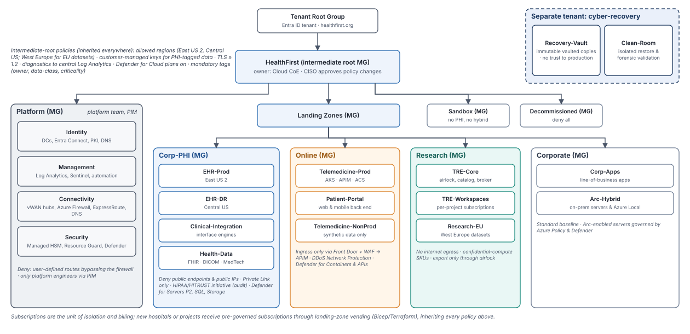
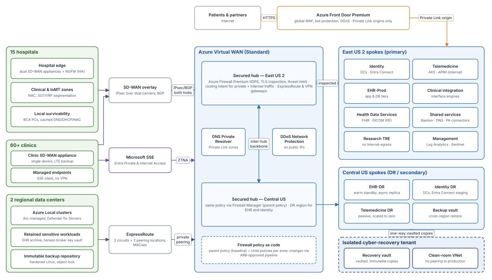
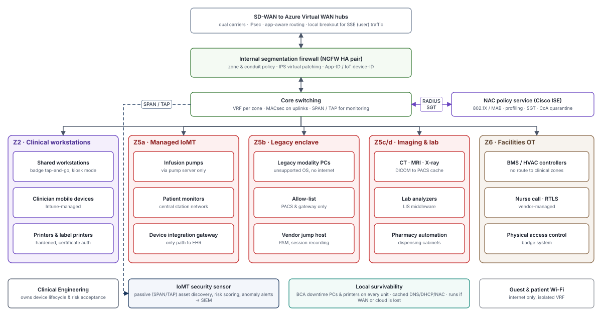
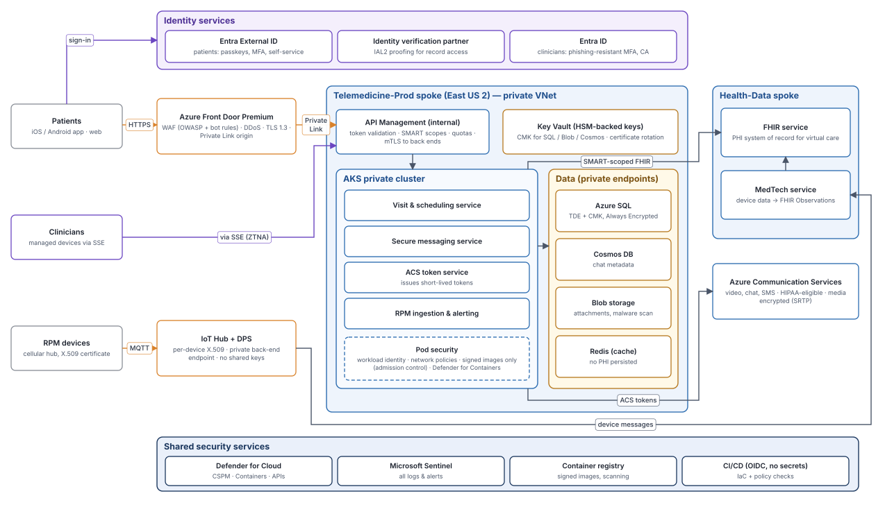
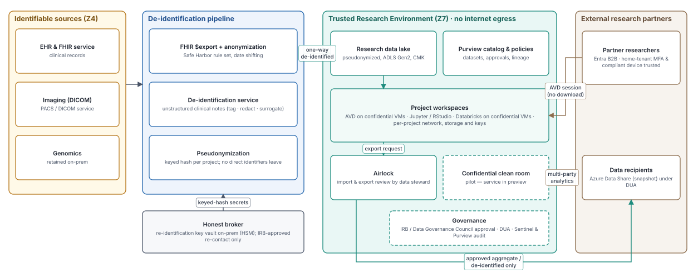
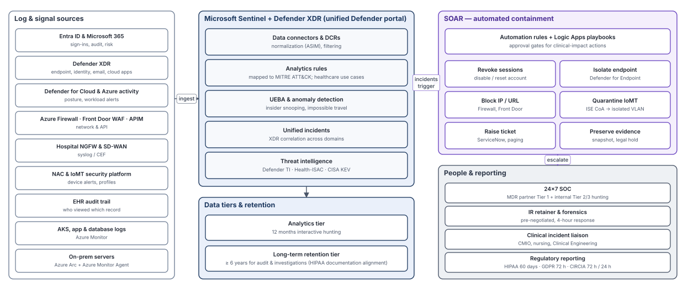
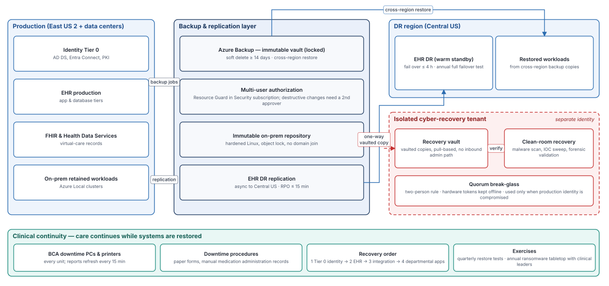

# HealthFirst Network — Enterprise Security Architecture

## Document 3 of 4 · Physical Architecture and Technology Specification

**Phase 3 — Physical and Component-Level Architecture Design (SABSA Physical and Component layers)**

| | |
|---|---|
| **Course** | Cybersecurity Architecture and Engineering — Group Project (CCSE, University of Jeddah, Fall 2026) |
| **Scenario** | Scenario 1 — Healthcare Sector: HealthFirst Network |
| **Team** | Rayan Ameen Kurdi (2440795) · Yazan Tareq Alhazmi (2440370) |
| **Version / date** | 1.0 · November 2026 |
| **Classification** | Academic work — HealthFirst Network is a fictional organization |

### Document control

| Version | Date | Author(s) | Change |
|---|---|---|---|
| 0.1 | Week 5 | All architects | Landing zones, network and hospital site design |
| 0.5 | Week 6 | All architects | Component designs, technology specification, standards |
| 1.0 | Nov 2026 | All architects | Baseline approved by ARB for implementation planning |

**Companion documents:** (1) Business and Security Strategy · (2) Conceptual and Logical Architecture · (4) Security Architecture Governance and Assessment Plan · Final Architecture Review Presentation.

---

## Executive summary

This document specifies **how and with what** HealthFirst's Zero Trust architecture is built. It implements the 39 logical security services, 11 zones and 12 conduits of Document 2 across three environments: Microsoft Azure (East US 2 primary, Central US secondary, West Europe for EU-resident datasets only), two consolidated on-premises data centers running Azure Local under Azure Arc management, and the 15 hospitals and 60+ clinics.

**Platform strategy.** A Microsoft-native security platform — Entra ID, Defender XDR, Sentinel, Purview and Defender for Cloud — provides one identity and signal fabric for Zero Trust decisions across Azure, Microsoft 365 and on-premises servers. Specialist products are added only where healthcare needs exceed the platform: an IoMT security platform, network access control, hospital segmentation firewalls, a PAM broker for vendor access, clinical single sign-on and immutable on-premises backup. Every selection records the alternatives considered.

**Key physical design decisions**

- **Landing zones and policy-as-code**: a management-group hierarchy (Platform, Corp-PHI, Online, Research, Corporate) in which ePHI workloads physically *cannot* be deployed with public endpoints, platform-managed keys or outside approved regions.
- **Network**: Azure Virtual WAN with two secured hubs and routing intent, so that *all* private and Internet traffic is inspected by Azure Firewall Premium; ExpressRoute Direct with MACsec from both data centers; SD-WAN to every site; no VPN for users.
- **Hospital sites**: an internal segmentation firewall, VRF-per-zone core, Cisco ISE network access control and passive IoMT sensors implement the device sub-zones without touching medical devices; local survivability keeps care going if the WAN or cloud fails.
- **Platforms**: telemedicine on a private AKS cluster behind Front Door and API Management; FHIR data in Azure Health Data Services (Azure API for FHIR was retired on 30 September 2026); research in an isolated Trusted Research Environment on confidential computing.
- **Resilience**: locked immutable backup vaults with multi-user authorization, cross-region disaster recovery, and an isolated cyber-recovery tenant with a clean-room environment.

The **technology specification (Section 4)** lists 38 components, each mapped to its Zero Trust pillar, zone, control objective, HIPAA safeguard and NIST CSF 2.0 outcome. The **standards (Section 5)** fix cryptography, authentication, logging and patching baselines. Indicative run costs fit the $13.8 million-per-year envelope approved in Document 1.

---

## 1. Introduction

### 1.1 Purpose and scope

This is the Phase 3 deliverable. It completes the SABSA **physical** layer (mechanisms, infrastructure, rules) and **component** layer (products, configurations, standards) and corresponds to TOGAF ADM Phases D (Technology Architecture) and E (Opportunities and Solutions). It is the design basis for implementation; operational governance and assessment are in Document 4.

### 1.2 Design inputs

| Input | Source |
|---|---|
| Logical service catalogue (39 services) | Doc 2, §6.1 |
| Zones Z0–Z10, conduits C1–C12, IoMT sub-zones 5a–5d | Doc 2, §5 |
| Persona assurance levels (IAL / AAL / FAL) | Doc 2, §3.4 |
| Representative access policies AP-1 to AP-10 | Doc 2, §4.2 |
| Resilience tiers T0–T3 (RTO / RPO) | Doc 2, §6.6 |
| Threat-model requirements (token protection, RPM plausibility, legacy-protocol blocking, sensor health, Tier 0 sync servers) | Doc 2, §7.6 |
| Healthcare design constraints K1–K8 | Doc 2, §2.2 |
| Investment envelope ($41.4 M over 3 years) | Doc 1, §8.5 |

---

## 2. Physical architecture overview

### 2.1 Hosting strategy and workload placement

| Workload | Placement | Region / site | Zone | Rationale |
|---|---|---|---|---|
| EHR production (application and database tiers) | Azure IaaS, Corp-PHI landing zone (vendor reference architecture) | East US 2 (3 availability zones) | Z3 / Z4 | Brief (Azure for EHR); zone redundancy for availability ≥ 99.95 % |
| EHR disaster recovery | Azure IaaS warm standby | Central US (paired region) | Z3 / Z4 | Regional failure tolerance; RPO ≤ 15 min |
| EHR reporting and analytics databases | Azure SQL Managed Instance (private endpoint) | East US 2 | Z4 | Managed PaaS; CMK; auditing |
| Clinical integration engine | Azure VMs + a device integration gateway in each hospital | East US 2 + hospitals | Z3 / Z5 | Central routing; device data exits only via gateways |
| FHIR, DICOM and device-data services | Azure Health Data Services | East US 2 | Z3 / Z4 | Managed, HIPAA-eligible FHIR R4; replaces the retired Azure API for FHIR |
| Telemedicine platform | AKS, API Management, Communication Services (Online landing zone) | East US 2 (passive DR in Central US) | Z1 / Z3 | Elastic scale; cloud-native security controls |
| Patient identity | Microsoft Entra External ID (separate tenant) | U.S. data location | Z1 | Consumer identity isolated from workforce (ADR-03) |
| Research TRE | Azure Research landing zone | East US 2; West Europe (EU datasets) | Z7 | Isolation; residency (GDPR) |
| Legacy EHR archives (read-only), genomic raw data, honest-broker re-identification vault | On-premises Azure Local clusters | Two regional data centers | Z4 | Brief (sensitive data stays on-premises); volume; key separation (ADR-05) |
| Imaging long-term archive | On-premises near-line storage with cloud DR copy | Data centers | Z4 | Volume and latency to modalities |
| Hospital-local services | Device gateways, PACS cache, NAC service nodes, downtime PCs | Each hospital | Z2 / Z5 | Clinical latency; local survivability (K4) |
| Identity and security tooling | Entra ID, Defender XDR, Purview (SaaS); Sentinel (Management subscription) | Microsoft cloud; East US 2 | Z9 | Single control plane |
| Corporate applications | Microsoft 365, SaaS ERP / HR | SaaS | Z8 | Standard SaaS |
| Backup vaulted copies and clean room | Separate cyber-recovery Entra tenant and subscription | Central US | Z10 | Survive production identity compromise (ADR-06) |

### 2.2 Azure landing zones

*Figure 3.1 — Azure landing zones: management-group hierarchy, subscriptions, inherited policy and the isolated cyber-recovery tenant.*

The hierarchy follows the Microsoft Cloud Adoption Framework landing-zone pattern. Subscriptions are the unit of isolation; landing-zone "vending" (Bicep / Terraform pipelines) gives a new hospital or research project a pre-governed subscription in days rather than weeks (attribute A17 *Scalable*).

**Policy assignments (policy-as-code guardrails)**

| Guardrail | Scope | Effect | Requirement / risk addressed |
|---|---|---|---|
| Allowed locations: East US 2, Central US; West Europe for Research-EU only | HealthFirst MG | Deny | GDPR residency (K6) |
| Customer-managed keys required for Storage, SQL, Cosmos DB, managed disks and Health Data Services where `data-class=PHI` | Corp-PHI, Online, Research | Deny | CO-05; HITECH encryption safe harbor (ADR-07) |
| Public network access disabled on PaaS services (Storage, SQL, Key Vault, Cosmos DB, Health Data Services, ACR) | Corp-PHI, Online, Research | Deny | R07 cloud misconfiguration |
| No public IP addresses on network interfaces | Corp-PHI, Research | Deny | R07; Zero Trust conduits |
| Private endpoints with private DNS zone integration | Landing Zones MG | DeployIfNotExists | Conduit C4 |
| Diagnostic settings to central Log Analytics / Sentinel | HealthFirst MG | DeployIfNotExists | HIPAA §164.312(b) audit controls |
| Defender for Cloud plans enabled | HealthFirst MG | DeployIfNotExists | CO-07, CO-09 |
| Minimum TLS 1.2 on all services; HTTPS only | HealthFirst MG | Deny / Modify | HIPAA §164.312(e)(1) |
| Mandatory tags: owner, data-class, criticality tier, residency | HealthFirst MG | Deny | Asset management (ID.AM-05) |
| Built-in initiatives: Microsoft cloud security benchmark, HIPAA HITRUST, NIST SP 800-53 Rev. 5 | HealthFirst MG | Audit | Continuous compliance evidence (CO-10) |
| Confidential-computing VM SKUs only; no outbound Internet | Research MG | Deny | ADR-05; R08 |
| Backup with immutable vault required for tier-tagged VMs | Landing Zones MG | DeployIfNotExists | CO-08 |
| Deny user-defined routes that bypass the hub firewall | Platform, Landing Zones | Deny | Conduit integrity |

### 2.3 Network and connectivity

*Figure 3.2 — Hybrid network topology: sites, data centers, Virtual WAN secured hubs, spokes and Internet edge.*

| Element | Design | Security function |
|---|---|---|
| Azure Virtual WAN (Standard) | Two secured hubs (East US 2, Central US); hub-to-hub over the Microsoft backbone | Scales to 75+ sites with any-to-any routing; chosen over manual hub-and-spoke to reduce routing errors at this scale |
| Azure Firewall Premium in each hub | **Routing intent** for private and Internet traffic; parent policy (enterprise baseline) with child policies per zone via Firewall Manager; IDPS in alert-and-deny; TLS inspection of outbound workload traffic; threat-intelligence filtering; FQDN allow-lists | Enforces conduits C2–C11 for every east-west and north-south flow, including on-premises ↔ cloud |
| ExpressRoute Direct | 2 × 10 Gbps ports per data center at two peering locations; MACsec encryption on the ports | Private, encrypted, redundant hybrid link (R12) |
| SD-WAN | Dual-carrier SD-WAN at all hospitals and clinics with IPsec and BGP to both hubs; LTE backup at clinics; local breakout only for SSE and Microsoft 365 traffic | Encrypted site connectivity; resilient to carrier failure |
| Microsoft SSE (Entra Private Access / Internet Access) | Client on managed devices; Private Access connectors in the Shared Services spoke and both data centers; web content filtering and TLS inspection policies | ZTNA replaces VPN (ADR-01); egress control for users |
| Private Link and DNS | Private endpoints for all PaaS data services; Azure DNS Private Resolver in hubs; private DNS zones; protective DNS via SSE and firewall DNS proxy | No public data paths; malicious-domain blocking |
| Azure Front Door Premium | Global WAF (default rule set + bot manager), DDoS absorption, TLS 1.2+, managed certificates, **Private Link origins only** | Edge PEP for patient and partner traffic (Z1) |
| DDoS Network Protection | Plan on all regional public IPs (gateways) | R11 |
| Network security groups and application security groups | Micro-segmentation inside spokes (e.g., EHR web ↔ app ↔ database tiers) | Limits lateral movement within a zone |

**IP addressing (non-overlapping RFC 1918 plan)**

| Range | Use |
|---|---|
| 10.0.0.0/11 | Azure East US 2 (hubs and spokes) |
| 10.32.0.0/11 | Azure Central US |
| 10.64.0.0/10 | Hospitals (one /16 per hospital; one VRF block per zone) |
| 10.128.0.0/11 | Clinics (/22 per clinic) |
| 10.160.0.0/12 | Data centers |
| 10.176.0.0/12 | West Europe and reserved for growth / acquisitions |
| Separate address space | Cyber-recovery tenant (no routing to production) |

### 2.4 Hospital site reference architecture

*Figure 3.3 — Hospital site reference architecture: segmentation, NAC, IoMT sub-zones, monitoring and local survivability.*

Every hospital is built from the same reference design (principle P10):

- **Segmentation:** an internal segmentation firewall (NGFW high-availability pair) routes between zones; the core switches carry one VRF per zone (Z2, Z5a–d, Z6, guest), so no traffic can pass between zones without firewall inspection. Uplinks use MACsec.
- **Network access control:** Cisco ISE policy service nodes (two per hospital, with central administration) authenticate users and devices with 802.1X (EAP-TLS) where supported, and MAB plus behavioral profiling elsewhere. ISE assigns a TrustSec security group tag per device class and can quarantine a device through change-of-authorization when the SOC requests it.
- **Wireless:** WPA3-Enterprise (EAP-TLS) for workforce SSIDs; a device SSID with per-device keys for medical devices that cannot do 802.1X; an Internet-only guest SSID in its own VRF.
- **IoMT monitoring:** passive sensors receive SPAN/TAP copies from the core and feed the IoMT security platform; alerts and device risk scores flow to Sentinel and to ISE.
- **Clinical Engineering** owns device onboarding approval, risk acceptance for legacy devices, and the joint SOC runbook for device incidents.
- **Local survivability (K4):** read-only business-continuity-access (BCA) PCs and printers on every unit, on UPS, refreshing downtime reports every 15 minutes; cached individual credentials (no shared accounts, K5); local DNS, DHCP and NAC policy cache. Care continues if the WAN or cloud is lost.

---

## 3. Component designs

### 3.1 Identity and access

**Tenant design.** (1) Workforce tenant `healthfirst.org`; (2) Entra External ID tenant for patients; (3) isolated cyber-recovery tenant. Hybrid identity keeps on-premises AD DS for legacy applications and devices, synchronized with Entra Connect using password hash synchronization; **AD FS is retired** (ADR-02). The Entra Connect servers are managed as Tier 0 assets.

**Authentication methods by persona**

| Persona | Allowed methods | Disabled methods |
|---|---|---|
| Workforce on managed devices | Windows Hello for Business; FIDO2 security keys; passkeys in Microsoft Authenticator | SMS, voice, email OTP |
| Clinicians at shared workstations | Badge tap + PIN (clinical SSO bound to the individual's Entra identity) | Shared or generic accounts |
| Privileged administrators | FIDO2 hardware security keys (AAL3), from privileged access workstations only | All non-phishing-resistant methods |
| Patients | Passkeys; email one-time code fallback with risk checks; IAL2 proofing via verification partner for full record and proxy access | SMS where passkeys are available |
| Research partners | Home-tenant MFA accepted through cross-tenant trust only if phishing-resistant | — |
| Medical devices | EAP-TLS certificates where supported; MAB plus profiling | — |
| Workloads | Managed identities; workload identity federation | Client secrets (exception-only, vaulted, ≤ 90-day rotation) |

**Conditional Access baseline (physical implementation of AP-1 to AP-10)**

| Policy | Scope | Control |
|---|---|---|
| CA01 | All admin roles | Phishing-resistant authentication strength + compliant PAW device filter |
| CA02 | All users, all cloud apps | Phishing-resistant MFA authentication strength (exceptions: break-glass accounts only) |
| CA03 | EHR, Microsoft 365, clinical apps | Require compliant or hybrid-joined device for full access |
| CA04 | Unmanaged devices | EHR only through Azure Virtual Desktop; Defender for Cloud Apps session control (no download, watermark) |
| CA05 | All users | Block legacy authentication protocols |
| CA06 | All users | High user risk → secure password change with phishing-resistant MFA; high sign-in risk → block |
| CA07 | All users | Block countries outside the allowed list (travel exceptions via time-bound group) |
| CA08 | Supported desktop apps | Token protection (sign-in session binding) |
| CA09 | Critical apps | Continuous access evaluation, strict location enforcement |
| CA10 | B2B guests | MFA and device trust inherited from approved partner tenants; access only to TRE and assigned resources |
| CA11 | Workload identities | Restrict service principals to known network locations |
| CA12 | Session lifetime | Sign-in frequency: admins 4 h; unmanaged devices 12 h; persistent sessions only on compliant devices |
| CA13 | All users | Block device-code flow and authentication transfer except approved scenarios |
| CA14 | Emergency access | Two break-glass accounts excluded from all policies; FIDO2 keys in separate safes; Sentinel alert on any use; quarterly test |

**Privileged access.** All Entra and Azure privileged roles are *eligible*, never permanent, through Privileged Identity Management: maximum activation 4 hours, approval for Global Administrator, Privileged Role Administrator and production Owner, hardware-key MFA on activation. Tier 0 administration only from Intune-managed privileged access workstations. Azure Bastion for VM access; **CyberArk Privileged Access** (selected over BeyondTrust after RFP scoring; both met requirements) vaults on-premises privileged credentials and brokers vendor remote access with ticket-based JIT and session recording. Windows LAPS on all endpoints and servers; tiering GPOs prevent Tier 0 credentials on lower tiers; **Defender for Identity** sensors on domain controllers, AD CS and Entra Connect servers.

**Identity governance.** HR (Workday) inbound provisioning and lifecycle workflows automate joiner–mover–leaver. Access packages model roles ("ICU nurse — Hospital 7", "Research project R-0425"). Access reviews: quarterly for workforce and B2B guests, monthly for privileged roles. Separation-of-duties checks block toxic combinations (for example, payment approval with vendor master-data maintenance).

**Clinical single sign-on.** Imprivata provides badge tap-and-go with PIN and fast user switching on shared Windows 11 workstations, integrated with Entra ID and the EHR — the physical answer to constraint K1 and attribute A3 (*Usable*: sign-in ≤ 5 seconds).

**Patients.** Entra External ID with passkeys, bot and fraud protection, and an identity-verification partner for IAL2 proofing before full record or proxy access. (Azure AD B2C is not used: it has been closed to new customers since 1 May 2025.)

**Partners.** Entra B2B with cross-tenant access settings trusting MFA and compliant-device claims from the ≈ 25 approved partner tenants only; entitlement management grants time-bound TRE project access tied to IRB approval.

### 3.2 Endpoints and clinical workstations

| Control | Configuration |
|---|---|
| Management | Microsoft Intune for Windows, macOS, iOS, Android; Windows Autopilot provisioning |
| Hardening | Microsoft security baselines and CIS Benchmarks; BitLocker (XTS-AES 256) with recovery keys escrowed; Credential Guard and LSA protection; Secure Boot and TPM attestation |
| EDR | Microsoft Defender for Endpoint P2: attack-surface-reduction rules, tamper protection, network protection, automated investigation, device isolation |
| Application control | App Control for Business on shared clinical workstations and kiosks |
| Shared clinical devices | Shared-device mode with fast user switching through clinical SSO; no local ePHI caching beyond EHR client requirements |
| Unmanaged access | Azure Virtual Desktop (Windows 11 multi-session, Entra-joined): screen-capture protection, watermarking, clipboard and drive redirection disabled |
| Local admin | Windows LAPS; no standing local admin rights |

### 3.3 IoMT and medical devices

**IoMT security platform.** Selected: **Claroty xDome (Medigate)**, shortlisted against Armis Centrix and Microsoft Defender for IoT. Selection criteria (weighted): depth of the medical-device protocol and model library (25 %), passive discovery without device impact (20 %), MDS2 / SBOM ingestion and vulnerability correlation (15 %), integration with ISE, the hospital firewalls and Sentinel (20 %), clinical-workflow features such as utilization and recall tracking (10 %), cost (10 %). One or more passive sensors per hospital, scaled by traffic.

**Segmentation policy (implemented as ISE security group tags + firewall rules)**

| Device class (sub-zone) | Allowed destinations | Blocked |
|---|---|---|
| Infusion pumps (5a) | Manufacturer pump server (drug libraries, logs); integration gateway | Internet; other device classes; user zones |
| Patient monitors (5a) | Central station; integration gateway | Internet; user zones |
| Legacy modality PCs (5b) | PACS; modality worklist; vendor jump host (on approval) | Everything else, including SMB to other zones |
| Imaging modalities (5c) | PACS (DICOM, TLS where supported); worklist | Internet; user zones |
| Lab analyzers and dispensing cabinets (5d) | LIS middleware; pharmacy server | Internet; other device classes |
| Unknown / new devices | Onboarding segment until profiled and approved | All production zones |

**Legacy protective enclave (5b).** Strict allow-lists; IPS virtual-patching signatures for known vulnerabilities; SMBv1 and other legacy protocols blocked at the zone boundary (threat-model item I-08); a dedicated jump host reachable only through the PAM broker; each device has a funded replacement date in the asset register.

**Procurement and lifecycle.** New connected devices must provide an MDS2 form, an SBOM and a vulnerability-management plan (aligned with FD&C Act §524B and the June 2025 FDA premarket guidance); contracts include patch timelines, coordinated vulnerability disclosure and at least 24 months' end-of-support notice; devices are security-tested before go-live and sanitized on retirement (NIST SP 800-88).

### 3.4 EHR platform on Azure

| Layer | Physical design | Security controls |
|---|---|---|
| Presentation | EHR client delivered through hospital workstations and AVD host pools in both regions | Conditional Access; clinical SSO; AVD protections |
| Web / API | EHR web and API servers behind internal load balancers; external APIs exposed only via API Management | WAF policies on internal gateways; mTLS; SMART on FHIR scopes |
| Application | VMs spread across three availability zones | Defender for Servers P2 (file-integrity monitoring, JIT VM access, vulnerability assessment); NSG/ASG micro-segmentation |
| Database | High-memory VMs with Premium SSD v2 / Azure NetApp Files per vendor guidance; reporting on Azure SQL Managed Instance | Encryption at host and disk encryption sets with CMK; TDE with CMK; database auditing |
| DR | Database-native asynchronous replication + Azure Site Recovery for the application tier to Central US | RPO ≤ 15 min; RTO ≤ 4 h; annual full failover test |
| Audit and privacy | EHR access audit trail streamed to a patient-privacy monitoring platform and to Sentinel | Inappropriate-access analytics; ≥ 6-year retention |
| Downtime | BCA servers and PCs receive scheduled report extracts | Read-only; individual cached credentials |

### 3.5 Telemedicine platform

*Figure 3.4 — Telemedicine platform physical architecture.*

| Component | Configuration | Security function |
|---|---|---|
| Azure Front Door Premium | WAF (default rule set, bot manager), rate limits, Private Link origin to API Management | Edge PEP; DDoS absorption (T-01, T-03) |
| Entra External ID / Entra ID | Patients: passkeys and IAL2 proofing; clinicians: phishing-resistant MFA, compliant device | Authentication (T-01, T-08) |
| API Management (Premium, internal VNet) | JWT validation, SMART scopes, quotas, mTLS to back ends, request/response validation | API PEP (T-02, T-04) |
| AKS private cluster | Azure CNI with network policies; workload identity; image signing with admission control; Defender for Containers | Workload protection (T-05) |
| Data tier | Azure SQL (TDE + CMK, Always Encrypted for identifiers), Cosmos DB, Blob storage with malware scanning, Redis without persisted PHI — all private endpoints | Data protection (T-06) |
| Key Vault | HSM-backed keys; certificate auto-rotation; RBAC; purge protection | Key management |
| Azure Communication Services | Short-lived per-participant tokens issued by the token service; virtual lobby; encrypted media | Virtual visit confidentiality (T-07); covered by Microsoft BAA |
| IoT Hub + Device Provisioning Service | Per-device X.509 identity; private endpoint for back-end; no shared access keys | RPM device authenticity (T-09) |
| Health Data Services (FHIR, MedTech) | Device data mapped to FHIR Observations; plausibility rules in alerting; clinician confirmation workflow | Clinical data integrity (T-09) |
| Shared security services | Defender for Cloud (CSPM, Containers, APIs); Sentinel; container registry with scanning; CI/CD with OIDC | Posture, detection, supply chain |

### 3.6 Research data-sharing platform

*Figure 3.5 — Research Trusted Research Environment and data-sharing architecture.*

| Component | Design |
|---|---|
| De-identification pipeline | FHIR `$export` with an anonymization configuration (Safe Harbor rule set, date shifting); the Azure Health Data Services **de-identification service** (generally available since November 2024) for unstructured clinical notes; keyed-hash pseudonymization with per-project keys |
| Honest broker | Re-identification key vault on-premises in an HSM, operated by the research compliance office; re-identification only for IRB-approved purposes |
| Trusted Research Environment | Azure TRE (open-source accelerator): per-project workspaces with dedicated network, storage and keys; no Internet egress |
| Compute | AVD on confidential VMs (AMD SEV-SNP or Intel TDX) for interactive work; Databricks on confidential VMs for large-scale analytics (protection of data in use, CSF PR.DS-10) |
| Airlock | All imports and exports reviewed by a data steward; exports limited to approved aggregate or de-identified results |
| Partners | Entra B2B; work inside AVD sessions; no download |
| Outbound sharing | Azure Data Share (snapshot) of approved de-identified datasets to partners under a DUA |
| Clean rooms | Azure Confidential Clean Rooms evaluated as a **pilot only** — the service is still in preview; not used for production data until generally available and assessed |
| Governance | Purview catalog and access policies; IRB and Data Governance Council approvals recorded as access-package prerequisites; Sentinel monitoring |

### 3.7 Data protection

**Microsoft Purview configuration**

| Capability | Configuration |
|---|---|
| Sensitivity labels | Public · Internal · Confidential · Highly Confidential — PHI · Highly Confidential — Special handling · Research — De-identified (Doc 2, Section 6.3); label inheritance into Office files, Teams and Power BI |
| Auto-labeling | Built-in sensitive-information types (U.S. SSN, driver's license) plus custom types for medical record numbers, health-plan IDs, ICD-10 and drug terms; trainable classifiers for clinical documents |
| DLP | Exchange, SharePoint/OneDrive, Teams, endpoint and Defender for Cloud Apps; block external sharing of PHI-labeled content except to approved partner domains; endpoint DLP blocks copy to USB and personal cloud |
| Insider risk management | Data-theft-by-departing-users and patient-data-misuse policies fed by HR and EHR audit connectors; privacy-preserving pseudonymized investigation |
| Data Map and catalog | Scanning of Azure SQL, ADLS, Cosmos DB and on-premises SQL via self-hosted integration runtime; residency and classification metadata |
| Audit | Purview Audit (Premium) with long-term retention aligned to ≥ 6 years for ePHI-related records |

**Key management.** Azure Key Vault **Managed HSM** (FIPS 140-validated, Level 3) holds key-encryption keys per security domain, with the HSM security domain split between three custodians (quorum of two). Key Vault Premium holds application keys and certificates. Purge protection and soft delete are mandatory; RBAC separates key officers from key users; key-encryption keys rotate annually; Always Encrypted with secure enclaves protects identifiers such as SSNs inside databases.

### 3.8 Security operations

*Figure 3.6 — Security operations architecture: sources, Sentinel and Defender XDR, SOAR, retention and people.*

| Element | Design |
|---|---|
| SIEM platform | Microsoft Sentinel onboarded to the unified Defender portal (Sentinel management in the Azure portal is being retired on 31 March 2027); primary workspace in East US 2; separate West Europe workspace for EU-resident research logs |
| Ingestion | Azure Monitor Agent with data-collection rules (filtering at source); Arc-enabled servers on-premises; syslog/CEF collectors for firewalls, NAC and IoMT platform; EHR audit connector. Estimated 600–900 GB/day on a commitment tier |
| Analytics | Microsoft content-hub rules plus custom healthcare use cases (Doc 2, Section 6.5); ASIM normalization; UEBA; ATT&CK coverage tracked |
| Automation | Automation rules and Logic Apps playbooks: revoke Entra sessions, isolate device (MDE), block indicators (Azure Firewall, Front Door WAF), quarantine IoMT device (ISE change-of-authorization via API), ServiceNow ticket, evidence snapshot — with approval gates for clinical assets (K8) |
| Retention | 12 months interactive analytics; long-term retention tier ≥ 6 years for audit-relevant logs |
| People | 24×7 SOC: MDR partner Tier 1, internal Tier 2/3 hunting and engineering; IR retainer (4-hour response); clinical incident liaison; Health-ISAC membership |

### 3.9 Resilience and recovery

*Figure 3.7 — Ransomware resilience and recovery architecture.*

**Backup policy by tier**

| Tier | Frequency | Retention | Immutability and isolation | Recovery test |
|---|---|---|---|---|
| T0 control plane | Daily full + frequent incremental; offline AD backups | 35 days (daily), 12 months (monthly) | Locked immutable vault; vaulted copy in cyber-recovery tenant | Quarterly AD forest recovery exercise in clean room |
| T1 clinical critical | Continuous replication + daily backup + 4-hourly log backups | 35 days / 12 months / 7 years (annual) | Locked immutable vault, MUA, GRS; vaulted copy | Quarterly restore; annual full regional failover |
| T2 clinical important | Daily | 35 days / 12 months | Immutable vault | Semi-annual restore |
| T3 business | Daily (SaaS backup for Microsoft 365) | 35 days / 12 months | Immutable vault | Annual restore |

Destructive operations on vaults (disabling soft delete, reducing retention, deleting backup items) require a second approver through **multi-user authorization**, with the Resource Guard held in the Security subscription under separate administrators. The **cyber-recovery tenant** pulls vaulted copies; it has its own identities, no network peering to production, and quorum-based break-glass access. After a destructive attack, systems are restored into the clean room, scanned for indicators of compromise, validated, and only then returned to production in tier order.

### 3.10 Application security and DevSecOps

GitHub Enterprise with Advanced Security (code scanning, secret scanning with push protection, dependency review); **OIDC workload identity federation** from pipelines to Azure (no stored secrets); infrastructure-as-code scanned against policy before deployment; container images signed and verified at admission in AKS; SBOM generated for every release; Defender for Cloud DevOps security for posture of repositories and pipelines; pre-production DAST and an independent penetration test before each major release.

---

## 4. Technology specification

| # | Capability | Selected technology | Key configuration / standard | ZT pillar | Zone | CO | HIPAA / CSF 2.0 | Alternatives considered → rationale |
|---|---|---|---|---|---|---|---|---|
| 1 | Workforce identity provider | Microsoft Entra ID P2 + Entra ID Governance | Cloud authentication, PHS, AD FS retired; CA01–CA14 | Identity | Z9 | CO-01, CO-02 | §164.312(a)(1), (d); PR.AA-01–05 | Okta → strong, but a second control plane beside Azure-native signals |
| 2 | Phishing-resistant authenticators | Windows Hello for Business; FIDO2 keys; passkeys | AAL2 phishing-resistant (workforce); AAL3 (admins) | Identity | Z2 | CO-01 | §164.312(d); PR.AA-03 | SMS / OTP → phishable; rejected |
| 3 | Clinical SSO | Imprivata | Badge tap + PIN; fast user switching | Identity | Z2 | CO-01 | §164.312(a)(2)(i), (iii) | OS shared-PC mode only → too slow for clinical use |
| 4 | Patient identity (CIAM) | Entra External ID + identity-verification partner | Passkeys; IAL2 for full record | Identity | Z1 | CO-01 | §164.312(d); PR.AA-02 | Azure AD B2C → closed to new customers |
| 5 | Partner federation | Entra B2B, cross-tenant access, entitlement management | Partner MFA/device trust; time-bound packages | Identity | Z1, Z7 | CO-01, CO-02 | §164.308(a)(4); PR.AA-05 | Local partner accounts → orphan risk |
| 6 | Cloud privileged access | Entra PIM + PAWs + Azure Bastion | Eligible-only roles; 4-h activation | Identity | Z9 | CO-02 | §164.308(a)(3)–(4); PR.AA-05 | — |
| 7 | PAM and vendor access | CyberArk Privileged Access | Vaulting, JIT, recording, ticket integration | Identity | Z1, Z9 | CO-02, CO-09 | §164.308(b); GV.SC-05; PR.AA-05 | BeyondTrust → also compliant; scored lower on IoMT vendor workflows |
| 8 | Directory threat detection | Defender for Identity | Sensors on DCs, AD CS, Entra Connect | Identity | Z9 | CO-07 | §164.308(a)(1)(ii)(D); DE.CM-03 | — |
| 9 | Endpoint management | Microsoft Intune | Baselines, compliance, shared-device mode | Devices | Z2 | CO-03 | §164.310(b)–(c); PR.PS-01 | — |
| 10 | EDR / XDR | Defender for Endpoint P2 (Defender XDR) | ASR, tamper protection, isolation | Devices | Z2, Z3 | CO-03, CO-07 | §164.308(a)(5)(ii)(B); DE.CM-09 | CrowdStrike → excellent; weaker native risk signal into Conditional Access |
| 11 | IoMT security platform | Claroty xDome (Medigate) | Passive sensors; risk scoring; ISE/NGFW/Sentinel integration | Devices | Z5 | CO-03, CO-11 | §164.308(a)(1)(ii)(A); ID.AM-01; DE.CM-01 | Armis, Defender for IoT → weighted RFP (Section 3.3) |
| 12 | Network access control | Cisco ISE + TrustSec | 802.1X EAP-TLS / MAB + profiling; SGT; CoA | Devices / Networks | Z2, Z5 | CO-03, CO-04 | §164.312(a)(1); PR.AA-03; PR.IR-01 | Aruba ClearPass → comparable; Cisco installed base |
| 13 | ZTNA and SWG | Entra Private Access / Internet Access | Per-app access; connectors; web filtering | Networks | Z1 | CO-04 | §164.312(e)(1); PR.IR-01 | Zscaler → strong; separate policy plane |
| 14 | Cloud network security | Virtual WAN secured hubs + Azure Firewall Premium + Firewall Manager | Routing intent; IDPS; TLS inspection | Networks | Platform | CO-04 | §164.312(e)(1); PR.IR-01; DE.CM-01 | Third-party NVAs in hubs → more operational overhead |
| 15 | Hospital segmentation firewalls | NGFW HA pair per hospital (Palo Alto Networks with medical-IoT device identification; Fortinet as RFP alternative) | Zone/conduit policy; IPS virtual patching | Networks | Z5, Z6 | CO-04, CO-11 | §164.312(a)(1); PR.IR-01 | Switch ACLs only → no application or device awareness |
| 16 | SD-WAN | Enterprise SD-WAN integrated with Virtual WAN (RFP) | Dual carrier; IPsec; BGP | Networks | — | CO-04, CO-08 | §164.312(e)(1); PR.IR-03 | MPLS → costly, slow to change |
| 17 | Hybrid connectivity | ExpressRoute Direct with MACsec | 2 × 10 Gbps per DC, two peering locations | Networks | — | CO-05, CO-08 | §164.312(e)(2)(ii); PR.DS-02 | Site-to-site VPN only → insufficient bandwidth |
| 18 | Edge protection | Azure Front Door Premium + WAF; DDoS Network Protection | Default rule set + bot manager; Private Link origins | Networks | Z1 | CO-04 | PR.IR-01; PR.IR-04 | Third-party CDN/WAF → extra vendor |
| 19 | API gateway | Azure API Management (Premium, internal) | JWT, SMART scopes, quotas, mTLS | Apps | Z1, Z3 | CO-04, CO-09 | §164.312(c)(1), (e)(1); PR.PS-06 | — |
| 20 | Clinical data platform | Azure Health Data Services (FHIR R4, DICOM, MedTech, de-identification) | Private endpoints; SMART on FHIR; AuditEvent; CMK | Apps / Data | Z3, Z4 | CO-05, CO-06 | §164.312(b)–(c); PR.DS-01 | Azure API for FHIR → retired 30 Sep 2026 |
| 21 | Telemedicine runtime | AKS private cluster + Azure Communication Services | Workload identity; network policy; signed images | Apps | Z3 | CO-09 | PR.PS-01; PR.PS-06 | App Service Environment v3 → simpler, less flexible |
| 22 | Cloud posture and workload protection | Defender for Cloud (CSPM, Servers P2, SQL, Storage, Containers, Key Vault, APIs, Resource Manager) | Regulatory compliance dashboards | Apps | All Azure | CO-09, CO-10 | §164.308(a)(8); ID.RA-01; PR.PS-01 | — |
| 23 | Policy-as-code | Azure Policy + landing-zone accelerator (Bicep / Terraform) | Guardrails in Section 2.2 | Govern | All | CO-10 | §164.316; GV.PO-01 | Manual reviews → do not scale |
| 24 | Classification, DLP, insider risk | Microsoft Purview | Labels, auto-labeling, DLP, IRM, Audit Premium | Data | All | CO-05, CO-06, CO-12 | §164.312(b)–(c); PR.DS-01; ID.AM-07 | — |
| 25 | Key management | Key Vault Managed HSM + Key Vault Premium | CMK; annual rotation; quorum custodians | Data | Z4, Z9 | CO-05 | §164.312(a)(2)(iv), (e)(2)(ii); PR.DS-01 | Platform-managed keys → less control |
| 26 | Confidential computing | Azure confidential VMs; AVD on confidential VMs | AMD SEV-SNP / Intel TDX | Data | Z7 | CO-05 | PR.DS-10 | — |
| 27 | Research platform | Azure TRE + Azure Data Share + Databricks on confidential VMs; Confidential Clean Rooms (pilot) | Airlock; per-project isolation | Data | Z7 | CO-06 | §164.514(b); GDPR Art. 89 | Identifiable data in research → rejected (ADR-05) |
| 28 | SIEM | Microsoft Sentinel (Defender portal) | 12-month analytics; ≥ 6-year retention | Visibility | Z9 | CO-07, CO-12 | §164.308(a)(1)(ii)(D); §164.312(b); DE.CM; DE.AE | Splunk → strong; higher cost, separate from XDR |
| 29 | SOAR | Sentinel automation + Logic Apps | Clinical approval gates | Automation | Z9 | CO-07 | RS.MI-01 | — |
| 30 | MDR and incident response | MDR partner + IR retainer | 24×7 Tier 1; 4-h response | Visibility | — | CO-07 | §164.308(a)(6); RS.MA-01 | In-house only → staffing gap |
| 31 | EHR privacy monitoring | Patient-privacy monitoring platform (e.g., Protenus) | Inappropriate-access analytics → Sentinel | Visibility | Z3 | CO-12 | §164.308(a)(1)(ii)(D) | Manual sampling → insufficient |
| 32 | Email security | Defender for Office 365 P2; DMARC `p=reject` | Safe Links / Attachments; impersonation protection | Identity / Apps | Z1 | CO-01, CO-07 | §164.308(a)(5)(ii)(B) | — |
| 33 | Cloud backup | Azure Backup (locked immutable vault, soft delete, MUA) | Cross-region restore; vaulted copy | Resilience | Z10 | CO-08 | §164.308(a)(7)(ii)(A); PR.DS-11 | — |
| 34 | On-premises backup | Veeam with hardened Linux repository + vaulted copy | Object lock; not domain-joined | Resilience | Z10 | CO-08 | §164.308(a)(7); PR.DS-11 | Rubrik / Cohesity → comparable |
| 35 | DR orchestration | Azure Site Recovery + database-native replication | RPO ≤ 15 min; annual failover | Resilience | Z3, Z4 | CO-08 | §164.308(a)(7)(ii)(B); RC.RP-01 | — |
| 36 | Hybrid management | Azure Arc + Azure Local + Azure Update Manager | Defender for Servers; guest configuration | Apps | DCs | CO-09, CO-10 | PR.PS-02 | — |
| 37 | DevSecOps | GitHub Enterprise + Advanced Security; OIDC to Azure | Signed images; IaC scanning; SBOM | Apps | Z9 | CO-09 | PR.PS-06 | — |
| 38 | Vulnerability and exposure management | Defender Vulnerability Management + IoMT vulnerability correlation + Defender EASM | KEV-driven SLAs (Section 5) | All | — | CO-09 | §164.308(a)(1)(ii)(B); ID.RA-01 | — |

---

## 5. Security standards and configuration baselines

| Area | Standard |
|---|---|
| **Cryptography** | TLS 1.2 minimum, TLS 1.3 preferred; TLS 1.0/1.1 and SSL disabled; ECDHE key exchange with AES-GCM suites; HSTS on web endpoints; AES-256 at rest; RSA ≥ 3072-bit or ECC P-256+ for new keys; FIPS 140-validated modules for all ePHI encryption (HITECH safe harbor); crypto inventory and agility plan for post-quantum migration (NIST FIPS 203–205, August 2024) |
| **Authentication** | NIST SP 800-63B-4: phishing-resistant MFA for workforce; no forced periodic password changes without evidence of compromise; passwords ≥ 15 characters when used alone and ≥ 8 when used within MFA; breached-password blocklist; no composition rules |
| **Configuration baselines** | CIS Benchmarks and Microsoft security baselines (Windows 11, Windows Server, Linux); Microsoft cloud security benchmark for Azure services; AKS baseline and CIS Kubernetes; network-device hardening guides |
| **Logging** | All PEPs, identity, endpoints, servers, cloud control plane, databases and EHR audit logs centralized; NTP from trusted sources; 12 months interactive and ≥ 6 years long-term retention for audit-relevant logs; immutable log storage |
| **Vulnerability remediation** | CISA KEV: ≤ 72 h internet-facing, ≤ 7 days internal; critical (CVSS ≥ 9.0) ≤ 15 days; high ≤ 30 days; medium ≤ 90 days; medical devices: compensating control within 7 days, patch after manufacturer validation |
| **Keys and certificates** | KEKs rotated annually; TLS certificates auto-renewed (preparing for shorter public certificate lifetimes); secrets replaced by managed identities, residual secrets rotated ≤ 90 days |
| **Sessions** | Shared workstations: lock on badge tap-out or 10 min inactivity; privileged sessions ≤ 4 h; patient app access tokens ≤ 60 min with rotating refresh tokens; idle web sessions 30 min |
| **Backups** | Immutable, encrypted, at least one isolated vaulted copy; restore tests per tier (Section 3.9) |
| **Secure development** | OWASP ASVS Level 2 (patient-facing apps; Level 3 for authentication components); threat model before build; SAST, SCA and secret scanning on every commit; DAST before release |

---

## 6. HIPAA technical safeguards implemented by component

| HIPAA §164.312 standard / specification | Physical implementation |
|---|---|
| (a)(1) Access control — (i) Unique user identification (R) | Entra ID individual identities; clinical SSO on shared workstations; no shared accounts |
| (a)(2)(ii) Emergency access procedure (R) | EHR break-the-glass; break-glass cloud accounts (CA14) |
| (a)(2)(iii) Automatic logoff (A) | Badge tap-out and inactivity lock; session lifetimes (CA12) |
| (a)(2)(iv) Encryption and decryption (A) | CMK encryption via Managed HSM; BitLocker; TDE; Always Encrypted |
| (b) Audit controls (R) | Sentinel; EHR audit trail; Purview Audit; ≥ 6-year retention |
| (c)(1) Integrity; (c)(2) mechanism to authenticate ePHI (A) | Database integrity features, file-integrity monitoring, signed images, immutable backups, FHIR versioning |
| (d) Person or entity authentication (R) | Phishing-resistant MFA; device certificates; workload identities |
| (e)(1) Transmission security; (e)(2)(i) integrity controls (A); (e)(2)(ii) encryption (A) | TLS 1.2+/1.3; IPsec SD-WAN; MACsec on ExpressRoute and hospital uplinks; Private Link |

The complete mapping of all HIPAA administrative, physical, technical, organizational and documentation requirements is in Document 4, Section 4.1.

---

## 7. Hybrid and multi-cloud consistency

HealthFirst's primary cloud is Azure, but the architecture must enforce the same policy across Azure, two on-premises data centers, SaaS and the clouds used by research partners or future acquisitions:

| Challenge | Mechanism |
|---|---|
| Consistent policy on-premises | Azure Arc projects on-premises servers and Azure Local clusters into Azure Policy, Defender for Servers and Update Manager |
| Consistent posture across clouds | Defender for Cloud multi-cloud connectors (AWS, GCP) for any acquired or partner-hosted workload that processes HealthFirst data |
| One identity plane | Entra ID for workforce everywhere; SCIM provisioning to SaaS; B2B for partners |
| Consistent network policy | Firewall Manager parent/child policies across both hubs; hospital NGFW policies generated from the same conduit catalogue |
| Data residency | Allowed-location policies; residency tags; separate EU workspaces |
| Interoperability standards | FHIR R4, HL7 v2, DICOM, SMART on FHIR, OIDC/SAML, SCIM — no proprietary integration that bypasses the API gateway |

---

## 8. Cost and scalability

**Indicative annual run-rate of the incremental security architecture** (planning estimates, to be confirmed by vendor quotations and enterprise agreements):

| Cost driver | Sizing assumption | Indicative annual cost ($M) |
|---|---|---|
| SIEM ingestion and retention | 600–900 GB/day commitment tier; long-term retention | 1.8–2.4 |
| MDR service and IR retainer | 24×7 coverage for ≈ 60,000 endpoints and servers | 1.4–1.8 |
| Identity uplift (governance, ZTNA/SWG, workload identities) | ≈ 44,000 users | 1.2–1.5 |
| Defender for Cloud plans | ≈ 3,000 servers plus PaaS and containers | 0.8–1.0 |
| Network security (Azure Firewall Premium ×2, Front Door Premium, DDoS, hospital NGFW subscriptions) | 2 hubs; 15 hospitals | 1.5–1.9 |
| NAC and IoMT security platform | ≈ 100,000 endpoints; ≈ 48,000 medical devices | 1.3–1.6 |
| PAM and clinical SSO | ≈ 1,800 privileged/vendor users; ≈ 30,000 clinical users | 1.0–1.2 |
| Resilience (immutable backup storage, vaulted copies, DR test environments) | Tier 0–3 data | 1.2–1.5 |
| Purview, Managed HSM, DevSecOps tooling | Enterprise | 0.8–1.0 |
| Assurance and people (architects, pen tests, HITRUST, training) | Program | 1.2–1.4 |
| **Total (full run-rate, Year 3)** | | **≈ 12.2–15.3** (mid-point ≈ 13.8 — consistent with the Document 1 envelope; Year 1 is lower while capabilities ramp up, offset by one-time deployment services) |

**Scalability.** New hospitals reuse the site reference design and receive a governed landing zone in ≤ 30 days; Virtual WAN scales hubs and branches without redesign; AKS and Front Door scale telemedicine elastically; Sentinel commitment tiers scale with ingestion; IoMT sensors scale per hospital.

---

## 9. Implementation and transition architectures

| Transition architecture | Target date | State |
|---|---|---|
| **TA-1 Foundations** | Month 6–9 | Landing zones and policy-as-code live; Virtual WAN hubs; phishing-resistant MFA for admins and remote access; CA baseline; Sentinel + Defender XDR + MDR; immutable vaults and cyber-recovery tenant; BCA PCs in all hospitals |
| **TA-2 Transformation** | Month 15–18 | EHR consolidated on Azure (go-live waves); ZTNA live and VPN decommissioned; PAM and tiering; Purview labels and DLP; NAC and IoMT sensors in all hospitals with sub-zones in 10 of 15; telemedicine launched |
| **TA-3 Target** | Month 30 | All hospitals segmented; research TRE and data sharing; confidential computing; automation maturity; HITRUST r2 certification; CISA ZTMM "Advanced" across pillars |

**Key dependencies:** EHR vendor's Azure hosting approval; ExpressRoute provisioning lead times (3–6 months); Clinical Engineering capacity for device onboarding; workforce change management for passwordless and badge sign-in.

---

## 10. Residual risks and open issues

| Item | Description | Treatment |
|---|---|---|
| MAB spoofing for legacy devices | Devices without 802.1X can be impersonated (I-01) | Profiling and anomaly detection; segment limits; replacement plan (residual Medium, accepted by Clinical Engineering and CISO) |
| Token replay in the patient app | Sender-constrained tokens not universally supported (T-04) | Short lifetimes, rotation, anomaly detection; revisit annually |
| Platform concentration | Heavy reliance on one security vendor | Specialist tools where risk is highest; exit plan and data portability for logs (open formats) |
| Preview services | Confidential Clean Rooms not generally available | Pilot only; production use gated by ARB |
| TLS inspection side-effects | Some clinical and device traffic breaks under inspection | Documented exclusions approved by the ARB with compensating monitoring |
| Clinician adoption | Badge and passwordless changes workflows | Clinical champions, phased rollout, usability KPIs (A3) |

## References

1. Microsoft. *Cloud Adoption Framework — Azure landing zones*; *Azure Virtual WAN routing intent and routing policies*; *Azure Firewall Premium features* (Microsoft Learn).
2. Microsoft. "FAQ about migration from Azure API for FHIR" (retirement 30 September 2026). https://learn.microsoft.com/en-us/azure/healthcare-apis/fhir/migration-faq
3. Microsoft. "Generally Available: Azure Health Data Services de-identification service" (November 2024). https://mc.merill.net/message/AZ470517
4. Microsoft. "Azure Confidential Clean Rooms" (preview status). https://learn.microsoft.com/en-gb/Azure/confidential-computing/confidential-clean-rooms
5. Microsoft. Azure AD B2C FAQ — end of sale to new customers, 1 May 2025. https://learn.microsoft.com/lb-lu/AZURE/active-directory-b2c/faq
6. Microsoft. "What's new in Microsoft unified security operations" (Sentinel in the Azure portal retired 31 March 2027). https://learn.microsoft.com/unified-secops/whats-new
7. Microsoft. *Microsoft cloud security benchmark*; *Conditional Access authentication strengths and token protection*; *Privileged Identity Management*; *Azure Backup immutable vaults and multi-user authorization* (Microsoft Learn).
8. Microsoft. *Azure Trusted Research Environment* (open-source accelerator), https://github.com/microsoft/AzureTRE
9. NIST SP 800-63B-4, *Authentication and Authenticator Management*, July 2025.
10. NIST FIPS 203, 204, 205 (post-quantum cryptography standards), August 2024.
11. NIST SP 800-88, *Guidelines for Media Sanitization*.
12. U.S. FDA. *Cybersecurity in Medical Devices: Quality System Considerations and Content of Premarket Submissions*, June 2025.
13. CIS Benchmarks; OWASP ASVS 4.0; CISA Known Exploited Vulnerabilities catalogue.
14. HHS. *Guidance to Render Unsecured PHI Unusable, Unreadable, or Indecipherable to Unauthorized Individuals* (encryption safe harbor).
