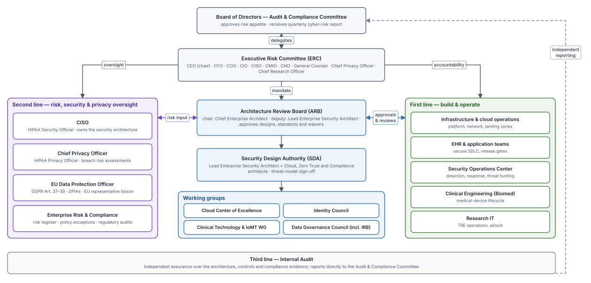
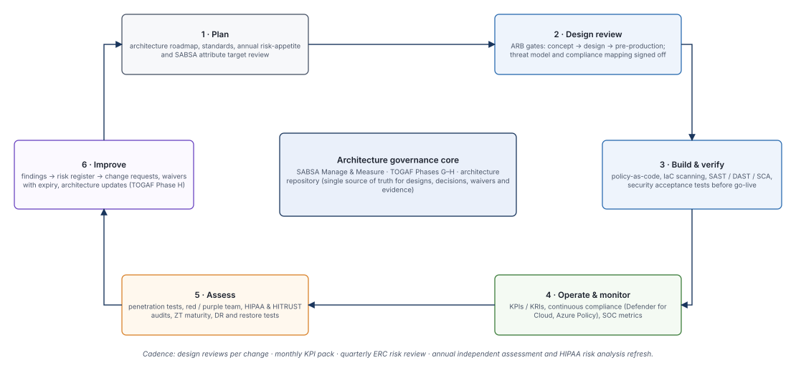
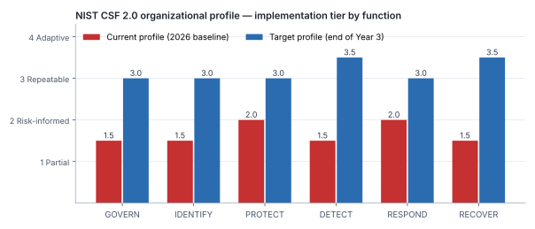
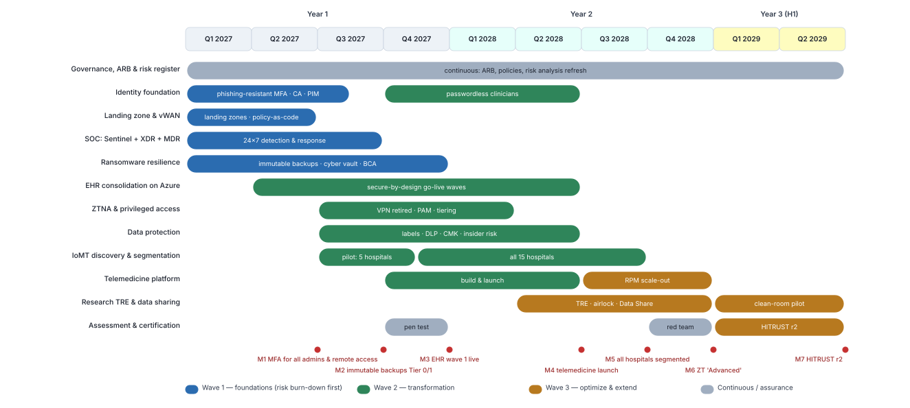

# HealthFirst Network — Enterprise Security Architecture

## Document 4 of 4 · Security Architecture Governance and Assessment Plan

**Phase 4 — Architecture Assessment and Governance (SABSA Service Management layer; TOGAF Phases F–H)**

| | |
|---|---|
| **Course** | Cybersecurity Architecture and Engineering — Group Project (CCSE, University of Jeddah, Fall 2026) |
| **Scenario** | Scenario 1 — Healthcare Sector: HealthFirst Network |
| **Team** | Rayan Ameen Kurdi (2440795) · Yazan Tareq Alhazmi (2440370) |
| **Version / date** | 1.0 · November 2026 |
| **Classification** | Academic work — HealthFirst Network is a fictional organization |

### Document control

| Version | Date | Author(s) | Change |
|---|---|---|---|
| 0.1 | Week 7 | All architects | Governance framework, RACI, policy architecture |
| 0.5 | Week 8 | All architects | Assessment plan, metrics, compliance mapping and gap analysis |
| 1.0 | Nov 2026 | All architects | Final; submitted with the Architecture Review Presentation |

**Companion documents:** (1) Business and Security Strategy · (2) Conceptual and Logical Architecture · (3) Physical Architecture and Technology Specification · Final Architecture Review Presentation.

---

## Executive summary

An architecture is only as good as its upkeep. Without governance, HealthFirst's Zero Trust design would erode within two years through exceptions, shortcuts and unreviewed changes — the same drift that created today's fragmented estate. This document defines how the architecture is **governed, assessed, proven compliant and improved**.

**Governance.** Authority flows from the Board's Audit & Compliance Committee through an Executive Risk Committee to an **Architecture Review Board (ARB)** and a **Security Design Authority (SDA)**, supported by four working groups. Responsibilities follow the three-lines model: operations build and run controls; risk, security and privacy oversee them; Internal Audit independently assures them. Every change that touches ePHI, clinical systems or medical devices passes ARB gates, and every exception expires.

**Assessment.** Eighteen assessment methods — from design reviews and continuous control monitoring to red-team exercises, restore tests and an annual HIPAA compliance audit — run on a fixed annual calendar. They measure the 18 SABSA business attributes from Document 1 through KPIs with green/amber/red thresholds, plus key risk indicators that warn before a risk materializes. Zero Trust maturity is reassessed annually against CISA ZTMM targets, and the NIST CSF 2.0 profile annually against the target tiers.

**Compliance.** The complete **HIPAA Security Rule traceability matrix** (all 18 standards and 36 implementation specifications, plus organizational and documentation requirements) shows every requirement met by a designed control, with evidence sources. HITECH, GDPR and NIST CSF 2.0 are mapped the same way, and the design is checked against the Azure Well-Architected security checklist and all 17 domains of the CSA Cloud Controls Matrix. The design already satisfies **all 17 major proposals in the January 2025 HIPAA Security Rule NPRM**; three need contractual or process updates rather than technology. A gap analysis converts the current-state findings into 12 funded remediation items.

**Delivery.** A 30-month, three-wave roadmap with seven executive milestones (M1–M7) sequences the work by risk reduction, starting with identity, detection and recoverability.

---

## 1. Introduction

### 1.1 Purpose and scope

This is the Phase 4 deliverable (1.1). It completes the SABSA **service management** layer — assurance of operational continuity, operational risk management, security service management, user and application management, platform security management and the operations schedule — and covers TOGAF ADM Phases F (Migration Planning), G (Implementation Governance) and H (Architecture Change Management). The Final Architecture Review Presentation (deliverable 1.2) summarizes all four documents for executive and technical stakeholders.

### 1.2 Objectives

1. Establish decision rights, roles and processes that keep the architecture aligned with business objectives and risk appetite.
2. Define how architecture compliance, control effectiveness and maturity are assessed, by whom and how often.
3. Demonstrate, with traceable evidence, how the architecture meets HIPAA, HITECH, GDPR and NIST CSF 2.0 — and the proposed HIPAA Security Rule changes.
4. Measure the business attributes and report them to leaders in business language.
5. Govern the delivery roadmap and continuous improvement.

---

## 2. Governance framework

### 2.1 Governance principles

| # | Principle | Meaning in practice |
|---|---|---|
| G1 | Business owns risk; security advises | Executives accept residual risk within the authority matrix (Doc 1, Section 5); the CISO never accepts business risk alone |
| G2 | One design authority | The ARB is the only body that approves designs, standards and exceptions affecting ePHI |
| G3 | Traceability or no approval | Designs must trace to business drivers and attributes (SABSA golden thread) |
| G4 | Exceptions expire | Every waiver is time-bound with compensating controls and an owner |
| G5 | Evidence by default | Controls produce machine-readable evidence; compliance is continuous, not annual |
| G6 | Independent assurance | Internal Audit and external assessors test what the first and second lines report |
| G7 | Clinical voice in security decisions | CMIO, CNO and Clinical Engineering sit on the ARB and the risk committee |

### 2.2 Governance structure

*Figure 4.1 — Security architecture governance structure and the three lines model.*

| Body | Chair / members | Mandate | Cadence | Escalates to |
|---|---|---|---|---|
| Board — Audit & Compliance Committee | Independent directors | Approves risk appetite and tolerance; receives cyber-risk and attribute dashboard; oversees Internal Audit | Quarterly | — |
| Executive Risk Committee (ERC) | CEO (chair), CFO, COO, CIO, CISO, CMIO, CNO, General Counsel, CPO, CRO | Accepts High residual risks; approves program funding and priorities; reviews FAIR loss-exceedance curve | Monthly | Board |
| Architecture Review Board (ARB) | Chief Enterprise Architect (chair), Lead Enterprise Security Architect (deputy), CMIO delegate, Clinical Engineering, Privacy, Infrastructure, Applications | Approves designs at gates; owns principles and standards; approves Medium-risk exceptions; architecture compliance reviews | Bi-weekly | ERC |
| Security Design Authority (SDA) | Lead Enterprise Security Architect; Cloud, Zero Trust and Compliance architects | Security reference architectures, patterns, threat-model sign-off, ZT maturity assessment, standards maintenance | Weekly | ARB |
| Cloud Center of Excellence | Cloud platform lead | Landing zones, policy-as-code, cost and posture | Weekly | SDA |
| Identity Council | IAM lead, HR, CMIO delegate | Identity lifecycle, roles, access reviews, authentication policy | Monthly | SDA |
| Clinical Technology & IoMT WG | Clinical Engineering director, nursing informatics, SOC | Device onboarding, segmentation policy, legacy risk acceptance, vendor access | Monthly | ARB |
| Data Governance Council | CPO, DPO, CRO, IRB chair, data stewards | Classification, research data release, DPIAs, residency | Monthly | ARB / ERC |

**HIPAA and GDPR designated roles.** The CISO is the HIPAA Security Official (§164.308(a)(2)); the Chief Privacy Officer is the HIPAA Privacy Official; an EU Data Protection Officer (GDPR Art. 37) and an EU representative (Art. 27) are appointed for EU processing.

### 2.3 RACI matrix

R = Responsible, A = Accountable, C = Consulted, I = Informed.

| Activity | Board | ERC | CISO | CIO | CMIO/CNO | CPO | DPO | ARB | SDA | Clin. Eng. | CRO/IRB | Int. Audit | System owner |
|---|---|---|---|---|---|---|---|---|---|---|---|---|---|
| Approve risk appetite and tolerance | A | R | C | C | C | C | I | I | I | I | I | C | I |
| Approve architecture principles and standards | I | A | C | C | C | C | C | R | R | C | C | I | I |
| Approve solution designs touching ePHI | — | I | C | C | C | C | C | A | R | C | C | I | R |
| Accept High residual risk | I | A | R | C | C | C | C | C | C | C | C | I | R |
| Accept Medium residual risk / approve exceptions | — | I | A | C | C | C | C | R | C | C | C | I | R |
| Maintain security policies | I | A | R | C | C | R | C | C | R | C | C | I | I |
| Operate security controls | — | I | A | R | I | I | I | I | C | R | I | I | R |
| Detect and respond to incidents | — | I | A | R | C | C | C | I | C | C | I | I | C |
| Decide on breach notification (HIPAA / GDPR / CIRCIA) | I | A | R | C | C | R | R | I | I | I | I | I | C |
| Medical-device risk acceptance | — | I | C | C | A | I | I | C | C | R | I | I | C |
| Release of research datasets | — | I | C | I | I | C | C | I | C | I | A | I | R |
| Third-party / BA risk assessment | — | I | A | C | I | C | C | I | C | C | C | I | R |
| Annual HIPAA compliance audit | I | I | C | C | I | C | C | I | C | C | I | A/R | C |
| Zero Trust maturity assessment | I | I | A | C | I | I | I | C | R | C | I | C | C |

### 2.4 Policy architecture

| Policy | Owner | Key standards it governs | Review | HIPAA reference |
|---|---|---|---|---|
| Enterprise information security policy | CISO | Framework, roles, risk management | Annual | §164.308(a)(1), (a)(2) |
| Identity and access management | CISO / IAM lead | Authentication standard, Conditional Access baseline, access reviews | Annual | §164.308(a)(3)–(4); §164.312(a), (d) |
| Privileged access | CISO | Tiering, PAW, PIM, PAM, break-glass | Annual | §164.308(a)(4) |
| Clinical access and privacy (incl. break-the-glass) | CMIO / CPO | EHR role design, sensitive records, sanctions | Annual | §164.308(a)(1)(ii)(C); §164.312(a)(2)(ii) |
| Medical-device security | Clinical Engineering | Onboarding, segmentation, procurement (MDS2/SBOM), vendor access | Annual | §164.310(d) |
| Data classification and handling | CPO | Labels, DLP, retention, disposal | Annual | §164.310(d)(2); §164.312(c) |
| Cryptography and key management | CISO | Doc 3, Section 5 standards | Annual | §164.312(a)(2)(iv), (e)(2)(ii) |
| Cloud security | CIO / CCoE | Landing zones, policy-as-code guardrails | Semi-annual | §164.308(a)(1) |
| Network security and segmentation | CIO | Zones, conduits, firewall rule lifecycle | Annual | §164.312(e) |
| Secure development | CIO | SDLC gates, ASVS levels, pipeline controls | Annual | §164.308(a)(1)(ii)(B) |
| Logging and monitoring | CISO | Log sources, retention, use cases | Annual | §164.312(b) |
| Incident response and breach notification | CISO / General Counsel | Playbooks, legal clocks, communications | Semi-annual + after incidents | §164.308(a)(6); §§164.400–414 |
| Backup, DR and clinical continuity | CIO | Tiers, RTO/RPO, test schedule, downtime procedures | Annual | §164.308(a)(7) |
| Third-party and business-associate security | CISO / Procurement | Vendor tiers, BAA security clauses, annual verification | Annual | §164.308(b); §164.314 |
| Research data governance | CRO / CPO | De-identification, TRE, airlock, DUA | Annual | §164.514 |
| Vulnerability and patch management | CIO | SLAs (Doc 3, Section 5) | Annual | §164.308(a)(1)(ii)(B) |
| Acceptable use and awareness | CISO / CHRO | Training, phishing simulation | Annual | §164.308(a)(5) |

All policies, procedures and assessments are retained for at least six years from creation or last effective date (§164.316(b)(2)(i)).

### 2.5 Architecture lifecycle and change management

*Figure 4.2 — Architecture governance and assessment lifecycle.*

**ARB gates (TOGAF Phase G implementation governance)**

| Gate | When | Required artifacts | Possible outcomes |
|---|---|---|---|
| G1 Concept | Before funding | Business case; SABSA traceability (driver → attribute); data classification; initial privacy screening | Approve / approve with conditions / reject |
| G2 Design | Before build | Logical and physical design; zone placement and conduits; threat model (STRIDE + ATT&CK); compliance mapping; DPIA if EU data | Approve / conditions / redesign |
| G3 Pre-production | Before go-live | Security test results (SAST/DAST/pen test as applicable); configuration compliance; runbooks; backup and restore test; logging verified | Go / go with time-bound waiver / no-go |
| G4 Post-implementation | 90 days after go-live | KPI evidence; incidents; residual risk confirmation | Close / remediation actions |

**Architecture compliance levels** (TOGAF) are recorded for each reviewed project: *Fully conformant*, *Conformant*, *Compliant*, *Consistent*, *Irrelevant* or *Non-conformant*. Non-conformant designs cannot pass G2 without an approved exception.

**Change classification (TOGAF Phase H)**

| Change type | Example | Governance route |
|---|---|---|
| Simplification change | Firewall rule clean-up; retiring a legacy app | Standard change management; SDA notified |
| Incremental change | New clinic onboarded with the reference design; new conduit | ARB light review (G2/G3 combined) |
| Re-architecting change | New cloud provider; new patient-facing platform; major regulation (e.g., final HIPAA Security Rule) | Full ADM cycle starting at Phase A; ERC informed |

### 2.6 Exception (waiver) management

1. **Request** — system owner documents the deviation, business justification and duration.
2. **Assess** — SDA rates the risk (likelihood × impact); a FAIR estimate is required if potential loss exceeds $1 million.
3. **Compensate** — compensating controls are defined and verified (for example, enclave isolation for an unpatchable device).
4. **Approve** — according to the residual-risk acceptance authority (Doc 1, Section 5); maximum 12 months.
5. **Track** — exceptions sit in the risk register with automatic reminders 30 days before expiry; expired exceptions are reported to the ERC as non-compliance.
6. **Review** — quarterly ARB review of all open exceptions; KRI "exceptions past expiry" target = 0.

### 2.7 Third-party and business-associate governance

| Vendor tier | Criteria | Assessment | Contractual requirements |
|---|---|---|---|
| Tier 1 — critical | Access to ePHI at scale, clinical systems, medical devices or network | Annual security assessment plus continuous external monitoring; evidence of technical safeguards | BAA with security schedule; breach notice ≤ 24 h to HealthFirst; contingency-plan activation notice ≤ 24 h; right to audit; MFA for all access; SBOM for software and devices |
| Tier 2 — significant | Limited ePHI or important services | Biennial assessment; questionnaire with evidence | BAA; breach notice ≤ 72 h; MFA |
| Tier 3 — low | No ePHI, no network access | Onboarding due diligence | Standard security terms |

Vendor remote access is permitted only through the PAM broker (Doc 3, Section 3.1). Microsoft's HIPAA BAA covers the in-scope Azure, Microsoft 365 and Dynamics services used; services outside BAA scope cannot store ePHI (enforced through ARB review and policy).

### 2.8 Architecture repository and documentation standards

The architecture is maintained "as code": Markdown documents, draw.io diagrams (editable `.drawio` sources and embedded SVG), architecture decision records, threat models and policy-as-code definitions live in a version-controlled repository. Changes are made through reviewed pull requests approved by the SDA; released versions are published to the intranet; the repository is the authoritative source for auditors and the single source of truth referred to in Figure 4.2.

---

## 3. Security architecture assessment plan

### 3.1 Objectives and scope

The assessment plan answers three questions continuously: **Is the architecture being followed?** (compliance), **Do the controls work?** (effectiveness), and **Is the business protected as intended?** (outcomes against attributes and risk appetite). Scope covers all zones Z0–Z10, all 15 hospitals and 60+ clinics, both data centers, all Azure landing zones, SaaS services holding ePHI and Tier 1 vendors.

### 3.2 Assessment methods

| # | Method | Scope | Frequency | Performed by | Output | Reference |
|---|---|---|---|---|---|---|
| A1 | ARB design and architecture-compliance review | Every change touching ePHI, clinical systems or devices | Per change (gates G1–G4) | ARB / SDA (2nd line) | Approval, conditions, compliance level | TOGAF |
| A2 | Threat-model review | New or changed systems and data flows | Per major release | SDA with product teams | Updated threat model and requirements | STRIDE, ATT&CK |
| A3 | Continuous control monitoring | Azure, Microsoft 365, Arc-enabled on-premises | Continuous; monthly report | CCoE and SOC (1st line), reviewed by 2nd line | Secure score, policy compliance, regulatory dashboards | MCSB; HIPAA HITRUST initiative |
| A4 | Vulnerability scanning | All IT assets; IoMT via passive correlation | Continuous; authenticated scans at least monthly; external weekly | Security operations | Remediation tracking against SLAs | NPRM (≥ every 6 months) |
| A5 | Penetration testing | External perimeter, internal network, cloud configuration, telemedicine apps and APIs, IoMT (in lab) | Annually and before major releases | Independent firm | Report, retest evidence | NPRM (≥ every 12 months); OWASP WSTG |
| A6 | Red team and purple team | End-to-end ransomware scenario; insider scenario | Red team annually; purple team quarterly | External red team with SOC | Detection and response gaps | MITRE ATT&CK |
| A7 | Breach and attack simulation | EDR, email, DLP, segmentation, egress | Weekly automated | Security operations | Control efficacy trend | — |
| A8 | Backup restore and DR tests | Tiers T0–T3 | Quarterly restores (T0/T1); annual regional failover; annual clean-room recovery | IT operations with SOC | Measured RTO / RPO | §164.308(a)(7)(ii)(D) |
| A9 | Tabletop exercises | Ransomware with clinical downtime; IoMT incident; research data leak; third-party outage | Semi-annual | ERC, clinical leaders, IR team | Lessons learned, plan updates | HHS / CISA exercise packages |
| A10 | HIPAA risk analysis refresh | Enterprise | Annual and on significant change | Risk & Compliance (2nd line) | Updated risk register and FAIR inputs | §164.308(a)(1)(ii)(A) |
| A11 | HIPAA compliance audit (evaluation) | All Security Rule standards | Annual | Internal Audit (3rd line) | Audit report and findings | §164.308(a)(8); NPRM |
| A12 | External certification | EHR and telemedicine platforms | HITRUST r2 biennial with interim assessment | External assessor | Certification | HITRUST CSF |
| A13 | Zero Trust maturity assessment | Five pillars and three cross-cutting capabilities | Annual (external validation every 2 years) | SDA | Maturity scores vs targets | CISA ZTMM v2.0 |
| A14 | NIST CSF 2.0 profile assessment | 22 categories | Annual | Risk & Compliance | Current vs target profile; HITECH RSP evidence | CSF 2.0; P.L. 116-321 |
| A15 | Third-party assessments | Tier 1 and 2 vendors | Annual / biennial | Vendor risk team | Ratings and remediation plans | GV.SC; NPRM BA verification |
| A16 | FAIR quantification refresh | Top loss scenarios | Quarterly | Risk team | Loss-exceedance curve vs tolerance | Doc 1, Section 7.5 |
| A17 | Phishing simulation and awareness | Workforce | Monthly simulation; annual training | Security awareness | Click and report rates | §164.308(a)(5) |
| A18 | EHR privacy access audits | EHR access logs | Continuous analytics; monthly review | Privacy office | Investigations and sanctions | §164.308(a)(1)(ii)(C)–(D) |

### 3.3 Annual assessment calendar

| Quarter | Planned assessments (in addition to continuous A3, A4, A7, A18 and monthly A17) |
|---|---|
| Q1 | A10 HIPAA risk analysis refresh · A16 FAIR refresh · A8 T0/T1 restore test · A6 purple team · A15 Tier 1 vendor assessments (first half) |
| Q2 | A5 external and internal penetration test · A9 tabletop (ransomware with clinical downtime) · A8 restore test · A16 · A6 purple team |
| Q3 | A11 HIPAA compliance audit (Internal Audit) · A13 ZT maturity · A14 CSF profile · A8 restore test and annual regional failover · A16 · A6 purple team |
| Q4 | A6 red-team exercise · A9 tabletop (IoMT or third-party outage) · A8 clean-room recovery exercise · A12 HITRUST interim or certification · A15 (second half) · A16 · Board annual report |

### 3.4 Architecture compliance review checklist (ARB)

| Area | Question the ARB must be able to answer "yes" to |
|---|---|
| Traceability | Does the design trace to business drivers, attributes and control objectives? |
| Principles | Does it follow principles P1–P12 or record an approved exception? |
| Identity | Are all human and workload identities from approved identity providers with the required assurance level? |
| Access | Is access per-session through a PEP, least-privilege and JIT for administration? |
| Zones | Is every component placed in a zone, and does every flow use an approved conduit? |
| Data | Is data classified; is ePHI encrypted with customer-managed keys; is residency respected? |
| Privacy | Has a privacy review / DPIA been completed where required? |
| Logging | Are all security-relevant events sent to the SIEM with the required retention? |
| Resilience | Is the system tiered, backed up immutably, and is its restore tested? |
| Devices | For medical devices: MDS2, SBOM, sub-zone and vendor-access route defined? |
| Vendors | Are BAAs and vendor-tier requirements in place? |
| Testing | Are the required security tests planned before go-live? |
| Operations | Are runbooks, monitoring use cases and owners defined? |
| Compliance | Is the HIPAA / GDPR / CSF mapping updated? |
| Cost | Are security run costs included in the business case? |

### 3.5 Zero Trust maturity assessment

Each pillar and cross-cutting capability is scored against the CISA ZTMM v2.0 stage descriptions (Traditional = 1, Initial = 2, Advanced = 3, Optimal = 4) using evidence (configuration exports, coverage metrics, test results), not self-declaration. The baseline and targets are in Document 2, Section 4.5 (Figure 2.3). Progress is judged at the level of functions: for example, the Identity pillar reaches *Advanced* only when phishing-resistant MFA covers ≥ 98 % of workforce sign-ins, identity risk is evaluated continuously, and access reviews are automated.

### 3.6 Testing scenarios

| Scenario | Method | Success criteria |
|---|---|---|
| Ransomware detonation in one hospital (assumed breach) | Red team + tabletop + restore | Containment within 4 h; no spread beyond the hospital's zones; EHR unaffected or restored ≤ 4 h; legal clocks started correctly |
| Stolen clinician credentials used from abroad | Purple team | Sign-in blocked; alert triaged ≤ 1 h |
| Malicious vendor session to infusion-pump server | Purple team | Session blocked without ticket; recorded; SOC alerted |
| Patient-portal credential-stuffing campaign | BAS / pen test | Bot protection and lockout prevent takeover; no data exposure |
| Public exposure of a storage account with PHI tag | Continuous control monitoring | Deployment denied by policy; drift detected ≤ 15 min |
| Total loss of WAN at one hospital | DR test | Downtime procedures active ≤ 15 min; BCA reports current |
| Destruction of production identity plane | Clean-room exercise | Directory and EHR restored from cyber-recovery tenant within T0/T1 objectives |

### 3.7 Metrics: KPIs and KRIs

**Key performance indicators (one or more per SABSA attribute)**

| Attribute (Doc 1) | KPI | Green | Amber | Red | Source | Frequency |
|---|---|---|---|---|---|---|
| A1 Available | EHR availability | ≥ 99.95 % | 99.9–99.95 % | < 99.9 % | Monitoring | Monthly |
| A2 Recoverable | Measured Tier 0/1 restore time in tests | ≤ 4 h | 4–8 h | > 8 h | DR test records | Quarterly |
| A3 Usable | Median clinician sign-in time at shared workstations | ≤ 5 s | 5–10 s | > 10 s | Clinical SSO telemetry | Monthly |
| A4 Accessible | Remote-access success rate | ≥ 99.5 % | 98–99.5 % | < 98 % | SSE logs | Monthly |
| A5 Authenticated | Workforce sign-ins with phishing-resistant MFA | ≥ 98 % | 90–98 % | < 90 % | Entra ID | Monthly |
| A6 Access-controlled | Standing privileged assignments | 0 | 1–5 | > 5 | PIM | Monthly |
| A7 Confidential | PHI data stores with CMK encryption | 100 % | 95–99 % | < 95 % | Azure Policy | Monthly |
| A8 Integrity-assured | Backups integrity-verified before restore | 100 % | — | < 100 % | Restore records | Quarterly |
| A9 Accountable | Shared clinical accounts in use | 0 | — | > 0 | Identity governance | Monthly |
| A10 Monitored | Crown-jewel log-source coverage / MTTD (high) | ≥ 98 % / ≤ 1 h | 95–98 % / 1–4 h | < 95 % / > 4 h | Sentinel | Monthly |
| A11 Interoperable | External integrations through the API gateway | 100 % | 95–99 % | < 95 % | APIM inventory | Quarterly |
| A12 Patient-safe | Connected devices discovered and profiled / legacy in enclaves | ≥ 98 % / 100 % | 95–98 % / 95–99 % | < 95 % | IoMT platform | Monthly |
| A13 Compliant | High audit findings open > 90 days | 0 | 1–2 | > 2 | Audit tracker | Monthly |
| A14 Privacy-respecting | Research releases without de-identification review | 0 | — | > 0 | Airlock records | Monthly |
| A15 Measured | Attributes with live KPI | 100 % | 90–99 % | < 90 % | Dashboard | Quarterly |
| A16 Cost-effective | ROSI (FAIR) | ≥ 100 % | 50–100 % | < 50 % | Risk model | Annual |
| A17 Scalable | Days to provision governed landing zone for a new site | ≤ 30 | 31–60 | > 60 | CCoE | Per event |
| A18 Legacy-sensitive | Unsupported systems without compensating controls | 0 | 1–5 | > 5 | CMDB | Monthly |

**Key risk indicators (early warning)**

| KRI | Threshold (red) | Linked risks |
|---|---|---|
| CISA KEV vulnerabilities past SLA | > 0 internet-facing; > 5 internal | R01, R09 |
| High-risk sign-ins not remediated in 24 h | > 10 per month | R01, R04, R14 |
| Privileged activations without matching change ticket | > 0 | R14 |
| Vendor sessions outside PAM broker | > 0 | R06 |
| Medical devices in quarantine or "unknown" segment > 7 days | > 50 | R03 |
| Exceptions past expiry | > 0 | All |
| High-severity DLP incidents involving ePHI | Upward trend 3 months | R02, R05 |
| EHR privacy alerts per 1,000 users | > 2× baseline | R05 |
| Backup job failures for T0/T1 | > 2 % per week | R01, R12 |
| Phishing-simulation click rate | > 5 % | R10 |
| Tier 1 vendors rated high risk without plan | > 0 | R06 |
| Probability of annual loss > $20 M (FAIR) | > 10 % | Appetite |

**Reporting.** Board (quarterly): attribute dashboard, FAIR loss-exceedance curve vs tolerance, top risks, major incidents. ERC (monthly): KPIs, KRIs, exceptions, program progress. ARB (bi-weekly): design pipeline and compliance levels. Operations (weekly / daily): SOC and vulnerability metrics.

---

## 4. Compliance mapping and gap analysis

Status legend — **Met (design)**: the architecture implements the requirement; **Met (process)**: met by a governed process defined in this document; **Wave n**: met when the roadmap wave completes.

### 4.1 HIPAA Security Rule traceability matrix

**Administrative safeguards — §164.308**

| Ref | Standard / implementation specification | R/A | HealthFirst control(s) | Evidence | Status |
|---|---|---|---|---|---|
| (a)(1)(i) | Security management process | R | Enterprise risk program (Doc 1, Section 7); ARB | Risk register; ERC minutes | Met (process) |
| (a)(1)(ii)(A) | Risk analysis | R | NIST SP 800-30 + FAIR, annual refresh (A10) | Risk analysis report | Met (process) |
| (a)(1)(ii)(B) | Risk management | R | Treatment plans; roadmap; vulnerability SLAs | Risk register; remediation tracking | Met (process) |
| (a)(1)(ii)(C) | Sanction policy | R | Clinical access and privacy policy with sanctions | HR sanction records | Met (process) |
| (a)(1)(ii)(D) | Information system activity review | R | Sentinel; EHR privacy monitoring (A18) | Review logs; investigations | Met (design) — Wave 1 |
| (a)(2) | Assigned security responsibility | R | CISO designated HIPAA Security Official | Appointment letter | Met (process) |
| (a)(3)(ii)(A) | Authorization and/or supervision | A | Role-based access packages; manager approvals | Access-package approvals | Met (design) |
| (a)(3)(ii)(B) | Workforce clearance procedure | A | HR screening; credentialing for medical staff | HR records | Met (process) |
| (a)(3)(ii)(C) | Termination procedures | A | Lifecycle workflows: removal ≤ 1 h (involuntary), same day otherwise | Deprovisioning logs | Met (design) — Wave 1 |
| (a)(4)(ii)(A) | Isolating health care clearinghouse functions | R | Not applicable — HealthFirst performs no clearinghouse function; clearinghouse partners are BAs in their own zone | Determination record | Met (N/A documented) |
| (a)(4)(ii)(B) | Access authorization | A | Identity governance; ABAC in EHR; PIM | Access reviews | Met (design) |
| (a)(4)(ii)(C) | Access establishment and modification | A | Joiner–mover–leaver automation; access reviews | Workflow logs | Met (design) |
| (a)(5)(ii)(A) | Security reminders | A | Awareness program; monthly phishing simulation | Training records | Met (process) |
| (a)(5)(ii)(B) | Protection from malicious software | A | Defender for Endpoint, Defender for Office 365, App Control | Coverage reports | Met (design) |
| (a)(5)(ii)(C) | Log-in monitoring | A | Entra ID Protection; Sentinel analytics | Alerts; reports | Met (design) |
| (a)(5)(ii)(D) | Password management | A | Phishing-resistant, passwordless authentication; NIST SP 800-63B-4 password rules where passwords remain | Authentication-method reports | Met (design) |
| (a)(6)(ii) | Security incident procedures — response and reporting | R | IR policy and playbooks; MDR; IR retainer; legal clocks | Incident records; tabletop reports | Met (process) |
| (a)(7)(ii)(A) | Data backup plan | R | Immutable vaults; vaulted copies (Doc 3, Section 3.9) | Backup reports | Met (design) — Wave 1 |
| (a)(7)(ii)(B) | Disaster recovery plan | R | Cross-region DR; clean-room recovery | DR plan; failover reports | Met (design) |
| (a)(7)(ii)(C) | Emergency mode operation plan | R | Clinical continuity: BCA PCs, downtime procedures; break-glass | Downtime drills | Met (design) |
| (a)(7)(ii)(D) | Testing and revision procedures | A | A8 quarterly/annual tests; A9 tabletops | Test reports | Met (process) |
| (a)(7)(ii)(E) | Applications and data criticality analysis | A | Business process criticality and tiers (Doc 1, Section 3.2; Doc 2, Section 6.6) | BIA | Met (process) |
| (a)(8) | Evaluation | R | Annual HIPAA compliance audit (A11); ARB reviews | Audit report | Met (process) |
| (b)(1) | Business associate contracts — written contract | R | BAAs with security schedule; vendor tiers (Section 2.7) | Contract register | Met (process) — Wave 1 update |

**Physical safeguards — §164.310**

| Ref | Standard / implementation specification | R/A | HealthFirst control(s) | Evidence | Status |
|---|---|---|---|---|---|
| (a)(2)(i) | Contingency operations | A | Facility access during emergencies in continuity plans | Plans; drills | Met (process) |
| (a)(2)(ii) | Facility security plan | A | Data-center and hospital comms-room physical controls; Azure facilities via Microsoft attestations | Plans; SOC 2 / ISO reports from Microsoft | Met (process) |
| (a)(2)(iii) | Access control and validation procedures | A | Badge access to restricted rooms (Z6 systems); visitor management | Access logs | Met (design) |
| (a)(2)(iv) | Maintenance records | A | Facility maintenance logged in CMMS | Records | Met (process) |
| (b) | Workstation use | R | Acceptable use; shared-device mode; clinical SSO | Policy; configuration | Met (design) |
| (c) | Workstation security | R | Intune baselines; BitLocker; auto-lock; physical placement in clinical areas | Compliance reports | Met (design) |
| (d)(2)(i) | Disposal | R | NIST SP 800-88 sanitization; certificates of destruction; crypto-shredding in cloud | Destruction records | Met (process) |
| (d)(2)(ii) | Media re-use | R | Sanitization before reuse; device-retirement workflow (incl. medical devices) | Records | Met (process) |
| (d)(2)(iii) | Accountability | A | CMDB and IoMT inventory track hardware and media | Inventory | Met (design) — Wave 2 (IoMT) |
| (d)(2)(iv) | Data backup and storage | A | Backup before equipment moves; immutable backups | Backup records | Met (design) |

**Technical safeguards — §164.312**

| Ref | Standard / implementation specification | R/A | HealthFirst control(s) | Evidence | Status |
|---|---|---|---|---|---|
| (a)(2)(i) | Unique user identification | R | Individual Entra identities; clinical SSO; no shared accounts (KPI A9) | Identity reports | Met (design) — Wave 1–2 |
| (a)(2)(ii) | Emergency access procedure | R | EHR break-the-glass; break-glass admin accounts | Break-glass logs and reviews | Met (design) |
| (a)(2)(iii) | Automatic logoff | A | Badge tap-out; inactivity lock; session lifetimes | Configuration | Met (design) |
| (a)(2)(iv) | Encryption and decryption | A | CMK in Managed HSM; BitLocker; TDE; Always Encrypted | Azure Policy compliance | Met (design) |
| (b) | Audit controls | R | Sentinel; EHR audit trail; Purview Audit; ≥ 6-year retention | Log inventory | Met (design) |
| (c)(2) | Mechanism to authenticate ePHI | A | Database integrity features; file-integrity monitoring; signed images; immutable backups | Configuration; test results | Met (design) |
| (d) | Person or entity authentication | R | Phishing-resistant MFA; device certificates; workload identities | Authentication reports | Met (design) |
| (e)(2)(i) | Transmission integrity controls | A | TLS; IPsec; MACsec; message validation in integration engine | Configuration | Met (design) |
| (e)(2)(ii) | Encryption (in transmission) | A | TLS 1.2+/1.3 everywhere; IPsec SD-WAN; ExpressRoute MACsec | Scans; policy | Met (design) |

**Organizational and documentation requirements — §164.314 and §164.316**

| Ref | Requirement | HealthFirst control(s) | Status |
|---|---|---|---|
| §164.314(a) | Business associate contracts or other arrangements | BAA templates with security schedule; Microsoft BAA | Met (process) |
| §164.314(b) | Requirements for group health plans | HealthFirst's employee health plan documents include required safeguards language (HR/legal) | Met (process) |
| §164.316(a) | Policies and procedures | Policy architecture (Section 2.4) | Met (process) |
| §164.316(b)(2)(i) | Documentation — time limit (6 years) | Repository retention; long-term log retention | Met (design) |
| §164.316(b)(2)(ii) | Documentation — availability | Intranet publication; role-based access to repository | Met (process) |
| §164.316(b)(2)(iii) | Documentation — updates | Annual policy review; change-driven updates (Phase H) | Met (process) |

### 4.2 HITECH Act

| Requirement | HealthFirst response |
|---|---|
| Breach notification (individuals ≤ 60 days; HHS; media for ≥ 500 in a state; annual log for < 500) | IR playbooks with legal-clock triggers; breach risk assessment by the Privacy Official; notification templates; tested in tabletops |
| Encryption safe harbor ("unsecured PHI") | FIPS-validated encryption with customer-managed keys for all ePHI at rest and in transit; key compromise monitoring — a breach of properly encrypted data with uncompromised keys is not a reportable breach of unsecured PHI |
| Direct liability of business associates; subcontractor BAAs | Vendor tiers, BAA security schedules, annual verification (Section 2.7) |
| Accounting of disclosures and access transparency | EHR audit trail retained ≥ 6 years supports disclosure accounting and access reports |
| Tiered civil money penalties and state AG enforcement | Evidence program (G5) demonstrates reasonable diligence; no willful neglect |
| Recognized security practices (P.L. 116-321) | NIST CSF 2.0 and 405(d) HICP adopted; **12 months of continuous evidence** retained (A3, A14) to qualify for mitigation of penalties and audit scope |
| CMS Promoting Interoperability (HITECH successor program) | Annual security risk analysis (A10) and SAFER Guides self-assessment for the EHR |

### 4.3 GDPR

| Article | Requirement | HealthFirst response |
|---|---|---|
| Art. 5 | Principles (lawfulness, minimization, purpose limitation, storage limitation, integrity and confidentiality, accountability) | Data classification and retention; de-identification for research; evidence program |
| Arts. 6 and 9 | Lawful basis; special-category health data | Health care (9(2)(h)) for telemedicine; research with safeguards (9(2)(j), Art. 89); consent where required |
| Arts. 12–22 | Data-subject rights | Patient portal self-service (access, rectification requests); DPO-managed request workflow |
| Art. 25 | Data protection by design and by default | Principle P12; ARB gate G2 privacy review; minimization in pipelines |
| Art. 27 | EU representative | Appointed |
| Art. 28 | Processor contracts | Data processing terms with Microsoft and vendors |
| Art. 30 | Records of processing activities | Maintained by DPO in Purview / GRC tool |
| Art. 32 | Security of processing | Entire architecture; encryption, pseudonymization, resilience, regular testing (Section 3) |
| Arts. 33–34 | Breach notification within 72 hours to supervisory authority; to individuals if high risk | 24×7 SOC; GDPR trigger in IR playbooks; DPO in breach decision (RACI) |
| Art. 35 | Data protection impact assessment | Mandatory DPIA for telemedicine (EU patients) and research platforms |
| Arts. 37–39 | Data Protection Officer | Appointed; independent reporting line |
| Arts. 44–49 | International transfers | EU datasets in West Europe; Data Privacy Framework with SCC fallback (appeal pending before the CJEU) |
| Art. 89 | Safeguards for research | Pseudonymization, TRE, airlock, honest broker |

### 4.4 NIST CSF 2.0 organizational profile

*Figure 4.3 — NIST CSF 2.0 current and target profile by function.*

| Category | Current tier | Target tier | Key architecture controls |
|---|---|---|---|
| GV.OC Organizational context | 2 | 3 | Business drivers, stakeholders, regulatory analysis (Doc 1) |
| GV.RM Risk management strategy | 1 | 3 | Appetite and tolerance; FAIR; acceptance authority |
| GV.RR Roles, responsibilities, authorities | 2 | 3 | Governance structure; RACI; designated officials |
| GV.PO Policy | 2 | 3 | Policy architecture with annual review |
| GV.OV Oversight | 1 | 3 | KPI/KRI reporting; Board dashboard |
| GV.SC Supply-chain risk management | 1 | 3 | Vendor tiers; BAAs; SBOM; PAM broker |
| ID.AM Asset management | 1 | 3 | CMDB; IoMT discovery; data map; tagging policy |
| ID.RA Risk assessment | 2 | 3 | NIST 800-30; threat modeling; vulnerability management; CTI |
| ID.IM Improvement | 1 | 3 | Assessment program; lessons learned; Phase H |
| PR.AA Identity management, authentication, access control | 2 | 3.5 | Entra ID; phishing-resistant MFA; PIM; NAC; ABAC |
| PR.AT Awareness and training | 2 | 3 | Training; phishing simulation; role-based training for admins and developers |
| PR.DS Data security | 2 | 3 | Purview; CMK; DLP; immutable backups; confidential computing |
| PR.PS Platform security | 2 | 3 | Baselines; App Control; patch SLAs; secure SDLC |
| PR.IR Technology infrastructure resilience | 2 | 3.5 | Zones and conduits; DR; local survivability |
| DE.CM Continuous monitoring | 1.5 | 3.5 | Sentinel; XDR; IoMT monitoring; posture management |
| DE.AE Adverse event analysis | 1.5 | 3.5 | Analytics catalogue; UEBA; threat intelligence |
| RS.MA Incident management | 2 | 3 | MDR; playbooks; SOAR with approval gates |
| RS.AN Incident analysis | 2 | 3 | Forensics retainer; evidence preservation |
| RS.CO Incident response reporting and communication | 2 | 3 | Legal clocks; notification templates |
| RS.MI Incident mitigation | 2 | 3 | Automated containment; NAC quarantine |
| RC.RP Incident recovery plan execution | 1.5 | 3.5 | Tiered recovery; clean room; integrity verification before restore |
| RC.CO Incident recovery communication | 1.5 | 3 | Clinical and public communication plans |

### 4.5 Readiness for the proposed HIPAA Security Rule (NPRM, January 2025)

The rule is not final (final action is targeted for July 2027), but the design already addresses each major proposal:

| # | NPRM proposal | HealthFirst design status |
|---|---|---|
| 1 | All implementation specifications required (addressable distinction removed), with limited exceptions | **Met** — every addressable specification is implemented (Section 4.1) |
| 2 | Written documentation of all policies, procedures, plans and analyses | **Met** — architecture repository and policy architecture |
| 3 | Technology asset inventory and network map of ePHI flows, reviewed at least every 12 months and on change | **Met** — CMDB, IoMT inventory, data map; diagrams maintained as code |
| 4 | More specific risk analysis | **Met** — NIST SP 800-30 with threat, vulnerability, likelihood, impact and FAIR quantification |
| 5 | Notify relevant entities within 24 hours when workforce access is changed or terminated | **Met (design)** — automated deprovisioning ≤ 1 h; partner notification step added to lifecycle workflow |
| 6 | Restore certain systems and data within 72 hours; criticality analysis | **Met — exceeds** (T0 ≤ 2 h, T1 ≤ 4 h) |
| 7 | Written incident response plans, tested and revised | **Met** — playbooks; semi-annual tabletops |
| 8 | Compliance audit at least every 12 months | **Met** — A11 |
| 9 | Business associates verify technical safeguards at least every 12 months (expert analysis + certification) | **Process update — Wave 1** (BAA schedules and annual attestation) |
| 10 | Encryption of ePHI at rest and in transit | **Met** — exceptions limited to legacy devices in enclave with compensating controls |
| 11 | Consistent configuration: anti-malware, removal of extraneous software, disabling unused ports | **Met** — baselines, EDR, App Control, NAC port control |
| 12 | Multi-factor authentication | **Met — exceeds** (phishing-resistant) |
| 13 | Vulnerability scanning at least every 6 months; penetration testing at least every 12 months | **Met — exceeds** (continuous scanning; annual pen test + red team) |
| 14 | Network segmentation | **Met** — zones Z0–Z10, conduits C1–C12, IoMT sub-zones |
| 15 | Separate technical controls for backup and recovery | **Met** — immutable vaults, MUA, isolated cyber-recovery tenant |
| 16 | Review and test effectiveness of security measures at least every 12 months | **Met** — assessment calendar (Section 3.3) |
| 17 | BAs notify covered entities within 24 hours of activating contingency plans | **Process update — Wave 1** (BAA clause) |

Three items (5, 9, 17) need contractual or workflow changes rather than new technology; all are scheduled in Wave 1.

### 4.6 Gap analysis and remediation plan

| Gap ID | Current-state gap (Doc 1, Section 2.4) | Target state | Remediation | Wave | Owner | Target date |
|---|---|---|---|---|---|---|
| G01 | Separate directories; password-only access in places | One identity provider; phishing-resistant MFA | Entra consolidation; MFA rollout (admins and remote first) | 1 | IAM lead | M1 (Q2 2027) |
| G02 | Shared clinical logins | Individual badge tap-and-go identities | Clinical SSO deployment by hospital | 1–2 | CMIO / IAM | Q4 2027 |
| G03 | No enterprise SOC; local logs | 24×7 SOC with central SIEM | Sentinel, XDR, MDR onboarding | 1 | CISO | Q3 2027 |
| G04 | Backups reachable from production | Immutable, isolated backups | Immutable vaults, MUA, cyber-recovery tenant | 1 | CIO | M2 (Q3 2027) |
| G05 | Flat interconnected networks | Zones and conduits | vWAN hubs; hospital segmentation firewalls | 1–2 | Network lead | M5 (Q3 2028) |
| G06 | Persistent vendor VPNs | Brokered vendor access | PAM vendor portal; VPN decommission | 2 | CISO | Q1 2028 |
| G07 | No complete device inventory | ≥ 98 % devices profiled; sub-zones | IoMT sensors; NAC; device onboarding process | 2 | Clinical Engineering | Q3 2028 |
| G08 | PHI in unknown locations | Classified, labeled, encrypted data | Purview data map, labels, DLP; CMK policies | 2 | CPO | Q2 2028 |
| G09 | Disparate EHRs on unsupported systems | Single EHR on Azure; legacy retired or enclaved | EHR consolidation waves; decommissioning | 2 | CIO | Q2 2028 |
| G10 | No enterprise architecture authority | ARB and SDA operating | Governance charters; gates live | 1 | Chief Enterprise Architect | Q1 2027 |
| G11 | Uneven BAA security terms | Tiered vendor program with NPRM-ready clauses | Contract renegotiation; annual attestations | 1 | Procurement / CISO | Q4 2027 |
| G12 | Research extracts outside governance | TRE with airlock and honest broker | TRE build; data release process | 3 | CRO | Q4 2028 |

### 4.7 Alignment with cloud security frameworks

Two cloud-specific references complement the regulations: the **Microsoft Azure Well-Architected Framework (security pillar)**, because the EHR and telemedicine platforms run on Azure, and the **CSA Cloud Controls Matrix (CCM) v4.1**, a vendor-neutral control framework for cloud computing (207 controls in 17 domains, released January 2026). Neither is a legal obligation; both serve as review checklists. The ARB applies the twelve Well-Architected security recommendations at gate G2 (design) for every Azure workload, and the CCM domains structure the annual cloud and vendor reviews (assessment methods A1 and A15).

**Azure Well-Architected Framework — security checklist (SE:01–SE:12)**

| Recommendation | HealthFirst design response | Where |
|---|---|---|
| SE:01 Security baseline | Enterprise standards (cryptography, authentication, logging, patching) enforced as Azure Policy initiatives in the landing zones; drift measured continuously by Defender for Cloud | Doc 3, Sections 2.2 and 5 |
| SE:02 Secure development lifecycle | Threat modeling at gate G2; code scanning, signed images and SBOM; CI/CD with workload identity federation instead of secrets | Doc 3, Section 3.10; Doc 2, Section 7 |
| SE:03 Data classification | Six Purview sensitivity labels (including PHI and Research — De-identified), auto-labeling, label-driven DLP and key policy | Doc 3, Section 3.7; Doc 2, Section 6.3 |
| SE:04 Segmentation and perimeters | Zones Z0–Z10 and conduits C1–C12; management-group and subscription boundaries; separate patient and cyber-recovery tenants | Doc 2, Section 5; Doc 3, Section 2.2 |
| SE:05 Identity and access management | Phishing-resistant MFA, Conditional Access CA01–CA14, just-in-time privilege (PIM), managed identities, no standing administrators | Doc 3, Section 3.1 |
| SE:06 Network traffic control | Routing intent sends east-west and north-south traffic through Azure Firewall Premium; Front Door WAF at the edge; private endpoints only; NSG and ASG micro-segmentation | Doc 3, Section 2.3 |
| SE:07 Encryption | TLS 1.2+ everywhere, MACsec on ExpressRoute, customer-managed keys in Managed HSM for Highly Confidential stores, Always Encrypted for identifiers | Doc 3, Section 3.7; ADR-07 |
| SE:08 Hardening | CIS Benchmarks and Microsoft security baselines, App Control, Defender for Servers and Containers; legacy devices in protective enclaves | Doc 3, Sections 3.2, 3.3 and 5 |
| SE:09 Application secrets | Key Vault with RBAC, purge protection and rotation; managed identities; no secrets in pipelines | Doc 3, Sections 3.7 and 3.10 |
| SE:10 Monitoring and threat detection | Sentinel and Defender XDR with UEBA, IoMT and EHR privacy analytics; SOAR with clinical approval gates | Doc 3, Section 3.8 |
| SE:11 Security testing | Annual penetration test and red team, quarterly purple team, restore tests, continuous vulnerability scanning | Sections 3.2 and 3.6 |
| SE:12 Incident response | Playbooks with legal notification clocks, semi-annual tabletops, MDR and a 4-hour IR retainer, clean-room recovery in tier order | Section 3.6; Doc 3, Sections 3.8 and 3.9 |

**CSA Cloud Controls Matrix v4.1 — domain coverage**

| CCM domain | How the architecture covers it | Where |
|---|---|---|
| A&A Audit and Assurance | Annual HIPAA compliance audit; Internal Audit as third line; HITRUST r2 target (M7) | Sections 2.2, 3.2 and 6 |
| AIS Application and Interface Security | API Management with SMART scopes and mTLS; WAF; secure SDLC | Doc 3, Sections 3.5 and 3.10 |
| BCR Business Continuity Management and Operational Resilience | Recovery tiers T0–T3 with RTO and RPO; cross-region DR; cyber-recovery tenant; downtime procedures | Doc 2, Section 6.6; Doc 3, Section 3.9 |
| CCC Change Control and Configuration Management | ARB gates and TOGAF change types; infrastructure-as-code; Azure Policy guardrails | Section 2.5; Doc 3, Section 2.2 |
| CEK Cryptography, Encryption and Key Management | Managed HSM, customer-managed keys, custodian quorum, annual key rotation | Doc 3, Section 3.7 |
| DCS Datacenter Security | Microsoft attestations and BAA for Azure regions; HIPAA physical safeguards for the two data centers and hospital sites | Section 4.1 (§164.310) |
| DSP Data Security and Privacy Lifecycle Management | Classification, DLP, de-identification, residency, retention ≥ 6 years, DPIAs | Doc 3, Sections 3.6 and 3.7; Section 4.3 |
| GRC Governance, Risk Management and Compliance | Governance bodies, risk appetite, FAIR, policy architecture, exception management | Doc 1, Sections 5 and 7; Section 2 |
| HRS Human Resources | HR-driven joiner–mover–leaver, sanctions policy, awareness and role-based training | Doc 3, Section 3.1; Section 4.1 |
| IAM Identity and Access Management | Entra ID, phishing-resistant MFA, PIM, brokered vendor access (CyberArk), access reviews | Doc 3, Section 3.1 |
| IPY Interoperability and Portability | FHIR R4, HL7 v2, DICOM, SMART on FHIR; open log formats and an exit plan | Doc 3, Sections 7 and 10 |
| I&S Infrastructure Security | Landing zones, Virtual WAN secured hubs, segmentation, hardened baselines, Azure Local under Arc | Doc 3, Section 2 |
| LOG Logging and Monitoring | Central Sentinel ingestion, EHR audit connector, UEBA, retention ≥ 6 years | Doc 3, Section 3.8 |
| SEF Security Incident Management, E-Discovery and Cloud Forensics | MDR, IR retainer, evidence preservation, notification clocks (HIPAA, GDPR, CIRCIA) | Doc 3, Section 3.8; Sections 3.6 and 4.2 |
| STA Supply Chain Management, Transparency and Accountability | Vendor tiers, BAAs with security terms (including Microsoft’s), SBOM, annual attestations | Section 2.7 |
| TVM Threat and Vulnerability Management | KEV-driven remediation SLAs, continuous scanning, IoMT vulnerability correlation, Health-ISAC intelligence | Doc 3, Section 5; Section 3.7 |
| UEM Universal Endpoint Management | Intune compliance, Defender for Endpoint, shared clinical workstations, NAC for medical and unmanaged devices | Doc 3, Sections 3.2 and 3.3 |

No CCM domain is left uncovered. Two points need care: under DCS, HealthFirst relies on Microsoft’s attestations for the Azure regions and must review them every year (method A15); under STA, cloud shared-responsibility boundaries are written into every BAA schedule (gap G11).

---

## 5. Traceability matrix — the SABSA golden thread

| Driver | Attribute | Control objective | Logical service (Doc 2) | Physical mechanism (Doc 3) | Component | KPI |
|---|---|---|---|---|---|---|
| BD9, BD5 | A5 Authenticated | CO-01 | Workforce authentication | Phishing-resistant MFA; CA01–CA02 | Entra ID; WHfB; FIDO2; Imprivata | Phishing-resistant sign-ins ≥ 98 % |
| BD5, BD6 | A6 Access-controlled | CO-02 | Privileged access management | JIT roles; PAWs; vendor brokering | Entra PIM; CyberArk; Bastion | Standing privileged assignments = 0 |
| BD3, BD5 | A12 Patient-safe | CO-03, CO-11 | IoMT asset intelligence; NAC | Passive discovery; SGT per device class | Claroty xDome; Cisco ISE | Devices profiled ≥ 98 % |
| BD5, BD7 | A18 Legacy-sensitive | CO-04 | Segmentation & firewalling | Zones / conduits; legacy enclave | vWAN + Azure Firewall; hospital NGFW | Unsupported systems without controls = 0 |
| BD6, BD5 | A7 Confidential | CO-05 | Encryption & key management | CMK for all PHI stores | Managed HSM; Azure Policy | CMK coverage = 100 % |
| BD4, BD6 | A14 Privacy-respecting | CO-06 | De-identification; residency | One-way pipeline; airlock; honest broker | AHDS de-identification; Azure TRE | Unreviewed releases = 0 |
| BD5, BD7 | A10 Monitored | CO-07 | SIEM, XDR, SOAR | Central analytics with approval gates | Sentinel; Defender XDR; MDR | MTTD ≤ 1 h |
| BD7, BD1 | A2 Recoverable; A1 Available | CO-08 | Immutable backup; DR; isolated recovery; clinical continuity | Locked vaults; MUA; clean room; BCA | Azure Backup; Veeam; ASR | Restore ≤ 4 h; EHR ≥ 99.95 % |
| BD6, BD3 | A13 Compliant | CO-09 | Secure SDLC; third-party risk | Signed builds; SBOM; vendor tiers | GitHub Advanced Security; PAM | High findings > 90 days = 0 |
| BD6, BD8 | A15 Measured; A17 Scalable | CO-10 | Policy-as-code & continuous compliance | Landing-zone guardrails; vending | Azure Policy; Defender for Cloud | Policy compliance ≥ 95 %; LZ ≤ 30 days |
| BD6 | A9 Accountable | CO-12 | Log management; EHR privacy monitoring | ≥ 6-year retention; privacy analytics | Sentinel LTR; privacy platform | Shared accounts = 0 |
| BD9, BD1 | A3 Usable; A4 Accessible | CO-01 | ZTNA; clinical SSO | Per-app access; tap-and-go | Entra Private Access; Imprivata | Sign-in ≤ 5 s; access ≥ 99.5 % |

Reading any row left to right answers "why does this control exist?"; right to left answers "what business quality does this metric prove?" — the two-way traceability that SABSA requires.

---

## 6. Implementation roadmap

*Figure 4.4 — 30-month implementation roadmap with executive milestones.*

| Milestone | Description | Target | Main risks reduced |
|---|---|---|---|
| M1 | Phishing-resistant MFA for all administrators and all remote access | Q2 2027 | R01, R14 |
| M2 | Immutable backups and cyber-recovery tenant for Tier 0 / Tier 1 | Q3 2027 | R01, R12 |
| M3 | EHR go-live wave 1 on the secure Azure platform | Q4 2027 | R09 |
| M4 | Telemedicine platform launch | Q2 2028 | R04, R11 |
| M5 | All 15 hospitals segmented (zones, NAC, IoMT sub-zones) | Q3 2028 | R03, R01 |
| M6 | CISA ZTMM "Advanced" across pillars | Q4 2028 | All |
| M7 | HITRUST r2 certification for EHR and telemedicine | Q2 2029 | R13; insurability |

**Budget phasing** (from the $41.4 million envelope in Doc 1): Year 1 ≈ $13.9 M (foundations, one-time deployment services), Year 2 ≈ $14.1 M (transformation peak), Year 3 ≈ $13.4 M (optimization). Release of each year's budget is tied to milestone evidence reviewed by the ERC.

**Delivery governance.** A security program office reports monthly to the ERC on milestones, KPIs and risk burn-down (FAIR residual ALE). Wave exit criteria are evidence-based: for example, Wave 1 exits only when KPI A5 ≥ 90 %, A2 restore tests pass, and the SOC meets MTTD ≤ 1 h for two consecutive months.

---

## 7. Continuous improvement

The architecture improves through four feedback loops:

1. **Threat loop** — threat intelligence, incidents, red-team findings and new ATT&CK techniques update threat models, detection use cases and standards (monthly).
2. **Risk loop** — the quarterly FAIR refresh and annual HIPAA risk analysis re-prioritize the roadmap against appetite.
3. **Compliance loop** — regulatory change (notably a final HIPAA Security Rule, CIRCIA's final rule, the CJEU ruling on the Data Privacy Framework) triggers Phase H change assessment.
4. **Performance loop** — KPIs that stay amber or red for two periods trigger an ARB root-cause review and corrective action.

Each loop ends in the architecture repository: updated documents, diagrams, decisions and policies, versioned and approved — so that the architecture HealthFirst operates is always the architecture HealthFirst has documented.

## References

1. The Open Group. *The TOGAF Standard, 10th Edition* — Architecture Board, Architecture Compliance, Implementation Governance (Phase G) and Architecture Change Management (Phase H).
2. The SABSA Institute. SABSA Matrix and Service Management Matrix; SABSA lifecycle (Strategy & Planning, Design, Implement, Manage & Measure).
3. Institute of Internal Auditors. *The IIA's Three Lines Model*, 2020.
4. U.S. HHS. HIPAA Security Rule, 45 CFR §§164.302–318; Breach Notification Rule, 45 CFR §§164.400–414.
5. U.S. HHS OCR. *HIPAA Security Rule NPRM Fact Sheet* (January 2025). https://www.hhs.gov/hipaa/for-professionals/security/hipaa-security-rule-nprm/factsheet/index.html
6. Coalfire. "The HIPAA Security Rule Update is Delayed to July 2027," July 2026. https://coalfire.com/the-coalfire-blog/the-hipaa-security-rule-update-is-delayed-to-july-2027-a-new-opportunity-to-strengthen-your-compliance-roadmap
7. NIST SP 800-66 Rev. 2, *Implementing the HIPAA Security Rule: A Cybersecurity Resource Guide*, February 2024.
8. NIST. *Cybersecurity Framework 2.0*, February 2024; CSF 2.0 organizational profiles quick-start guide.
9. CISA. *Zero Trust Maturity Model v2.0*, April 2023.
10. Regulation (EU) 2016/679 (GDPR).
11. Public Law 116-321 (HITECH amendment — recognized security practices), January 2021.
12. HITRUST Alliance. *HITRUST CSF* and r2 validated assessment.
13. HHS 405(d). *Health Industry Cybersecurity Practices* (2023) and *HPH Cybersecurity Performance Goals* (2024).
14. CMS. Promoting Interoperability Program — Security Risk Analysis measure and SAFER Guides attestation.
15. MITRE ATT&CK®; OWASP Web Security Testing Guide.
16. Microsoft. *Azure Well-Architected Framework — Security: design review checklist (SE:01–SE:12)*. https://learn.microsoft.com/azure/well-architected/security/checklist
17. Cloud Security Alliance. *Cloud Controls Matrix and CAIQ v4.1*, January 2026; *Introductory Guidance to CCM*, February 2026. https://cloudsecurityalliance.org/artifacts/introductory-guidance-to-ccm
